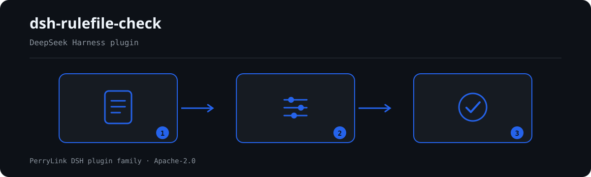

# dsh-rulefile-check — उद्धरण-अनुशासन और गंभीरता-सीमा के अनुसार नियम-फ़ाइल की स्वयं-जाँच

[English](README.md) · [简体中文](README-zh.md) · [Español](README-es.md) · [Português](README-pt.md) · [हिन्दी](README-hi.md)

[](https://dsh.market/)
[](https://dshfind.com/en/plugins/PerryLink/dsh-rulefile-check?ref=badge)

`dsh-rulefile-check` एक नियम-फ़ाइल पढ़ता है — फ़ाइल का हेडर और प्रत्येक नियम की एक पंक्ति — और उस फ़ाइल को उस उद्धरण-अनुशासन से मिलाता है जिसे इसका प्लगइन-परिवार लागू करता है: क्या हर नियम आईडी फ़ाइल के भीतर अद्वितीय है, क्या आधार के दोनों फ़ील्ड भरे हैं, क्या कोई अंश न्यूनतम लंबाई से छोटा नहीं है, क्या हर स्रोत http(s) लिंक के रूप में लिखा है, क्या जिस नियम का आधार-प्रकार `derived-from-principle` या `institutional-configuration` है उसमें गंभीरता दर्ज है, क्या जाँच-प्रकार इंजन द्वारा समर्थित है, और क्या फ़ाइल का हेडर अपना नाम, प्लगइन और संस्करण घोषित करता है।

## Install

```sh
dsh plugin --profile <name> add dsh-rulefile-check
dsh --profile <name> --dump-config | grep 'dsh-rulefile-check'
```

## आउटपुट कैसा दिखता है



*कार्यप्रवाह: दस्तावेज़ → नियम → निष्कर्ष। नीचे के उदाहरण वास्तविक कमांड सतह का उपयोग करते हैं।*


इस प्लगइन का अपने ही `RF-001` टेस्ट फ़िक्स्चर पर वास्तविक आउटपुट — कोई नकली चित्र नहीं। नियम-पैक उद्धरण नहीं गढ़ता, इसलिए हर निष्कर्ष लागू किए गए खंड का नाम और यह भी बताता है कि उसका मूल पाठ इस बार प्राप्त नहीं हुआ।

## यह किन सवालों का जवाब देता है

### उदाहरण

नीचे दी गई तालिका उदाहरण-समुच्चय है: पहली पंक्ति विस्तृत केस है, बाकी संक्षिप्त केस हैं।


| आपका सवाल | इसका जवाब |
|---|---|
| एक ही नियम आईडी फ़ाइल में दो नियमों पर आ गई है। | `RF-001` दोहराई गई आईडी दर्ज करता है, क्योंकि दोहराव से `issue.id` दो अलग नियमों की ओर इशारा करता है और मिलान का पता नहीं चलता रहता। तुलना में रिक्त स्थान नहीं गिने जाते। यह एक बार में एक ही फ़ाइल देखता है: दो फ़ाइलों की आपस में तुलना नहीं करता और किसी रजिस्टर में भी नहीं देखता। |
| किसी नियम में केवल `document` है, अनुच्छेद के बारे में कुछ नहीं लिखा। | `RF-002` देखता है कि आधार के दोनों में से कम से कम एक फ़ील्ड भरा हो, इसलिए जिस नियम में `document` मौजूद है वह पास हो जाता है। यह नहीं आँकता कि उद्धृत अनुच्छेद वास्तव में मौजूद है या नियम से उसका संबंध है या नहीं। |
| अंश अनुच्छेद का एक वाक्य में वर्णन है, शब्दशः उद्धरण नहीं। | `RF-003` की अपेक्षा है कि अंश मौजूद हो और कम से कम आठ अक्षरों का हो। लंबाई आवश्यक है, पर्याप्त नहीं: बीस अक्षरों का वर्णन भी उद्धरण नहीं होता, और यह नियम यह अंतर नहीं पकड़ सकता — यह अंश की तुलना मूल अनुच्छेद से नहीं करता। |
| स्रोत में लिंक के बजाय «某某网站» लिखा है। | `RF-004` इसे दर्ज करता है, क्योंकि स्रोत-फ़ील्ड को http(s) लिंक जैसा दिखना चाहिए। यह केवल रूप देखता है: लिंक पर जाता नहीं, यह नहीं बताता कि लिंक चलता है या नहीं, और यह भी नहीं कि उस पृष्ठ पर उद्धृत अनुच्छेद वाकई है। |
| किसी सिद्धांत से निकाले गए नियम की गंभीरता `error` भर दी गई है। | `RF-005` पुष्टि करता है कि जिस नियम का आधार-प्रकार `derived-from-principle` या `institutional-configuration` है, उसमें गंभीरता दर्ज तो है। वह गंभीरता वास्तव में सीमा के भीतर है या नहीं, यह लोडर लागू करता है, जो ऐसी फ़ाइल को `strongest permitted severity` कहकर सीधे अस्वीकार कर देता है; यह जाँच केवल फ़ील्ड मौजूद होने तक सीमित है और लोडर की जगह नहीं ले सकती। |
| फ़ाइल में ऐसा `check.kind` लिखा है जिसे इंजन नहीं जानता — और क्या वह अपना `packName` तथा `version` बताती है? | `RF-006` अनजाने `check.kind` को दर्ज करता है, क्योंकि ऐसा नियम चुपचाप चलता ही नहीं। इसकी समर्थित-प्रकार सूची खाली आती है, क्योंकि कौन-कौन से kind मौजूद हैं यह इंजन के संस्करण पर निर्भर है, इसलिए बिना कॉन्फ़िगर की फ़ाइल में वह नियम पास होने के बजाय `skipped` में चला जाता है; यह केवल आपकी दी गई सूची से मिलाता है। `RF-007` हेडर में `packName`, `plugin` और `version` तीनों एक साथ देखता है, क्योंकि इनके बिना फ़ाइल बदलते समय यह पता नहीं चलता कि वह किस प्लगइन की है और किस संस्करण की। इनमें से कोई भी यह नहीं जाँचता कि घोषित मान वास्तव में इस्तेमाल हो रहे प्लगइन से मेल खाते हैं। |

## यह किन मानकों पर आधारित है

यह नियम-फ़ाइल किसी सार्वजनिक मानक का उद्धरण नहीं देती: हर नियम का आधार इसी प्लगइन-परिवार का स्वयं-लागू उद्धरण-अनुशासन, उसका इंजन-अनुबंध और उसका फ़ाइल-अनुबंध है, इसलिए नीचे दी गई प्रविष्टियाँ परिवार के आंतरिक अनुबंधों के नाम गिनाती हैं, किसी कानून या राष्ट्रीय मानक के नहीं।

| दस्तावेज़ | संख्यांक | इन्हें उद्धृत करने वाले नियम |
|---|---|---|
| 本插件家族的条款引用纪律（自定纪律，非国家标准） | 无编号（本规则库自定） | RF-001, RF-002, RF-003, RF-004, RF-005 |
| 本插件家族的检查引擎契约（自定纪律，非国家标准） | 无编号（本规则库自定） | RF-006 |
| 本插件家族的规则库契约（自定纪律，非国家标准） | 无编号（本规则库自定） | RF-007 |

**Boundary:** this plugin checks a **规则库** (a rule pack) for the citation discipline this plugin family
enforces — that rule ids are unique, that every basis field is present, that an excerpt has real length, that a
source is a link, that a derived or locally configured basis carries a severity, that the check kind is one the
engine supports, and that the pack declares its name, plugin and version.

> ### ⚠️ This checks form, not content — and it says so
>
> **The discipline being checked is self-imposed, not a national standard.** "An excerpt must be a verbatim
> quotation" and "a principle-derived check may not be an `error`" are rules this plugin family enforces in
> `shared/ruleset.ts`; their basis is the general principle of intellectual honesty — never dress a description
> up as a quotation, never dress an inference up as a requirement — **not any statute or standard**. Every
> rule's `basis` says exactly that, which is why every rule here is `warn` or `info`.
>
> **It cannot tell whether a citation is apt.** It checks that fields are filled, that an excerpt is long
> enough, that a source *looks like* a link, and that a severity is stated. It will happily pass a rule that
> cites **a real but irrelevant clause** — that is the documented limit of a form check, and it is why
> automated checking never replaces a human read-through.
>
> Two rules deserve a note. `RF-003`'s floor of eight characters is the ledger-side echo of the load-time guard
> — but **length is necessary, not sufficient**: a twenty-character *description* is still not a quotation, and
> this plugin cannot tell the difference. And `RF-005` can only confirm a severity field is present: whether a
> severity actually respects the ceiling is enforced by the loader, which rejects a violating pack outright with
> `strongest permitted severity`. `RF-006`'s kind vocabulary ships **empty**, because which kinds an engine
> supports depends on the engine version — hard-coding this family's own list would mean editing this plugin
> every time the engine gains a kind.

## Compatibility

| सतह | स्थिति |
|---|---|
| Harness | peer रेंज `>=0.1.2-rc.1 <0.2.0 \|\| >=0.2.0-0 <0.3.0` — `0.2.0-rc.2` और `0.2.1-rc.2` दोनों को स्वीकार करने के लिए सत्यापित। **`engines.dsh` `>=0.2.1-0 <0.3.0` के रूप में घोषित है** और 0.2.1 से होस्ट इसे लागू करता है |
| Node | `^22.19.0 || >=24.0.0` |
| प्लेटफ़ॉर्म | सभी (शुद्ध ESM; कोई नेटिव कोड नहीं, कोई नेटवर्क नहीं, कोई मॉडल कॉल नहीं) |
| टूल मोड | `native` और `ptc` में काम करता है; पूरे फ़ोल्डर के लिए `ptc` चुनें |

## What it does

नियम-सूची, फ़ील्ड और विस्तृत व्यवहार [README.md](README.md#what-it-does) (अंग्रेज़ी मुख्य संस्करण) में हैं। यह प्लगइन केवल उद्धृत धाराओं के सामने शाब्दिक अंतर सूचीबद्ध करता है और हर न चल पाई जाँच को `skipped` में बताता है।

## Configuration

सभी समायोज्य पैरामीटर `src/config.ts` की Schemastery स्कीमा में हैं, इसलिए कोड बदले बिना `cordis.yml` से बदले जा सकते हैं; प्रति-नियम सीमाएँ `rules/` के नियम-पैक में हैं।

| कुंजी | प्रकार | डिफ़ॉल्ट | विवरण |
|---|---|---|---|
| `rulesFile` | string | `rules/rulefile-check.yaml` | नियम-पैक का पथ, पैकेज रूट के सापेक्ष |
| `disabledRules` | string[] | `[]` | बंद करने वाले नियम id; प्रत्येक `skipped` में दिखता है |
| `onlyRules` | string[] | `[]` | केवल ये नियम चलाएँ; खाली होने पर सभी नियम चलते हैं |
| `skipNotes` | string | `""` | हर `skipped` कारण के आगे जोड़ी जाने वाली टिप्पणी |
| `timeoutMs` | number | `120000` | उपकरण का सहकारी समय-सीमा बजट |

## Material format

JSON या YAML स्वीकार्य है। पूरा फ़ील्ड उदाहरण [README.md](README.md#material-format) (अंग्रेज़ी मुख्य संस्करण) में है। पढ़ने की परत में फ़ील्ड वैकल्पिक हैं और जाँच इंजन उन्हें सत्यापित करता है, इसलिए आंशिक निर्यात पर क्रैश के बजाय "अनुपस्थित" श्रेणी के निष्कर्ष मिलते हैं।

## Rule sources

नियम-डेटा कोड से अलग है: प्रत्येक नियम में दस्तावेज़, संख्या, स्रोत की अपनी क्रमांकन-प्रणाली के अनुसार धारा, शब्दशः उद्धरण और स्रोत URL होता है। लोडर लागू करता है कि उद्धरण कम से कम आठ अक्षरों का वास्तविक उद्धरण हो, और जिस जाँच का आधार केवल सामान्य सिद्धांत (`kind: derived-from-principle`, अधिकतम `warn`) या स्थानीय नीति (`kind: institutional-configuration`, अधिकतम `info`) हो, उसे कभी `error` घोषित न किया जाए।

सत्यापित सीमाएँ और जान-बूझकर **न** कहे गए निष्कर्ष [README.md](README.md#rule-sources) (अंग्रेज़ी मुख्य संस्करण) और `rules/evidence/` में हैं।

## Troubleshooting

- **प्लगइन इंस्टॉल हो गया पर टूल दिखता नहीं**: जाँचें कि `main` `lib/index.mjs` पर जाता है और `pnpm run build` ने उसे बनाया है।
- **`dsh plugin add` असंगत बताकर मना करता है**: peer range `0.1.x` और `0.2.x` दोनों को कवर करती है; बाहर होने पर स्पष्ट छूट दें: `dsh plugin --profile <name> allow-version <pkg@ver> --dsh-version <runtime> --accept-risk`।
- **कोई नियम नहीं चला**: `skipped` सरणी देखें।
- **`check` में `manifest-peers` विफल दिखता है**: यह `dsh-plugin-dev` की ज्ञात अपस्ट्रीम समस्या है; रनटाइम इंस्टॉल के समय अनुकूलता लागू करता है।
- **समय खिसका हुआ लगता है**: सारी गणना दिए गए स्ट्रिंग पर वॉल-क्लॉक है।

## Development

```sh
pnpm install
pnpm run typecheck
pnpm test
pnpm run build
node ../scripts/sync-shared.mjs dsh-rulefile-check
```

अंतिम कमांड `../_shared` का साझा किट `src/shared/` में कॉपी करता है; हर साझा बदलाव के बाद इसे दोबारा चलाएँ।

## PerryLink DSH Plugin Family

यह प्रोजेक्ट [PerryLink](https://github.com/PerryLink) के DeepSeek Harness प्लगइन परिवार का हिस्सा है। पूरी सूची नीचे संक्षिप्त रखी गई है ताकि हर README की पहली स्क्रीन छोटी रहे; हर पंक्ति और उसकी स्थिति देखने के लिए इसे खोलें।

<details>
<summary>सभी प्लगइन खोलें</summary>

| प्लगइन | स्थिति |
|---|---|
| **[dsh-aqua-input-check](https://github.com/PerryLink/dsh-aqua-input-check)** |  |
| **[dsh-archive-check](https://github.com/PerryLink/dsh-archive-check)** |  |
| **[dsh-auto-review](https://github.com/PerryLink/dsh-auto-review)** |  |
| **[dsh-autotier](https://github.com/PerryLink/dsh-autotier)** |  |
| **[dsh-bid-ca-precheck](https://github.com/PerryLink/dsh-bid-ca-precheck)** |  |
| **[dsh-bid-qual-check](https://github.com/PerryLink/dsh-bid-qual-check)** |  |
| **[dsh-cert-mcp](https://github.com/PerryLink/dsh-cert-mcp)** |  |
| **[dsh-checkpoint-rewind](https://github.com/PerryLink/dsh-checkpoint-rewind)** |  |
| **[dsh-click](https://github.com/PerryLink/dsh-click)** |  |
| **[dsh-composer-history](https://github.com/PerryLink/dsh-composer-history)** |  |
| **[dsh-contract-stance](https://github.com/PerryLink/dsh-contract-stance)** |  |
| **[dsh-customs-doc-check](https://github.com/PerryLink/dsh-customs-doc-check)** |  |
| **[dsh-data-quality](https://github.com/PerryLink/dsh-data-quality)** |  |
| **[dsh-demurrage-ledger](https://github.com/PerryLink/dsh-demurrage-ledger)** |  |
| **[dsh-doublecheck](https://github.com/PerryLink/dsh-doublecheck)** |  |
| **[dsh-drill-script-check](https://github.com/PerryLink/dsh-drill-script-check)** |  |
| **[dsh-eia-guide-check](https://github.com/PerryLink/dsh-eia-guide-check)** |  |
| **[dsh-emergency-plan](https://github.com/PerryLink/dsh-emergency-plan)** |  |
| **[dsh-essay-rubric-check](https://github.com/PerryLink/dsh-essay-rubric-check)** |  |
| **[dsh-evidence-check](https://github.com/PerryLink/dsh-evidence-check)** |  |
| **[dsh-export-ctl-check](https://github.com/PerryLink/dsh-export-ctl-check)** |  |
| **[dsh-fast](https://github.com/PerryLink/dsh-fast)** |  |
| **[dsh-fmea-table-check](https://github.com/PerryLink/dsh-fmea-table-check)** |  |
| **[dsh-forecast-penalty](https://github.com/PerryLink/dsh-forecast-penalty)** |  |
| **[dsh-fund-research](https://github.com/PerryLink/dsh-fund-research)** |  |
| **[dsh-github](https://github.com/PerryLink/dsh-github)** |  |
| **[dsh-gongwen-flow-check](https://github.com/PerryLink/dsh-gongwen-flow-check)** |  |
| **[dsh-gongwen-word-check](https://github.com/PerryLink/dsh-gongwen-word-check)** |  |
| **[dsh-guard-plan-qc](https://github.com/PerryLink/dsh-guard-plan-qc)** |  |
| **[dsh-hazchem-check](https://github.com/PerryLink/dsh-hazchem-check)** |  |
| **[dsh-hazplan-check](https://github.com/PerryLink/dsh-hazplan-check)** |  |
| **[dsh-hidden-risk-map](https://github.com/PerryLink/dsh-hidden-risk-map)** |  |
| **[dsh-hs-classify](https://github.com/PerryLink/dsh-hs-classify)** |  |
| **[dsh-icd-rule-check](https://github.com/PerryLink/dsh-icd-rule-check)** |  |
| **[dsh-industry-research](https://github.com/PerryLink/dsh-industry-research)** |  |
| **[dsh-lawcite-adapter](https://github.com/PerryLink/dsh-lawcite-adapter)** |  |
| **[dsh-laya](https://github.com/PerryLink/dsh-laya)** |  |
| **[dsh-lc-doc-check](https://github.com/PerryLink/dsh-lc-doc-check)** |  |
| **[dsh-learning-gap-check](https://github.com/PerryLink/dsh-learning-gap-check)** |  |
| **[dsh-library](https://github.com/PerryLink/dsh-library)** |  |
| **[dsh-local-ai](https://github.com/PerryLink/dsh-local-ai)** |  |
| **[dsh-lsp-actions](https://github.com/PerryLink/dsh-lsp-actions)** |  |
| **[dsh-mask](https://github.com/PerryLink/dsh-mask)** |  |
| **[dsh-mcp-panel](https://github.com/PerryLink/dsh-mcp-panel)** |  |
| **[dsh-medrec-qc](https://github.com/PerryLink/dsh-medrec-qc)** |  |
| **[dsh-memento](https://github.com/PerryLink/dsh-memento)** |  |
| **[dsh-nsfc-form-check](https://github.com/PerryLink/dsh-nsfc-form-check)** |  |
| **[dsh-nurse-record-check](https://github.com/PerryLink/dsh-nurse-record-check)** |  |
| **[dsh-observe](https://github.com/PerryLink/dsh-observe)** |  |
| **[dsh-origin-rvc-check](https://github.com/PerryLink/dsh-origin-rvc-check)** |  |
| **[dsh-ota-review-check](https://github.com/PerryLink/dsh-ota-review-check)** |  |
| **[dsh-output-styles](https://github.com/PerryLink/dsh-output-styles)** |  |
| **[dsh-paper-doc-adapter](https://github.com/PerryLink/dsh-paper-doc-adapter)** |  |
| **[dsh-permission-rules](https://github.com/PerryLink/dsh-permission-rules)** |  |
| **[dsh-permit-report-check](https://github.com/PerryLink/dsh-permit-report-check)** |  |
| **[dsh-pipeline-check](https://github.com/PerryLink/dsh-pipeline-check)** |  |
| **[dsh-pleading-draft](https://github.com/PerryLink/dsh-pleading-draft)** |  |
| **[dsh-plugin-doctor](https://github.com/PerryLink/dsh-plugin-doctor)** |  |
| **[dsh-plugin-guide](https://github.com/PerryLink/dsh-plugin-guide)** |  |
| **[dsh-plugin-kit](https://github.com/PerryLink/dsh-plugin-kit)** |  |
| **[dsh-plugin-upgrade](https://github.com/PerryLink/dsh-plugin-upgrade)** |  |
| **[dsh-policy-brief-draft](https://github.com/PerryLink/dsh-policy-brief-draft)** |  |
| **[dsh-power-loss-split](https://github.com/PerryLink/dsh-power-loss-split)** |  |
| **[dsh-power-ticket-check](https://github.com/PerryLink/dsh-power-ticket-check)** |  |
| **[dsh-ppap-check](https://github.com/PerryLink/dsh-ppap-check)** |  |
| **[dsh-protest-deadline](https://github.com/PerryLink/dsh-protest-deadline)** |  |
| **[dsh-railway-window](https://github.com/PerryLink/dsh-railway-window)** |  |
| **[dsh-repair-order-qc](https://github.com/PerryLink/dsh-repair-order-qc)** |  |
| **[dsh-research-report](https://github.com/PerryLink/dsh-research-report)** |  |
| **[dsh-review-reply-check](https://github.com/PerryLink/dsh-review-reply-check)** |  |
| **[dsh-rulefile-check](https://github.com/PerryLink/dsh-rulefile-check)** |  |
| **[dsh-safety-brief-check](https://github.com/PerryLink/dsh-safety-brief-check)** |  |
| **[dsh-score](https://github.com/PerryLink/dsh-score)** |  |
| **[dsh-session-sync](https://github.com/PerryLink/dsh-session-sync)** |  |
| **[dsh-site-log-check](https://github.com/PerryLink/dsh-site-log-check)** |  |
| **[dsh-skill-pack-security](https://github.com/PerryLink/dsh-skill-pack-security)** |  |
| **[dsh-soe-decision-check](https://github.com/PerryLink/dsh-soe-decision-check)** |  |
| **[dsh-soilwater-check](https://github.com/PerryLink/dsh-soilwater-check)** |  |
| **[dsh-sop-sync-check](https://github.com/PerryLink/dsh-sop-sync-check)** |  |
| **[dsh-spc-gbt-adapter](https://github.com/PerryLink/dsh-spc-gbt-adapter)** |  |
| **[dsh-talk](https://github.com/PerryLink/dsh-talk)** |  |
| **[dsh-tender-extract](https://github.com/PerryLink/dsh-tender-extract)** |  |
| **[dsh-tender-matrix](https://github.com/PerryLink/dsh-tender-matrix)** |  |
| **[dsh-test-drive](https://github.com/PerryLink/dsh-test-drive)** |  |
| **[dsh-ticktick](https://github.com/PerryLink/dsh-ticktick)** |  |
| **[dsh-translate](https://github.com/PerryLink/dsh-translate)** |  |
| **[dsh-warranty-calc](https://github.com/PerryLink/dsh-warranty-calc)** |  |
| **[dsh-budget](https://github.com/PerryLink/dsh-budget)** | 🧊 फ़्रोज़न — रिपॉज़िटरी README देखें |
| **[dsh-claude-move](https://github.com/PerryLink/dsh-claude-move)** | 🧊 फ़्रोज़न — रिपॉज़िटरी README देखें |
| **[dsh-defend](https://github.com/PerryLink/dsh-defend)** | 🧊 फ़्रोज़न — रिपॉज़िटरी README देखें |
| **[dsh-draw](https://github.com/PerryLink/dsh-draw)** | 🧊 फ़्रोज़न — रिपॉज़िटरी README देखें |
| **[dsh-reach](https://github.com/PerryLink/dsh-reach)** | 🧊 फ़्रोज़न — रिपॉज़िटरी README देखें |
| **[dsh-background-agents](https://github.com/PerryLink/dsh-background-agents)** | 🚫 सेवानिवृत्त — रिपॉज़िटरी README देखें |
| **[dsh-session-pin](https://github.com/PerryLink/dsh-session-pin)** | 🚫 सेवानिवृत्त — रिपॉज़िटरी README देखें |
| **[dsh-team-rooms](https://github.com/PerryLink/dsh-team-rooms)** | 🚫 सेवानिवृत्त — रिपॉज़िटरी README देखें |

</details>

## License

[Apache License 2.0](LICENSE) © 2026 dsh-rulefile-check contributors.
