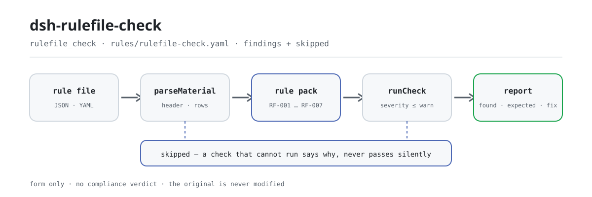

<div align="center">

<picture>
  <source media="(prefers-color-scheme: dark)" srcset="docs/assets/dsh-rulefile-check-flow-dark.svg">
  
</picture>

# dsh-rulefile-check

**Check a rule pack line by line — unique rule ids, complete basis fields, real excerpt length, link-shaped sources and severity ceilings — and get back what is inconsistent, where, and what to fix.**

A DeepSeek Harness checker for rule-pack maintainers: it applies this plugin family's self-imposed citation discipline and severity ceilings, lists only the formal differences a rule pack can be held to mechanically, and does not decide compliance, assign liability or modify the original.

[Install](#three-step-setup) · [Configuration](#configuration) · [FAQ](#faq) · [简体中文](README.md) · [English](README.en.md) · [Español](README.es.md) · [Português](README.pt.md) · [हिन्दी](README.hi.md)

[](LICENSE)
[](#compatibility)
[](https://www.npmjs.com/package/dsh-rulefile-check)
[](https://github.com/PerryLink/dsh-rulefile-check/actions/workflows/ci.yml)
[](#compatibility)

[](https://github.com/PerryLink/dsh-rulefile-check/stargazers)
[](https://www.npmjs.com/package/dsh-rulefile-check)
[](https://dshfind.com/plugins/PerryLink/dsh-rulefile-check?ref=badge)
[](https://securityscorecards.dev/viewer/?uri=github.com/PerryLink/dsh-rulefile-check)
[](https://dsh.market/)
[](https://gitee.com/perrylink/dsh-rulefile-check)

```sh
dsh plugin --profile <name> add dsh-rulefile-check
```

</div>

<sub>Community plugin, not affiliated with DeepSeek. Canonical repository: <https://github.com/PerryLink/dsh-rulefile-check> (Gitee is a mirror).</sub>

## What it is

`dsh-rulefile-check` reads one rule pack — the pack header plus one row per rule — and checks it against the citation discipline this plugin family enforces: that every rule id is unique within the pack, that both basis fields are filled in, that no excerpt is shorter than the minimum length, that every source is written as an http(s) link, that a rule whose basis kind is `derived-from-principle` or `institutional-configuration` carries a severity, that the check kind is one the engine supports, and that the pack header declares its name, plugin and version. You hand it a rule pack (JSON or YAML); it returns a list of what is inconsistent, where, and what to fix.

It does not pass a compliance verdict, does not assign liability, does not replace the reviewer — and never modifies the original.

## Three-step setup

1. **Install**:

   ```sh
   dsh plugin --profile <name> add dsh-rulefile-check
   ```

2. **Minimal config** (sane defaults; `cordis.patch.yml` is exactly this one `insert` row):

   ```yaml
   - insert:
       - id: dsh-rulefile-check
         name: dsh-rulefile-check
   ```

   Every tunable lives in the Schemastery schema in `src/config.ts`, with defaults ready to use; the per-rule thresholds live in the rule pack at `rules/rulefile-check.yaml`.

3. **Verify it mounts**:

   ```sh
   dsh --profile <name> --dump-config | grep 'dsh-rulefile-check'
   ```

   Then run the bundled sample (build first with `pnpm run build`, so `lib/index.mjs` is in place):

   ```sh
   node samples/quickstart/run.mjs --check
   ```

   The sample input is at `samples/quickstart/input/RF-001-unsafe.json` and the expected output at `samples/quickstart/expected/result.json`. Actual output:

   ```text
   $ node samples/quickstart/run.mjs
   rulefile_check: 1 issue(s) — error 0, warn 1, info 0
   skipped: 1
   ```

   *Observed from `samples/quickstart/run.mjs:24-26; samples/quickstart/expected/result.json`*

**Uninstall**: `dsh plugin --profile <name> remove dsh-rulefile-check` (or remove the row from the profile patch).

<details>
<summary>Install from the DSH Desktop market</summary>

Every PerryLink plugin is listed in the built-in DSH Desktop market: **Market → Sources → Add source → paste** `https://perrylink-dsh-catalog.perrylink.workers.dev/catalog-source.json` **→ select**. Installation still requires the market's npm identity check and your confirmation.

</details>

## Core capabilities

The plugin registers the `rulefile_check` tool: it reads one rule pack (the header plus one row per rule), applies a versioned rule pack (`rules/rulefile-check.yaml`, 7 rules) and returns a structured report.

- **The rule pack is data, not code** — every check lives in `rules/rulefile-check.yaml`; replacing the file switches the rule set without touching TypeScript, and the pack is validated on load rather than trusted.
- **Severity follows the evidence** — all seven rules rest on `derived-from-principle` and are capped at `warn`; a check resting on `institutional-configuration` is capped at `info`; the loader rejects a pack that exceeds the ceiling outright with `strongest permitted severity`.
- **An empty list is never "no problem"** — every check that could not run reports itself in `skipped` with its reason; `RF-006`'s supported-kind list ships empty, so the rule lands in `skipped` instead of passing silently.
- **No adjudication** — the report lists differences only and never pronounces on compliance, liability or correctness; a wording guard forces the report to carry the disclaimer.
- **Citations must be verbatim** — every rule carries document, number, clause, verbatim excerpt and source link; when the verbatim text could not be obtained the excerpt says so, and a paraphrase is never dressed up as a quotation.

```text
rule pack (JSON / YAML) ──parseMaterial──▶ header + rows ──runCheck──▶ RF-001…RF-007
                                                                    └──▶ report (found / expected / fix + skipped)
```

### Rules at a glance

| Rule | Check | Severity | Basis kind |
|---|---|---|---|
| `RF-001` | rule ids are unique within the pack | warn | family citation discipline |
| `RF-002` | at least one basis field is filled in | warn | family citation discipline |
| `RF-003` | the excerpt has real length (at least eight characters) | warn | family citation discipline |
| `RF-004` | the source is written as an http(s) link | warn | family citation discipline |
| `RF-005` | a derived or locally configured basis carries a severity | warn | family citation discipline |
| `RF-006` | the check kind is one the engine supports (empty list ships, off by default) | warn | engine contract |
| `RF-007` | the pack header declares name, plugin and version | warn | pack contract |

### Examples

These are the plugin's real entry points; install once, then call one.

**Detailed output** — tool `rulefile_check`, input:

```json
{"rows":[{"规则编号":"XX-001"},{"规则编号":"XX-001"}]}
```

Output:

```json
{
  "id": "dsh-rulefile-check.RF-001.de02f9e1",
  "ruleId": "RF-001",
  "severity": "warn",
  "locator": {
    "row": 2,
    "field": "ruleId"
  },
  "found": "第 2 行「ruleId」的值「XX-001」与第 1 行重复",
  "expected": "「ruleId」在材料内应唯一",
  "fix": "核对是否重复登记或抄错；本条只核对唯一性"
}
```

*Observed from `dsh-rulefile-check/tests/fixtures/RF-001/RF-001-unsafe.json`*

### What it answers

| You ask | What it answers |
|---|---|
| The same rule id appears on two rules in the pack. | `RF-001` reports the repeated id, because a duplicate makes `issue.id` point at two different rules and the hit can no longer be traced back. Comparison ignores whitespace. It can only see one pack at a time: it does not compare two packs with each other or look anything up in a register. |
| A rule carries only `document` and says nothing about the clause. | `RF-002` checks that at least one of the two basis fields is filled in, so a rule whose `document` is present passes. It does not judge whether the cited clause really exists or whether it relates to the rule. |
| The excerpt is a one-sentence description of the clause rather than a quotation. | `RF-003` requires the excerpt to exist and to be at least eight characters long. Length is necessary, not sufficient: a twenty-character description is still not a quotation, and this rule cannot tell the difference — it does not compare the excerpt against the original clause. |
| The source reads a bare site name instead of a link. | `RF-004` reports it, because the source field has to look like an http(s) link. It checks the form only: it does not visit the link, does not tell you whether the link works, and does not tell you whether the page really contains the clause being cited. |
| A rule derived from a principle is filed as `error`. | `RF-005` confirms that a rule whose basis kind is `derived-from-principle` or `institutional-configuration` states a severity at all. Whether that severity actually respects the ceiling is enforced by the loader, which rejects such a pack outright with `strongest permitted severity`; this check only covers the field being present and cannot replace the loader. |
| The pack writes a `check.kind` the engine does not know — and does it declare its `packName` and `version`? | `RF-006` reports the unknown `check.kind`, because such a rule is silently not executed. Its list of supported kinds ships empty, since which kinds exist depends on the engine version, so an unconfigured pack puts that rule in `skipped` instead of passing it; it only compares against the list you supply. `RF-007` checks the header for `packName`, `plugin` and `version` together, because without them you cannot tell which plugin a pack belongs to, or which revision, when you swap it in. Neither rule verifies that the declared values match the plugin actually in use. |

## Configuration

Every tunable lives in the Schemastery schema in `src/config.ts`, so it can be changed from `cordis.yml` without touching code; the per-rule thresholds live in the rule pack under `rules/`. These five keys are the whole configuration surface; rule-level parameters follow the table.

| Key | Type | Default | Description |
|---|---|---|---|
| `rulesFile` | string | `rules/rulefile-check.yaml` | Rule-pack path, relative to the package root |
| `disabledRules` | string[] | `[]` | Rule ids to stop running; each appears in `skipped` |
| `onlyRules` | string[] | `[]` | Run only these rule ids; empty runs every rule |
| `skipNotes` | string | `""` | Note appended to every `skipped` reason |
| `timeoutMs` | number | `120000` | Cooperative tool timeout budget |

Rule-level parameters worth knowing:

- `RF-003` `minLength` — the excerpt floor, eight characters by default (the same figure the loader uses).
- `RF-004` `pattern` — the source shape, `^https?://[^\s]+$` by default.
- `RF-006` `values` — **your engine's supported check kinds.** Empty means the rule does not run; fill it from the engine's dispatch table rather than from this plugin.

## FAQ

<details>
<summary>Will my rule pack be uploaded or rewritten?</summary>

No. The tool reads only the `file` or `material` text you hand it and **never modifies the original**; it is plain ESM with no native code, **no network access and no model call** (see "Compatibility"), so the material never leaves your machine. The `writes: []` and `network: false` fields in the package manifest are the machine-readable version of that statement.

</details>

<details>
<summary>If a rule does not run, does it pass silently?</summary>

No. Every check that could not run reports itself in `skipped` with its reason; `RF-006`'s supported-kind list ships empty, so an unconfigured pack puts that rule in `skipped` rather than passing it. An empty difference list therefore cannot be read as "the pack is fine".

</details>

<details>
<summary>Can it tell me whether my rule pack is compliant?</summary>

No. It checks form only: fields present, excerpt long enough, source link-shaped, severity within the ceiling. It cannot catch "a real but irrelevant clause" — see "Known limitations". The report lists differences; the judgement stays with a human.

</details>

<details>
<summary>Will it clash with other DSH plugins?</summary>

No. It registers exactly one `rulefile_check` tool through the `tools` service; it listens to no shared events, provides no service keys, registers no client slots or HTTP routes and rewrites no globals, so there is no tool-name, service-key or patch-layer conflict.

</details>

<details>
<summary>Can it check a whole directory of rule packs in one go?</summary>

Yes. It works in both `native` and `ptc` mode; for a whole directory prefer `ptc`, so the schema cost is paid once. The check itself is pure computation and does no I/O beyond reading the material and the rule-pack file.

</details>

## Standards it follows

This rule pack cites no public standard: every rule's basis is the plugin family's own self-imposed citation discipline, its engine contract and its pack contract, so the entries below name the family's internal contracts rather than any statute or national standard.

| Document | Number | Cited by rules |
|---|---|---|
| This plugin family's clause-citation discipline (self-imposed, not a national standard) | No number (set by this rule pack) | RF-001, RF-002, RF-003, RF-004, RF-005 |
| This plugin family's check-engine contract (self-imposed, not a national standard) | No number (set by this rule pack) | RF-006 |
| This plugin family's rule-pack contract (self-imposed, not a national standard) | No number (set by this rule pack) | RF-007 |

The pack's own names for these contracts:

```text
本插件家族的条款引用纪律（自定纪律，非国家标准）
本插件家族的检查引擎契约（自定纪律，非国家标准）
本插件家族的规则库契约（自定纪律，非国家标准）
```

**Boundary:** this plugin checks a **rule pack** for the citation discipline this plugin family enforces — that rule ids are unique, that every basis field is present, that an excerpt has real length, that a source is a link, that a derived or locally configured basis carries a severity, that the check kind is one the engine supports, and that the pack declares its name, plugin and version.

## Material format

The tool accepts JSON or YAML:

```yaml
packName: 某某规则库
plugin: dsh-rulefile-check
version: '2026.1'
rows:
  - { 规则编号: XX-001, 规则标题: 示例规则标题, 定级: warn,
      依据类型: derived-from-principle, 依据文件: 《某某标准》, 条款号: 第 5.3 条,
      摘录: 该条文本次未取得：核查未获得该标准的逐字原文，本规则库不伪造引文。,
      来源: https://openstd.samr.gov.cn/, 检查类型: presence, 参数: 'field: title' }
```

Column names are matched case-insensitively and ignoring spaces, underscores and hyphens; the inventory's own column names are kept, so a finding names the column it read. Fields are optional at the reader layer and validated by the check engine, so a partial export produces "missing field" findings rather than a crash.

## Rule sources

Rule data lives in `rules/rulefile-check.yaml`, separate from the code. Every rule carries a document, a document number, a clause in the source's own numbering, a verbatim excerpt and the URL it was read from. The loader enforces that an excerpt is a real quotation of at least eight characters, and that a check resting on a general principle (`kind: derived-from-principle`, ceiling `warn`) or on a local configuration (`kind: institutional-configuration`, ceiling `info`) can **never** be declared `error`. A pack that inflates its basis fails at load instead of producing a report that sounds confident.

`pnpm run check:citations` verifies rule by rule that every excerpt can be found in `rules/evidence/`; rules not yet traceable are listed in `rules/citations-baseline.json`, and that list can only shrink — a new citation must be sourced before it can land. The boundaries confirmed during verification, and the conclusions deliberately not drawn, are recorded in the packaged `rules/evidence/` directory.

## Security boundaries

- **The original is read-only.** The tool reads only the `file` or `material` text you hand it and **never modifies the original**; `writes: []`, `network: false` and `external: []` in the package manifest are the machine-readable version of that statement.
- **No network, no model call.** Plain ESM with no native code, no network requests and no model invocation; the material never leaves your machine.
- **No adjudication.** The report lists differences only and never pronounces on compliance, liability or correctness; a wording guard forces it to carry the disclaimer.
- **Fail loud, not silent.** Every check that cannot run lands in `skipped` with its reason; a rule pack that fails to load throws instead of yielding a report that sounds confident.
- **Severity ceilings.** A check resting on a principle is capped at `warn`, one resting on local configuration at `info`; the loader rejects a pack that exceeds the ceiling outright.

## Known limitations

> ### ⚠️ This checks form, not content — and it says so
>
> **The discipline being checked is self-imposed, not a national standard.** "An excerpt must be a verbatim
> quotation" and "a principle-derived check may not be an `error`" are rules this plugin family enforces in
> `shared/ruleset.ts`; their basis is the general principle of intellectual honesty — never dress a description
> up as a quotation, never dress an inference up as a requirement — **not any statute or standard**. Every
> rule's `basis` says exactly that, which is why every rule here is `warn` or `info`.
>
> **It cannot tell whether a citation is apt.** It checks that fields are filled, that an excerpt is long
> enough, that a source *looks like* a link, and that a severity is stated. It will happily pass a rule that
> cites **a real but irrelevant clause** — that is the documented limit of a form check, and it is why
> automated checking never replaces a human read-through.
>
> Two rules deserve a note. `RF-003`'s floor of eight characters is the ledger-side echo of the load-time guard
> — but **length is necessary, not sufficient**: a twenty-character *description* is still not a quotation, and
> this plugin cannot tell the difference. And `RF-005` can only confirm a severity field is present: whether a
> severity actually respects the ceiling is enforced by the loader, which rejects a violating pack outright with
> `strongest permitted severity`. `RF-006`'s kind vocabulary ships **empty**, because which kinds an engine
> supports depends on the engine version — hard-coding this family's own list would mean editing this plugin
> every time the engine gains a kind.

- **One pack at a time.** `RF-001` compares ids within a single pack: it does not compare two packs with each other, nor look anything up in a register.
- **Pack identity is a field check.** `RF-007` only checks that `packName`, `plugin` and `version` are present; it does not verify that the declared values match the plugin actually in use.
- **The static `manifest-peers` verdict is not authoritative.** That checker compares against a hard-coded peer range that predates the 0.2 line; the runtime enforces peer compatibility at install time, so the declared range is the correct one (see "Troubleshooting").

## Compatibility

| Surface | Status |
|---|---|
| Harness | Peer range `>=0.1.2-rc.1 <0.2.0 \|\| >=0.2.0-0 <0.3.0` — verified to accept both `0.2.0-rc.2` and `0.2.1-rc.2`. **`engines.dsh` is declared as `>=0.2.1-0 <0.3.0`** and is enforced by the host since 0.2.1 |
| Node | `^22.19.0 \|\| >=24.0.0` |
| Platforms | All (plain ESM; no native code, no network, no model call) |
| Tool mode | Works in `native` and `ptc`; for a whole directory use `ptc` |

## Troubleshooting

- **The plugin installs but the tool never appears.** Check that `main` resolves to `lib/index.mjs` and that `pnpm run build` produced it; a wrong `main` makes the loader skip the entry silently.
- **`dsh plugin add` refuses the package as incompatible.** The peer range covers `0.1.x` and `0.2.x`; if your runtime sits outside it, grant an explicit exemption: `dsh plugin --profile <name> allow-version dsh-rulefile-check@0.1.0 --dsh-version <runtime> --accept-risk`
- **A rule did not run.** Read the `skipped` array — it names the rule id and the reason. That is what happens while `RF-006`'s `values` is empty.
- **`RF-005` passes a pack the loader then rejects.** That is expected: `RF-005` checks that a severity field is present, while the loader enforces the ceiling itself. The loader's error names the offending rule.
- **`check` reports `manifest-peers` as failed.** The static checker compares against a hard-coded peer range that predates the 0.2 line. The runtime enforces peer compatibility at install time, so the declared range is the correct one; this is a known upstream issue in `dsh-plugin-dev`.
- **`check:citations` reports a rule that is not yet traceable.** A new citation must first have a verification record under `rules/evidence/`; `rules/citations-baseline.json` can only shrink, never grow.

## Ecosystem & quality

- [Gitee mirror](https://gitee.com/perrylink/dsh-rulefile-check) (synchronised mirror; GitHub is canonical)
- [dshfind plugin page](https://dshfind.com/plugins/PerryLink/dsh-rulefile-check) (installs and ranking)
- [OpenSSF Scorecard report](https://securityscorecards.dev/viewer/?uri=github.com/PerryLink/dsh-rulefile-check) (driven by [.github/workflows/scorecard.yml](.github/workflows/scorecard.yml))
- [DSH Market](https://dsh.market/) (listed)
- [Ecosystem knowledge base — choose a checker by material](https://perrylink.github.io/zh/checkers/choose/) (the full family index)

## Development

```sh
pnpm install
pnpm run typecheck      # tsc --noEmit
pnpm test               # vitest, paired positive/negative fixtures per rule (tests/fixtures/<RULE>/)
pnpm run build          # tsdown -> lib/index.mjs + lib/index.d.mts
pnpm run check:citations   # verbatim excerpts are traceable (rules/evidence/)
pnpm run check:readmes     # five-language README consistency
node ../scripts/sync-shared.mjs dsh-rulefile-check   # refresh src/shared from ../_shared
pnpm pack
```

The plugin is **data-only**: `src/model.ts` declares the table shape, `src/shared/` supplies the reader and the check engine, and the rule pack declares every check. The rule pack is data, not code: edit `rules/*.yaml` to switch the rule set without touching TypeScript, and the pack is validated on load rather than trusted. README assets are generated programmatically by [`scripts/gen-readme-assets.py`](scripts/gen-readme-assets.py) (Python + Pillow) and can be re-run safely; this plugin has no UI, so the hero is a hand-written SVG flow diagram (light/dark pair, command-surface tokens only).

Topics: `dsh`, `dsh-plugin`, `deepseek-harness`, `cordis`, `rulefile`

## Family & thanks

This project is a member of the DeepSeek Harness plugin family maintained by [PerryLink](https://github.com/PerryLink) (all Apache-2.0). If it helps you, **give it a star** — it does not unlock anything, but it makes the next person more likely to find it.

- [@PerryLink](https://github.com/PerryLink) — creator and maintainer: the `rulefile_check` tool, the verbatim-citation rule pack and its clause-verification record, and the five-language docs.

<details>
<summary>Expand all plugins</summary>

| Plugin | Status |
|---|---|
| **[dsh-aqua-input-check](https://github.com/PerryLink/dsh-aqua-input-check)** |  |
| **[dsh-archive-check](https://github.com/PerryLink/dsh-archive-check)** |  |
| **[dsh-auto-review](https://github.com/PerryLink/dsh-auto-review)** |  |
| **[dsh-autotier](https://github.com/PerryLink/dsh-autotier)** | 🧊 FROZEN — see the repo README |
| **[dsh-bid-ca-precheck](https://github.com/PerryLink/dsh-bid-ca-precheck)** |  |
| **[dsh-bid-qual-check](https://github.com/PerryLink/dsh-bid-qual-check)** |  |
| **[dsh-cert-mcp](https://github.com/PerryLink/dsh-cert-mcp)** | 🧊 FROZEN — see the repo README |
| **[dsh-checkpoint-rewind](https://github.com/PerryLink/dsh-checkpoint-rewind)** |  |
| **[dsh-click](https://github.com/PerryLink/dsh-click)** |  |
| **[dsh-composer-history](https://github.com/PerryLink/dsh-composer-history)** |  |
| **[dsh-contract-stance](https://github.com/PerryLink/dsh-contract-stance)** |  |
| **[dsh-customs-doc-check](https://github.com/PerryLink/dsh-customs-doc-check)** |  |
| **[dsh-data-quality](https://github.com/PerryLink/dsh-data-quality)** | 🧊 FROZEN — see the repo README |
| **[dsh-demurrage-ledger](https://github.com/PerryLink/dsh-demurrage-ledger)** |  |
| **[dsh-doublecheck](https://github.com/PerryLink/dsh-doublecheck)** |  |
| **[dsh-drill-script-check](https://github.com/PerryLink/dsh-drill-script-check)** |  |
| **[dsh-eia-guide-check](https://github.com/PerryLink/dsh-eia-guide-check)** |  |
| **[dsh-emergency-plan](https://github.com/PerryLink/dsh-emergency-plan)** |  |
| **[dsh-essay-rubric-check](https://github.com/PerryLink/dsh-essay-rubric-check)** |  |
| **[dsh-evidence-check](https://github.com/PerryLink/dsh-evidence-check)** |  |
| **[dsh-export-ctl-check](https://github.com/PerryLink/dsh-export-ctl-check)** |  |
| **[dsh-fast](https://github.com/PerryLink/dsh-fast)** |  |
| **[dsh-fmea-table-check](https://github.com/PerryLink/dsh-fmea-table-check)** |  |
| **[dsh-forecast-penalty](https://github.com/PerryLink/dsh-forecast-penalty)** |  |
| **[dsh-fund-research](https://github.com/PerryLink/dsh-fund-research)** |  |
| **[dsh-github](https://github.com/PerryLink/dsh-github)** |  |
| **[dsh-gongwen-flow-check](https://github.com/PerryLink/dsh-gongwen-flow-check)** |  |
| **[dsh-gongwen-word-check](https://github.com/PerryLink/dsh-gongwen-word-check)** |  |
| **[dsh-guard-plan-qc](https://github.com/PerryLink/dsh-guard-plan-qc)** |  |
| **[dsh-hazchem-check](https://github.com/PerryLink/dsh-hazchem-check)** |  |
| **[dsh-hazplan-check](https://github.com/PerryLink/dsh-hazplan-check)** |  |
| **[dsh-hidden-risk-map](https://github.com/PerryLink/dsh-hidden-risk-map)** |  |
| **[dsh-hs-classify](https://github.com/PerryLink/dsh-hs-classify)** |  |
| **[dsh-icd-rule-check](https://github.com/PerryLink/dsh-icd-rule-check)** |  |
| **[dsh-industry-research](https://github.com/PerryLink/dsh-industry-research)** |  |
| **[dsh-lawcite-adapter](https://github.com/PerryLink/dsh-lawcite-adapter)** |  |
| **[dsh-laya](https://github.com/PerryLink/dsh-laya)** |  |
| **[dsh-lc-doc-check](https://github.com/PerryLink/dsh-lc-doc-check)** |  |
| **[dsh-learning-gap-check](https://github.com/PerryLink/dsh-learning-gap-check)** |  |
| **[dsh-library](https://github.com/PerryLink/dsh-library)** |  |
| **[dsh-local-ai](https://github.com/PerryLink/dsh-local-ai)** |  |
| **[dsh-lsp-actions](https://github.com/PerryLink/dsh-lsp-actions)** |  |
| **[dsh-mask](https://github.com/PerryLink/dsh-mask)** |  |
| **[dsh-mcp-panel](https://github.com/PerryLink/dsh-mcp-panel)** |  |
| **[dsh-medrec-qc](https://github.com/PerryLink/dsh-medrec-qc)** |  |
| **[dsh-memento](https://github.com/PerryLink/dsh-memento)** | 🧊 FROZEN — see the repo README |
| **[dsh-nsfc-form-check](https://github.com/PerryLink/dsh-nsfc-form-check)** |  |
| **[dsh-nurse-record-check](https://github.com/PerryLink/dsh-nurse-record-check)** |  |
| **[dsh-observe](https://github.com/PerryLink/dsh-observe)** |  |
| **[dsh-origin-rvc-check](https://github.com/PerryLink/dsh-origin-rvc-check)** |  |
| **[dsh-ota-review-check](https://github.com/PerryLink/dsh-ota-review-check)** |  |
| **[dsh-output-styles](https://github.com/PerryLink/dsh-output-styles)** |  |
| **[dsh-paper-doc-adapter](https://github.com/PerryLink/dsh-paper-doc-adapter)** |  |
| **[dsh-permission-rules](https://github.com/PerryLink/dsh-permission-rules)** |  |
| **[dsh-permit-report-check](https://github.com/PerryLink/dsh-permit-report-check)** |  |
| **[dsh-pipeline-check](https://github.com/PerryLink/dsh-pipeline-check)** |  |
| **[dsh-pleading-draft](https://github.com/PerryLink/dsh-pleading-draft)** |  |
| **[dsh-plugin-doctor](https://github.com/PerryLink/dsh-plugin-doctor)** | 🚫 RETIRED (repo archived) |
| **[dsh-plugin-guide](https://github.com/PerryLink/dsh-plugin-guide)** |  |
| **[dsh-plugin-kit](https://github.com/PerryLink/dsh-plugin-kit)** | 🚫 RETIRED (repo archived) |
| **[dsh-plugin-upgrade](https://github.com/PerryLink/dsh-plugin-upgrade)** | 🚫 RETIRED (repo archived) |
| **[dsh-policy-brief-draft](https://github.com/PerryLink/dsh-policy-brief-draft)** |  |
| **[dsh-power-loss-split](https://github.com/PerryLink/dsh-power-loss-split)** |  |
| **[dsh-power-ticket-check](https://github.com/PerryLink/dsh-power-ticket-check)** |  |
| **[dsh-ppap-check](https://github.com/PerryLink/dsh-ppap-check)** |  |
| **[dsh-protest-deadline](https://github.com/PerryLink/dsh-protest-deadline)** |  |
| **[dsh-railway-window](https://github.com/PerryLink/dsh-railway-window)** |  |
| **[dsh-repair-order-qc](https://github.com/PerryLink/dsh-repair-order-qc)** |  |
| **[dsh-research-report](https://github.com/PerryLink/dsh-research-report)** |  |
| **[dsh-review-reply-check](https://github.com/PerryLink/dsh-review-reply-check)** |  |
| **[dsh-rulefile-check](https://github.com/PerryLink/dsh-rulefile-check)** |  |
| **[dsh-safety-brief-check](https://github.com/PerryLink/dsh-safety-brief-check)** |  |
| **[dsh-score](https://github.com/PerryLink/dsh-score)** | 🧊 FROZEN — see the repo README |
| **[dsh-session-sync](https://github.com/PerryLink/dsh-session-sync)** |  |
| **[dsh-site-log-check](https://github.com/PerryLink/dsh-site-log-check)** |  |
| **[dsh-skill-pack-security](https://github.com/PerryLink/dsh-skill-pack-security)** |  |
| **[dsh-soe-decision-check](https://github.com/PerryLink/dsh-soe-decision-check)** |  |
| **[dsh-soilwater-check](https://github.com/PerryLink/dsh-soilwater-check)** |  |
| **[dsh-sop-sync-check](https://github.com/PerryLink/dsh-sop-sync-check)** |  |
| **[dsh-spc-gbt-adapter](https://github.com/PerryLink/dsh-spc-gbt-adapter)** |  |
| **[dsh-talk](https://github.com/PerryLink/dsh-talk)** |  |
| **[dsh-tender-extract](https://github.com/PerryLink/dsh-tender-extract)** |  |
| **[dsh-tender-matrix](https://github.com/PerryLink/dsh-tender-matrix)** |  |
| **[dsh-test-drive](https://github.com/PerryLink/dsh-test-drive)** |  |
| **[dsh-ticktick](https://github.com/PerryLink/dsh-ticktick)** | 🚫 RETIRED (repo archived) |
| **[dsh-translate](https://github.com/PerryLink/dsh-translate)** |  |
| **[dsh-warranty-calc](https://github.com/PerryLink/dsh-warranty-calc)** |  |
| **[dsh-budget](https://github.com/PerryLink/dsh-budget)** | 🧊 FROZEN — see the repo README |
| **[dsh-claude-move](https://github.com/PerryLink/dsh-claude-move)** | 🧊 FROZEN — see the repo README |
| **[dsh-defend](https://github.com/PerryLink/dsh-defend)** | 🧊 FROZEN — see the repo README |
| **[dsh-draw](https://github.com/PerryLink/dsh-draw)** | 🧊 FROZEN — see the repo README |
| **[dsh-reach](https://github.com/PerryLink/dsh-reach)** | 🧊 FROZEN — see the repo README |
| **[dsh-background-agents](https://github.com/PerryLink/dsh-background-agents)** | 🚫 RETIRED (repo archived) |
| **[dsh-session-pin](https://github.com/PerryLink/dsh-session-pin)** | 🚫 RETIRED (repo archived) |
| **[dsh-team-rooms](https://github.com/PerryLink/dsh-team-rooms)** | 🚫 RETIRED (repo archived) |

</details>

## License

[LICENSE](LICENSE) (Apache License 2.0) © 2026 dsh-rulefile-check contributors

<p align="center"><sub>Apache-2.0 · Community plugin, not affiliated with DeepSeek.</sub></p>
