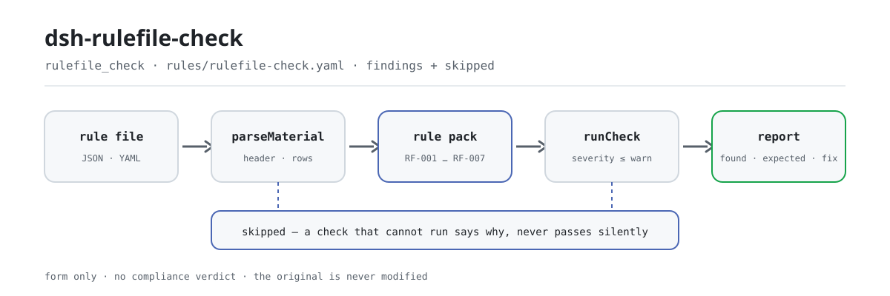

<div align="center">

<picture>
  <source media="(prefers-color-scheme: dark)" srcset="docs/assets/dsh-rulefile-check-flow-dark.svg">
  
</picture>

# dsh-rulefile-check

**Comprueba línea a línea un archivo de reglas —ids únicos, campos de fundamento completos, extractos con longitud real, fuentes con forma de enlace y techos de severidad— y devuelve qué es inconsistente, dónde y cómo corregirlo.**

Un verificador de DeepSeek Harness para mantenedores de archivos de reglas: aplica la disciplina de citas y los techos de severidad que esta familia de plugins se impone, solo enumera las diferencias formales que un archivo de reglas puede sostener mecánicamente, y no decide conformidad, no atribuye responsabilidad ni modifica el original.

[Instalar](#instalación-en-tres-pasos) · [Configuración](#configuración) · [FAQ](#faq) · [简体中文](README.md) · [English](README.en.md) · [Español](README.es.md) · [Português](README.pt.md) · [हिन्दी](README.hi.md)

[](LICENSE)
[](#compatibilidad)
[](https://www.npmjs.com/package/dsh-rulefile-check)
[](https://github.com/PerryLink/dsh-rulefile-check/actions/workflows/ci.yml)
[](#compatibilidad)

[](https://github.com/PerryLink/dsh-rulefile-check/stargazers)
[](https://www.npmjs.com/package/dsh-rulefile-check)
[](https://dshfind.com/plugins/PerryLink/dsh-rulefile-check?ref=badge)
[](https://securityscorecards.dev/viewer/?uri=github.com/PerryLink/dsh-rulefile-check)
[](https://dsh.market/)
[](https://gitee.com/perrylink/dsh-rulefile-check)

```sh
dsh plugin --profile <name> add dsh-rulefile-check
```

</div>

<sub>Plugin de la comunidad, no afiliado a DeepSeek. Repositorio canónico: <https://github.com/PerryLink/dsh-rulefile-check> (Gitee es un espejo).</sub>

## Qué es

`dsh-rulefile-check` lee un archivo de reglas —la cabecera del archivo más una fila por regla— y lo contrasta con la disciplina de citas que impone su familia de plugins: que cada id de regla sea único dentro del archivo, que los dos campos de fundamento estén completos, que ningún extracto sea más corto que la longitud mínima, que toda fuente esté escrita como enlace http(s), que una regla cuyo tipo de fundamento sea `derived-from-principle` o `institutional-configuration` lleve una severidad, que el tipo de comprobación sea uno que el motor admita, y que la cabecera del archivo declare su nombre, su plugin y su versión. Usted entrega el archivo de reglas (JSON o YAML) y recibe una lista de qué es inconsistente, dónde y cómo corregirlo.

No emite un veredicto de conformidad, no atribuye responsabilidad, no sustituye al revisor —y nunca modifica el original.

## Instalación en tres pasos

1. **Instala**:

   ```sh
   dsh plugin --profile <name> add dsh-rulefile-check
   ```

2. **Configuración mínima** (funciona con los valores por defecto; `cordis.patch.yml` es exactamente esta fila `insert`):

   ```yaml
   - insert:
       - id: dsh-rulefile-check
         name: dsh-rulefile-check
   ```

   Todos los parámetros ajustables viven en el esquema Schemastery de `src/config.ts` y los valores por defecto están listos para usar; los umbrales por regla están en el paquete de reglas de `rules/rulefile-check.yaml`.

3. **Verifica que se monta**:

   ```sh
   dsh --profile <name> --dump-config | grep 'dsh-rulefile-check'
   ```

   Después ejecuta el ejemplo incluido (primero `pnpm run build`, para que `lib/index.mjs` exista):

   ```sh
   node samples/quickstart/run.mjs --check
   ```

   La entrada de ejemplo está en `samples/quickstart/input/RF-001-unsafe.json` y la salida esperada en `samples/quickstart/expected/result.json`. Salida real:

   ```text
   $ node samples/quickstart/run.mjs
   rulefile_check: 1 issue(s) — error 0, warn 1, info 0
   skipped: 1
   ```

   *Observado en `samples/quickstart/run.mjs:24-26; samples/quickstart/expected/result.json`*

**Desinstalar**: `dsh plugin --profile <name> remove dsh-rulefile-check` (o elimina la fila del patch del perfil).

<details>
<summary>Instalar desde el mercado de DSH Desktop</summary>

Todos los plugins de PerryLink pueden explorarse en el mercado integrado de DSH Desktop: **Market → Sources → add source → pegar** `https://perrylink-dsh-catalog.perrylink.workers.dev/catalog-source.json` **→ seleccionarlo**. La instalación sigue pasando por la verificación de identidad npm del mercado y tu confirmación.

</details>

## Capacidades clave

El plugin registra la herramienta `rulefile_check`: lee un archivo de reglas (la cabecera más una fila por regla), aplica un paquete de reglas versionado (`rules/rulefile-check.yaml`, 7 reglas) y devuelve un informe estructurado.

- **El paquete de reglas es dato, no código** — todas las comprobaciones viven en `rules/rulefile-check.yaml`; cambiar el archivo cambia el conjunto de reglas sin tocar TypeScript, y el paquete se valida al cargar, no se confía en él.
- **La severidad sigue a la evidencia** — las siete reglas se apoyan en `derived-from-principle` y tienen tope `warn`; una comprobación basada en `institutional-configuration` tiene tope `info`; el cargador rechaza sin más un archivo que supere el techo con `strongest permitted severity`.
- **Una lista vacía nunca es «todo en orden»** — cada comprobación que no pudo ejecutarse se declara en `skipped` con su motivo; la lista de tipos admitidos de `RF-006` viene vacía, así que la regla acaba en `skipped` en lugar de pasar en silencio.
- **Sin adjudicación** — el informe solo enumera diferencias y nunca se pronuncia sobre conformidad, responsabilidad o corrección; un guardián de redacción obliga a que el informe lleve siempre el descargo.
- **Citas solo literales** — cada regla lleva documento, número, cláusula en la numeración propia de la fuente, extracto literal y enlace de origen; cuando el texto no pudo obtenerse, el extracto lo dice, y una paráfrasis nunca se presenta como cita.

```text
archivo de reglas (JSON / YAML) ──parseMaterial──▶ cabecera + filas ──runCheck──▶ RF-001…RF-007
                                                                          └──▶ informe (found / expected / fix + skipped)
```

### Reglas en resumen

| Regla | Comprobación | Severidad | Tipo de base |
|---|---|---|---|
| `RF-001` | los ids de regla son únicos dentro del archivo | warn | disciplina de citas de la familia |
| `RF-002` | al menos uno de los dos campos de fundamento está relleno | warn | disciplina de citas de la familia |
| `RF-003` | el extracto tiene longitud real (al menos ocho caracteres) | warn | disciplina de citas de la familia |
| `RF-004` | la fuente está escrita como enlace http(s) | warn | disciplina de citas de la familia |
| `RF-005` | un fundamento derivado o de configuración local lleva severidad | warn | disciplina de citas de la familia |
| `RF-006` | el tipo de comprobación es uno que el motor admite (lista vacía de fábrica, apagada por defecto) | warn | contrato del motor |
| `RF-007` | la cabecera declara nombre, plugin y versión | warn | contrato del archivo |

### Ejemplos

Estos son los puntos de entrada reales del plugin; instálalo una vez y llama a uno.

**Salida detallada** — herramienta `rulefile_check`, entrada:

```json
{"rows":[{"规则编号":"XX-001"},{"规则编号":"XX-001"}]}
```

Salida:

```json
{
  "id": "dsh-rulefile-check.RF-001.de02f9e1",
  "ruleId": "RF-001",
  "severity": "warn",
  "locator": {
    "row": 2,
    "field": "ruleId"
  },
  "found": "第 2 行「ruleId」的值「XX-001」与第 1 行重复",
  "expected": "「ruleId」在材料内应唯一",
  "fix": "核对是否重复登记或抄错；本条只核对唯一性"
}
```

*Observado en `dsh-rulefile-check/tests/fixtures/RF-001/RF-001-unsafe.json`*

### Qué responde

| Usted pregunta | Qué responde |
|---|---|
| El mismo id de regla aparece en dos reglas del archivo. | `RF-001` informa del id repetido, porque un duplicado hace que `issue.id` apunte a dos reglas distintas y la coincidencia ya no se puede rastrear. La comparación ignora los espacios en blanco. Solo ve un archivo a la vez: no compara dos archivos entre sí ni consulta ningún registro. |
| Una regla solo trae `document` y no dice nada de la cláusula. | `RF-002` comprueba que al menos uno de los dos campos de fundamento esté relleno, así que una regla con `document` presente pasa. No juzga si la cláusula citada existe realmente ni si guarda relación con la regla. |
| El extracto es una descripción de la cláusula en una frase, no una cita. | `RF-003` exige que el extracto exista y tenga al menos ocho caracteres. La longitud es necesaria, no suficiente: una descripción de veinte caracteres sigue sin ser una cita, y esta regla no distingue — no coteja el extracto con la cláusula original. |
| La fuente es el nombre de un sitio web en lugar de un enlace. | `RF-004` lo informa, porque el campo de fuente tiene que parecer un enlace http(s). Solo comprueba la forma: no visita el enlace, no le dice si el enlace funciona ni si la página contiene realmente la cláusula citada. |
| Una regla derivada de un principio está clasificada como `error`. | `RF-005` confirma que una regla cuyo tipo de fundamento sea `derived-from-principle` o `institutional-configuration` indique alguna severidad. Que esa severidad respete de verdad el techo lo impone el cargador, que rechaza ese archivo con `strongest permitted severity`; esta comprobación solo cubre que el campo exista y no puede sustituir al cargador. |
| El archivo escribe un `check.kind` que el motor no conoce, ¿y declara su `packName` y su `version`? | `RF-006` informa del `check.kind` desconocido, porque esa regla no se ejecuta en silencio. Su lista de tipos admitidos viene vacía, ya que qué tipos existen depende de la versión del motor, de modo que un archivo sin configurar deja esa regla en `skipped` en lugar de aprobarla; solo compara con la lista que usted aporte. `RF-007` comprueba juntos `packName`, `plugin` y `version` en la cabecera, porque sin ellos no se puede saber a qué plugin pertenece un archivo, ni qué revisión, al sustituirlo. Ninguna de las dos verifica que los valores declarados correspondan al plugin realmente en uso. |

## Configuración

Todos los parámetros ajustables viven en el esquema Schemastery de `src/config.ts`, por lo que se cambian desde `cordis.yml` sin tocar el código; los umbrales por regla están en el paquete de reglas bajo `rules/`. Estas cinco claves son toda la superficie de configuración; los parámetros por regla van después de la tabla.

| Clave | Tipo | Predeterminado | Descripción |
|---|---|---|---|
| `rulesFile` | string | `rules/rulefile-check.yaml` | Ruta del paquete de reglas, relativa a la raíz del paquete |
| `disabledRules` | string[] | `[]` | Ids de reglas que se dejan de ejecutar; cada una aparece en `skipped` |
| `onlyRules` | string[] | `[]` | Ejecutar solo estas reglas; vacío ejecuta todas |
| `skipNotes` | string | `""` | Nota añadida a cada motivo de `skipped` |
| `timeoutMs` | number | `120000` | Presupuesto de tiempo de espera cooperativo de la herramienta |

Parámetros por regla que conviene conocer:

- `RF-003` `minLength` — el suelo del extracto, ocho caracteres por defecto (la misma cifra que usa el cargador).
- `RF-004` `pattern` — la forma de la fuente, `^https?://[^\s]+$` por defecto.
- `RF-006` `values` — **los tipos de comprobación que admite su motor.** Vacío significa que la regla no se ejecuta; rellénelo desde la tabla de despacho del motor, no desde este plugin.

## FAQ

<details>
<summary>¿Se sube o se reescribe mi archivo de reglas?</summary>

No. La herramienta solo lee el texto de `file` o `material` que usted entrega y **nunca modifica el original**; es ESM puro, sin código nativo, **sin red y sin llamada al modelo** (ver «Compatibilidad»), así que el material no sale de su máquina. Los campos `writes: []` y `network: false` del manifiesto del paquete son la versión legible por máquina de esa declaración.

</details>

<details>
<summary>Si una regla no se ejecuta, ¿pasa en silencio?</summary>

No. Cada comprobación que no pudo ejecutarse se declara en `skipped` con su motivo; la lista de tipos admitidos de `RF-006` viene vacía, así que un archivo sin configurar deja esa regla en `skipped` en lugar de aprobarla. Por tanto, una lista de diferencias vacía no puede leerse como «el archivo está bien».

</details>

<details>
<summary>¿Puede decirme si mi archivo de reglas cumple la norma?</summary>

No. Solo comprueba la forma: campos presentes, extracto suficientemente largo, fuente con forma de enlace, severidad dentro del techo. No detecta «una cláusula real pero irrelevante» — ver «Limitaciones conocidas». El informe enumera diferencias; el juicio sigue siendo humano.

</details>

<details>
<summary>¿Chocará con otros plugins de DSH?</summary>

No. Registra exactamente una herramienta, `rulefile_check`, a través del servicio `tools`; no escucha eventos compartidos, no ofrece claves de servicio, no registra slots de cliente ni rutas HTTP y no reescribe objetos globales, así que no hay conflicto de nombres de herramienta, de claves de servicio ni de capas de patch.

</details>

<details>
<summary>¿Puede revisar un directorio entero de archivos de reglas de una vez?</summary>

Sí. Funciona tanto en modo `native` como `ptc`; para un directorio completo conviene `ptc`, así el coste del esquema se paga una sola vez. La comprobación es cálculo puro y no hace más E/S que leer el material y el archivo de reglas.

</details>

## Normas que sigue

Este archivo de reglas no cita ninguna norma pública: el fundamento de cada regla es la disciplina de citas que la propia familia de plugins se impone, su contrato de motor y su contrato de archivo, de modo que las entradas siguientes nombran compromisos internos de la familia y no ninguna ley ni norma nacional.

| Documento | Número | Reglas que lo citan |
|---|---|---|
| Disciplina de citas de esta familia de plugins (autimpuesta, no es una norma nacional) | Sin número (la fija este archivo de reglas) | RF-001, RF-002, RF-003, RF-004, RF-005 |
| Contrato del motor de comprobación de esta familia (autimpuesto, no es una norma nacional) | Sin número (la fija este archivo de reglas) | RF-006 |
| Contrato del archivo de reglas de esta familia (autimpuesto, no es una norma nacional) | Sin número (la fija este archivo de reglas) | RF-007 |

Los nombres que el propio archivo da a estos contratos:

```text
本插件家族的条款引用纪律（自定纪律，非国家标准）
本插件家族的检查引擎契约（自定纪律，非国家标准）
本插件家族的规则库契约（自定纪律，非国家标准）
```

**Límite:** este plugin comprueba un **archivo de reglas** (rule pack) frente a la disciplina de citas que esta familia de plugins impone — que los ids de regla sean únicos, que cada campo de fundamento esté presente, que un extracto tenga longitud real, que una fuente sea un enlace, que un fundamento derivado o de configuración local lleve severidad, que el tipo de comprobación sea uno que el motor admita y que el archivo declare su nombre, su plugin y su versión.

## Formato del material

La herramienta acepta JSON o YAML:

```yaml
packName: 某某规则库
plugin: dsh-rulefile-check
version: '2026.1'
rows:
  - { 规则编号: XX-001, 规则标题: 示例规则标题, 定级: warn,
      依据类型: derived-from-principle, 依据文件: 《某某标准》, 条款号: 第 5.3 条,
      摘录: 该条文本次未取得：核查未获得该标准的逐字原文，本规则库不伪造引文。,
      来源: https://openstd.samr.gov.cn/, 检查类型: presence, 参数: 'field: title' }
```

Los nombres de columna se comparan sin distinguir mayúsculas y ignorando espacios, guiones bajos y guiones; se conservan los nombres de columna del propio inventario, de modo que un hallazgo nombra la columna que leyó. Los campos son opcionales en la capa de lectura y los valida el motor de comprobación, así que una exportación parcial produce hallazgos sobre lo que falta en lugar de un fallo.

## Fuentes de las reglas

Los datos de las reglas están en `rules/rulefile-check.yaml`, separados del código. Cada regla lleva documento, número, cláusula en la numeración propia de la fuente, extracto literal y la URL de donde se leyó. El cargador impone que el extracto sea una cita real de al menos ocho caracteres y que una comprobación basada solo en un principio general (`kind: derived-from-principle`, tope `warn`) o en una configuración local (`kind: institutional-configuration`, tope `info`) **nunca** se declare `error`. Un archivo que infle su fundamento falla al cargar en lugar de producir un informe que suene seguro.

`pnpm run check:citations` verifica regla por regla que cada extracto se pueda encontrar en `rules/evidence/`; las reglas aún no rastreables figuran en `rules/citations-baseline.json`, y esa lista solo puede encoger: una cita nueva debe estar documentada antes de entrar. Los límites confirmados durante la verificación y las conclusiones deliberadamente no afirmadas están en el directorio `rules/evidence/` que acompaña al paquete.

## Límites de seguridad

- **El original es de solo lectura.** La herramienta solo lee el texto de `file` o `material` que usted entrega y **nunca modifica el original**; `writes: []`, `network: false` y `external: []` del manifiesto del paquete son la versión legible por máquina de esa declaración.
- **Sin red y sin llamada al modelo.** ESM puro, sin código nativo, sin peticiones de red y sin invocación de modelo; el material no sale de su máquina.
- **Sin adjudicación.** El informe solo enumera diferencias y nunca se pronuncia sobre conformidad, responsabilidad o corrección; un guardián de redacción obliga a que lleve el descargo.
- **Falla en voz alta, no en silencio.** Cada comprobación que no puede ejecutarse se declara en `skipped` con su motivo; un archivo de reglas que no carga lanza un error en lugar de producir un informe que suene seguro.
- **Techos de severidad.** Una comprobación basada en un principio tiene tope `warn`, una basada en configuración local tiene tope `info`; el cargador rechaza sin más un archivo que supere el techo.

## Limitaciones conocidas

> ### ⚠️ Esto comprueba la forma, no el contenido — y lo dice
>
> **La disciplina que se comprueba es autimpuesta, no una norma nacional.** «Un extracto debe ser una cita literal» y «una comprobación derivada de un principio no puede ser `error`» son reglas que esta familia de plugins impone en `shared/ruleset.ts`; su fundamento es el principio general de honestidad intelectual —nunca disfrazar una descripción de cita, nunca disfrazar una inferencia de requisito—, **no ninguna ley ni norma**. El `basis` de cada regla lo dice exactamente, y por eso aquí todas las reglas son `warn` o `info`.
>
> **No puede juzgar si una cita es pertinente.** Comprueba que los campos estén rellenos, que el extracto sea lo bastante largo, que la fuente *parezca* un enlace y que se declare una severidad. Aprobará sin problema una regla que cite **una cláusula real pero irrelevante**: ese es el límite documentado de una comprobación de forma, y por eso la comprobación automática nunca sustituye una lectura humana.
>
> Dos reglas merecen una nota. El suelo de ocho caracteres de `RF-003` es el eco en el libro de registro del guardián de carga, pero **la longitud es necesaria, no suficiente**: una *descripción* de veinte caracteres sigue sin ser una cita, y este plugin no distingue una de otra. Y `RF-005` solo puede confirmar que el campo de severidad existe: que una severidad respete de verdad el techo lo impone el cargador, que rechaza el archivo infractor con `strongest permitted severity`. El vocabulario de tipos de `RF-006` viene **vacío**, porque qué tipos admite un motor depende de su versión: codificar la lista de esta familia obligaría a editar este plugin cada vez que el motor gane un tipo.

- **Un archivo a la vez.** `RF-001` compara ids dentro de un solo archivo: no compara dos archivos entre sí ni consulta ningún registro.
- **La identidad del archivo es una comprobación de campos.** `RF-007` solo comprueba que `packName`, `plugin` y `version` estén presentes; no verifica que los valores declarados correspondan al plugin realmente en uso.
- **El veredicto estático de `manifest-peers` no es autoritativo.** Ese comprobador compara contra un rango de peers fijado en código anterior a la línea 0.2; el runtime aplica la compatibilidad de peers al instalar, así que el rango declarado es el correcto (ver «Solución de problemas»).

## Compatibilidad

| Superficie | Estado |
|---|---|
| Harness | Rango de peers `>=0.1.2-rc.1 <0.2.0 \|\| >=0.2.0-0 <0.3.0` — verificado para aceptar tanto `0.2.0-rc.2` como `0.2.1-rc.2`. **`engines.dsh` se declara como `>=0.2.1-0 <0.3.0`** y el host lo aplica desde 0.2.1 |
| Node | `^22.19.0 \|\| >=24.0.0` |
| Plataformas | Todas (ESM puro; sin código nativo, sin red, sin llamada al modelo) |
| Modo de herramienta | Funciona en `native` y `ptc`; para un directorio completo use `ptc` |

## Solución de problemas

- **El plugin se instala pero la herramienta nunca aparece.** Comprueba que `main` resuelve a `lib/index.mjs` y que `pnpm run build` lo generó; un `main` erróneo hace que el cargador se salte la entrada en silencio.
- **`dsh plugin add` rechaza el paquete como incompatible.** El rango de peers cubre `0.1.x` y `0.2.x`; si tu runtime queda fuera, concede una exención explícita: `dsh plugin --profile <name> allow-version dsh-rulefile-check@0.1.0 --dsh-version <runtime> --accept-risk`
- **Una regla no se ejecutó.** Lea el arreglo `skipped`: nombra el id de la regla y el motivo. Eso es lo que ocurre mientras `values` de `RF-006` esté vacío.
- **`RF-005` aprueba un archivo que el cargador luego rechaza.** Es lo esperado: `RF-005` comprueba que el campo de severidad exista, mientras que el cargador aplica el techo. El error del cargador nombra la regla infractora.
- **`check` informa `manifest-peers` como fallo.** El comprobador estático compara contra un rango de peers fijado en código anterior a la línea 0.2. El runtime aplica la compatibilidad de peers al instalar, así que el rango declarado es el correcto; es un problema conocido de `dsh-plugin-dev`.
- **`check:citations` informa de una regla aún no rastreable.** Una cita nueva debe tener antes un registro de verificación en `rules/evidence/`; `rules/citations-baseline.json` solo puede encoger, nunca crecer.

## Ecosistema y calidad

- [Espejo de Gitee](https://gitee.com/perrylink/dsh-rulefile-check) (espejo sincronizado; GitHub es el canónico)
- [Página del plugin en dshfind](https://dshfind.com/plugins/PerryLink/dsh-rulefile-check) (instalaciones y ranking)
- [Informe de OpenSSF Scorecard](https://securityscorecards.dev/viewer/?uri=github.com/PerryLink/dsh-rulefile-check) (impulsado por [.github/workflows/scorecard.yml](.github/workflows/scorecard.yml))
- [DSH Market](https://dsh.market/) (listado)
- [Base de conocimiento del ecosistema — elige un verificador por material](https://perrylink.github.io/zh/checkers/choose/) (índice completo de la familia)

## Desarrollo

```sh
pnpm install
pnpm run typecheck      # tsc --noEmit
pnpm test               # vitest, fixtures emparejados por regla (tests/fixtures/<RULE>/)
pnpm run build          # tsdown -> lib/index.mjs + lib/index.d.mts
pnpm run check:citations   # los extractos literales son rastreables (rules/evidence/)
pnpm run check:readmes     # consistencia de los README en cinco idiomas
node ../scripts/sync-shared.mjs dsh-rulefile-check   # refresca src/shared desde ../_shared
pnpm pack
```

El plugin es **solo datos**: `src/model.ts` declara la forma de la tabla, `src/shared/` aporta el lector y el motor de comprobación, y el paquete de reglas declara cada comprobación. El paquete de reglas es dato, no código: edita `rules/*.yaml` para cambiar el conjunto de reglas sin tocar TypeScript, y el paquete se valida al cargar, no se confía en él. Las imágenes del README se generan programáticamente con [`scripts/gen-readme-assets.py`](scripts/gen-readme-assets.py) (Python + Pillow) y pueden reejecutarse sin riesgo; este plugin no tiene UI, así que el hero es un diagrama de flujo SVG escrito a mano (par claro/oscuro, solo tokens de la superficie de comandos).

Topics: `dsh`, `dsh-plugin`, `deepseek-harness`, `cordis`, `rulefile`

## Familia y agradecimientos

Este proyecto forma parte de la familia de plugins de DeepSeek Harness de [PerryLink](https://github.com/PerryLink) (todos Apache-2.0). Si te resulta útil, **una estrella** no desbloquea nada, pero ayuda a que la siguiente persona lo encuentre.

- [@PerryLink](https://github.com/PerryLink) — creador y mantenedor: la herramienta `rulefile_check`, el paquete de reglas con citas literales y su registro de verificación de cláusulas, y la documentación en cinco idiomas.

<details>
<summary>Expandir todos los plugins</summary>

| Plugin | Estado |
|---|---|
| **[dsh-aqua-input-check](https://github.com/PerryLink/dsh-aqua-input-check)** |  |
| **[dsh-archive-check](https://github.com/PerryLink/dsh-archive-check)** |  |
| **[dsh-auto-review](https://github.com/PerryLink/dsh-auto-review)** |  |
| **[dsh-autotier](https://github.com/PerryLink/dsh-autotier)** | 🧊 CONGELADO — ver el README del repo |
| **[dsh-bid-ca-precheck](https://github.com/PerryLink/dsh-bid-ca-precheck)** |  |
| **[dsh-bid-qual-check](https://github.com/PerryLink/dsh-bid-qual-check)** |  |
| **[dsh-cert-mcp](https://github.com/PerryLink/dsh-cert-mcp)** | 🧊 CONGELADO — ver el README del repo |
| **[dsh-checkpoint-rewind](https://github.com/PerryLink/dsh-checkpoint-rewind)** |  |
| **[dsh-click](https://github.com/PerryLink/dsh-click)** |  |
| **[dsh-composer-history](https://github.com/PerryLink/dsh-composer-history)** |  |
| **[dsh-contract-stance](https://github.com/PerryLink/dsh-contract-stance)** |  |
| **[dsh-customs-doc-check](https://github.com/PerryLink/dsh-customs-doc-check)** |  |
| **[dsh-data-quality](https://github.com/PerryLink/dsh-data-quality)** | 🧊 CONGELADO — ver el README del repo |
| **[dsh-demurrage-ledger](https://github.com/PerryLink/dsh-demurrage-ledger)** |  |
| **[dsh-doublecheck](https://github.com/PerryLink/dsh-doublecheck)** |  |
| **[dsh-drill-script-check](https://github.com/PerryLink/dsh-drill-script-check)** |  |
| **[dsh-eia-guide-check](https://github.com/PerryLink/dsh-eia-guide-check)** |  |
| **[dsh-emergency-plan](https://github.com/PerryLink/dsh-emergency-plan)** |  |
| **[dsh-essay-rubric-check](https://github.com/PerryLink/dsh-essay-rubric-check)** |  |
| **[dsh-evidence-check](https://github.com/PerryLink/dsh-evidence-check)** |  |
| **[dsh-export-ctl-check](https://github.com/PerryLink/dsh-export-ctl-check)** |  |
| **[dsh-fast](https://github.com/PerryLink/dsh-fast)** |  |
| **[dsh-fmea-table-check](https://github.com/PerryLink/dsh-fmea-table-check)** |  |
| **[dsh-forecast-penalty](https://github.com/PerryLink/dsh-forecast-penalty)** |  |
| **[dsh-fund-research](https://github.com/PerryLink/dsh-fund-research)** |  |
| **[dsh-github](https://github.com/PerryLink/dsh-github)** |  |
| **[dsh-gongwen-flow-check](https://github.com/PerryLink/dsh-gongwen-flow-check)** |  |
| **[dsh-gongwen-word-check](https://github.com/PerryLink/dsh-gongwen-word-check)** |  |
| **[dsh-guard-plan-qc](https://github.com/PerryLink/dsh-guard-plan-qc)** |  |
| **[dsh-hazchem-check](https://github.com/PerryLink/dsh-hazchem-check)** |  |
| **[dsh-hazplan-check](https://github.com/PerryLink/dsh-hazplan-check)** |  |
| **[dsh-hidden-risk-map](https://github.com/PerryLink/dsh-hidden-risk-map)** |  |
| **[dsh-hs-classify](https://github.com/PerryLink/dsh-hs-classify)** |  |
| **[dsh-icd-rule-check](https://github.com/PerryLink/dsh-icd-rule-check)** |  |
| **[dsh-industry-research](https://github.com/PerryLink/dsh-industry-research)** |  |
| **[dsh-lawcite-adapter](https://github.com/PerryLink/dsh-lawcite-adapter)** |  |
| **[dsh-laya](https://github.com/PerryLink/dsh-laya)** |  |
| **[dsh-lc-doc-check](https://github.com/PerryLink/dsh-lc-doc-check)** |  |
| **[dsh-learning-gap-check](https://github.com/PerryLink/dsh-learning-gap-check)** |  |
| **[dsh-library](https://github.com/PerryLink/dsh-library)** |  |
| **[dsh-local-ai](https://github.com/PerryLink/dsh-local-ai)** |  |
| **[dsh-lsp-actions](https://github.com/PerryLink/dsh-lsp-actions)** |  |
| **[dsh-mask](https://github.com/PerryLink/dsh-mask)** |  |
| **[dsh-mcp-panel](https://github.com/PerryLink/dsh-mcp-panel)** |  |
| **[dsh-medrec-qc](https://github.com/PerryLink/dsh-medrec-qc)** |  |
| **[dsh-memento](https://github.com/PerryLink/dsh-memento)** | 🧊 CONGELADO — ver el README del repo |
| **[dsh-nsfc-form-check](https://github.com/PerryLink/dsh-nsfc-form-check)** |  |
| **[dsh-nurse-record-check](https://github.com/PerryLink/dsh-nurse-record-check)** |  |
| **[dsh-observe](https://github.com/PerryLink/dsh-observe)** |  |
| **[dsh-origin-rvc-check](https://github.com/PerryLink/dsh-origin-rvc-check)** |  |
| **[dsh-ota-review-check](https://github.com/PerryLink/dsh-ota-review-check)** |  |
| **[dsh-output-styles](https://github.com/PerryLink/dsh-output-styles)** |  |
| **[dsh-paper-doc-adapter](https://github.com/PerryLink/dsh-paper-doc-adapter)** |  |
| **[dsh-permission-rules](https://github.com/PerryLink/dsh-permission-rules)** |  |
| **[dsh-permit-report-check](https://github.com/PerryLink/dsh-permit-report-check)** |  |
| **[dsh-pipeline-check](https://github.com/PerryLink/dsh-pipeline-check)** |  |
| **[dsh-pleading-draft](https://github.com/PerryLink/dsh-pleading-draft)** |  |
| **[dsh-plugin-doctor](https://github.com/PerryLink/dsh-plugin-doctor)** | 🚫 RETIRADO (repo archivado) |
| **[dsh-plugin-guide](https://github.com/PerryLink/dsh-plugin-guide)** |  |
| **[dsh-plugin-kit](https://github.com/PerryLink/dsh-plugin-kit)** | 🚫 RETIRADO (repo archivado) |
| **[dsh-plugin-upgrade](https://github.com/PerryLink/dsh-plugin-upgrade)** | 🚫 RETIRADO (repo archivado) |
| **[dsh-policy-brief-draft](https://github.com/PerryLink/dsh-policy-brief-draft)** |  |
| **[dsh-power-loss-split](https://github.com/PerryLink/dsh-power-loss-split)** |  |
| **[dsh-power-ticket-check](https://github.com/PerryLink/dsh-power-ticket-check)** |  |
| **[dsh-ppap-check](https://github.com/PerryLink/dsh-ppap-check)** |  |
| **[dsh-protest-deadline](https://github.com/PerryLink/dsh-protest-deadline)** |  |
| **[dsh-railway-window](https://github.com/PerryLink/dsh-railway-window)** |  |
| **[dsh-repair-order-qc](https://github.com/PerryLink/dsh-repair-order-qc)** |  |
| **[dsh-research-report](https://github.com/PerryLink/dsh-research-report)** |  |
| **[dsh-review-reply-check](https://github.com/PerryLink/dsh-review-reply-check)** |  |
| **[dsh-rulefile-check](https://github.com/PerryLink/dsh-rulefile-check)** |  |
| **[dsh-safety-brief-check](https://github.com/PerryLink/dsh-safety-brief-check)** |  |
| **[dsh-score](https://github.com/PerryLink/dsh-score)** | 🧊 CONGELADO — ver el README del repo |
| **[dsh-session-sync](https://github.com/PerryLink/dsh-session-sync)** |  |
| **[dsh-site-log-check](https://github.com/PerryLink/dsh-site-log-check)** |  |
| **[dsh-skill-pack-security](https://github.com/PerryLink/dsh-skill-pack-security)** |  |
| **[dsh-soe-decision-check](https://github.com/PerryLink/dsh-soe-decision-check)** |  |
| **[dsh-soilwater-check](https://github.com/PerryLink/dsh-soilwater-check)** |  |
| **[dsh-sop-sync-check](https://github.com/PerryLink/dsh-sop-sync-check)** |  |
| **[dsh-spc-gbt-adapter](https://github.com/PerryLink/dsh-spc-gbt-adapter)** |  |
| **[dsh-talk](https://github.com/PerryLink/dsh-talk)** |  |
| **[dsh-tender-extract](https://github.com/PerryLink/dsh-tender-extract)** |  |
| **[dsh-tender-matrix](https://github.com/PerryLink/dsh-tender-matrix)** |  |
| **[dsh-test-drive](https://github.com/PerryLink/dsh-test-drive)** |  |
| **[dsh-ticktick](https://github.com/PerryLink/dsh-ticktick)** | 🚫 RETIRADO (repo archivado) |
| **[dsh-translate](https://github.com/PerryLink/dsh-translate)** |  |
| **[dsh-warranty-calc](https://github.com/PerryLink/dsh-warranty-calc)** |  |
| **[dsh-budget](https://github.com/PerryLink/dsh-budget)** | 🧊 CONGELADO — ver el README del repo |
| **[dsh-claude-move](https://github.com/PerryLink/dsh-claude-move)** | 🧊 CONGELADO — ver el README del repo |
| **[dsh-defend](https://github.com/PerryLink/dsh-defend)** | 🧊 CONGELADO — ver el README del repo |
| **[dsh-draw](https://github.com/PerryLink/dsh-draw)** | 🧊 CONGELADO — ver el README del repo |
| **[dsh-reach](https://github.com/PerryLink/dsh-reach)** | 🧊 CONGELADO — ver el README del repo |
| **[dsh-background-agents](https://github.com/PerryLink/dsh-background-agents)** | 🚫 RETIRADO (repo archivado) |
| **[dsh-session-pin](https://github.com/PerryLink/dsh-session-pin)** | 🚫 RETIRADO (repo archivado) |
| **[dsh-team-rooms](https://github.com/PerryLink/dsh-team-rooms)** | 🚫 RETIRADO (repo archivado) |

</details>

## Licencia

[LICENSE](LICENSE) (Apache License 2.0) © 2026 dsh-rulefile-check contributors

<p align="center"><sub>Apache-2.0 · Plugin de la comunidad, no afiliado a DeepSeek.</sub></p>
