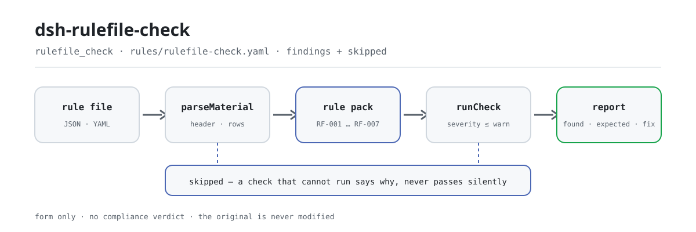

<div align="center">

<picture>
  <source media="(prefers-color-scheme: dark)" srcset="docs/assets/dsh-rulefile-check-flow-dark.svg">
  
</picture>

# dsh-rulefile-check

**नियम-फ़ाइल की पंक्ति-दर-पंक्ति जाँच करें — नियम आईडी की अद्वितीयता, आधार-फ़ील्ड की पूर्णता, अंश की वास्तविक लंबाई, स्रोत का लिंक-रूप और गंभीरता की सीमा — और पाएँ कि क्या असंगत है, कहाँ है, और कैसे ठीक करें।**

नियम-फ़ाइल रखरखावकर्ताओं के लिए DeepSeek Harness जाँच प्लगइन: यह इस प्लगइन-परिवार का स्वयं-लागू उद्धरण-अनुशासन और गंभीरता-सीमा लागू करता है, केवल वे औपचारिक अंतर सूचीबद्ध करता है जिन्हें एक नियम-फ़ाइल यंत्रवत् सह सकती है, और अनुपालन नहीं तय करता, उत्तरदायित्व नहीं ठहराता, मूल को नहीं बदलता।

[इंस्टॉल](#तीन-चरणों-में-शुरुआत) · [कॉन्फ़िगरेशन](#कॉन्फ़िगरेशन) · [FAQ](#faq) · [简体中文](README.md) · [English](README.en.md) · [Español](README.es.md) · [Português](README.pt.md) · [हिन्दी](README.hi.md)

[](LICENSE)
[](#संगतता)
[](https://www.npmjs.com/package/dsh-rulefile-check)
[](https://github.com/PerryLink/dsh-rulefile-check/actions/workflows/ci.yml)
[](#संगतता)

[](https://github.com/PerryLink/dsh-rulefile-check/stargazers)
[](https://www.npmjs.com/package/dsh-rulefile-check)
[](https://dshfind.com/plugins/PerryLink/dsh-rulefile-check?ref=badge)
[](https://securityscorecards.dev/viewer/?uri=github.com/PerryLink/dsh-rulefile-check)
[](https://dsh.market/)
[](https://gitee.com/perrylink/dsh-rulefile-check)

```sh
dsh plugin --profile <name> add dsh-rulefile-check
```

</div>

<sub>सामुदायिक प्लगइन, DeepSeek से असंबद्ध। canonical रिपॉज़िटरी: <https://github.com/PerryLink/dsh-rulefile-check> (Gitee एक मिरर है)।</sub>

## यह क्या है

`dsh-rulefile-check` एक नियम-फ़ाइल पढ़ता है — फ़ाइल का हेडर और प्रत्येक नियम की एक पंक्ति — और उसे उस उद्धरण-अनुशासन से मिलाता है जिसे यह प्लगइन-परिवार लागू करता है: क्या फ़ाइल के भीतर हर नियम आईडी अद्वितीय है, क्या आधार के दोनों फ़ील्ड भरे हैं, क्या कोई अंश न्यूनतम लंबाई से छोटा है, क्या हर स्रोत http(s) लिंक के रूप में लिखा है, क्या जिस नियम का आधार-प्रकार `derived-from-principle` या `institutional-configuration` है उसमें गंभीरता दर्ज है, क्या जाँच-प्रकार इंजन द्वारा समर्थित है, और क्या फ़ाइल का हेडर अपना नाम, प्लगइन और संस्करण घोषित करता है। आप नियम-फ़ाइल (JSON या YAML) सौंपते हैं और «कौन-सा नियम, कौन-सा कॉलम, क्या कम है» की सूची पाते हैं।

यह अनुपालन का निर्णय नहीं देता, उत्तरदायित्व नहीं ठहराता, समीक्षक की जगह नहीं लेता — और मूल को कभी नहीं बदलता।

## तीन चरणों में शुरुआत

1. **इंस्टॉल करें**:

   ```sh
   dsh plugin --profile <name> add dsh-rulefile-check
   ```

2. **न्यूनतम कॉन्फ़िगरेशन** (डिफ़ॉल्ट पर ही काम करता है; `cordis.patch.yml` ठीक यही `insert` पंक्ति है):

   ```yaml
   - insert:
       - id: dsh-rulefile-check
         name: dsh-rulefile-check
   ```

   सभी समायोज्य पैरामीटर `src/config.ts` की Schemastery स्कीमा में हैं और डिफ़ॉल्ट तैयार हैं; प्रति-नियम सीमाएँ `rules/rulefile-check.yaml` के नियम-पैक में हैं।

3. **जाँचें कि माउंट हुआ**:

   ```sh
   dsh --profile <name> --dump-config | grep 'dsh-rulefile-check'
   ```

   फिर bundled सैंपल चलाएँ (पहले `pnpm run build`, ताकि `lib/index.mjs` मौजूद हो):

   ```sh
   node samples/quickstart/run.mjs --check
   ```

   सैंपल इनपुट `samples/quickstart/input/RF-001-unsafe.json` में है और अपेक्षित आउटपुट `samples/quickstart/expected/result.json` में। वास्तविक आउटपुट:

   ```text
   $ node samples/quickstart/run.mjs
   rulefile_check: 1 issue(s) — error 0, warn 1, info 0
   skipped: 1
   ```

   *Observed from `samples/quickstart/run.mjs:24-26; samples/quickstart/expected/result.json`*

**अनइंस्टॉल**: `dsh plugin --profile <name> remove dsh-rulefile-check` (या profile patch से वह पंक्ति हटाएँ)।

<details>
<summary>DSH Desktop मार्केट से इंस्टॉल करें</summary>

सभी PerryLink प्लगइन DSH Desktop के अंतर्निहित मार्केट में ब्राउज़ किए जा सकते हैं: **Market → Sources → Add source → पेस्ट करें** `https://perrylink-dsh-catalog.perrylink.workers.dev/catalog-source.json` **→ चुनें**। इंस्टॉलेशन के लिए मार्केट की npm पहचान-जाँच और आपकी पुष्टि आवश्यक रहती है।

</details>

## मुख्य क्षमताएँ

यह प्लगइन `rulefile_check` टूल रजिस्टर करता है: एक नियम-फ़ाइल पढ़ता है (हेडर और प्रत्येक नियम की एक पंक्ति), एक संस्करणित नियम-पैक (`rules/rulefile-check.yaml`, 7 नियम) लागू करता है, और एक संरचित रिपोर्ट लौटाता है।

- **नियम-पैक डेटा है, कोड नहीं** — सभी जाँचें `rules/rulefile-check.yaml` में हैं; फ़ाइल बदलते ही नियम-सेट बदल जाता है, TypeScript छूने की ज़रूरत नहीं; पैक लोड के समय सत्यापित होता है, भरोसा नहीं किया जाता।
- **गंभीरता साक्ष्य के अनुसार** — सातों नियम `derived-from-principle` पर टिके हैं और उनकी अधिकतम सीमा `warn` है; `institutional-configuration` पर टिकी जाँच की सीमा `info` है; लोडर सीमा से बढ़ा पैक सीधे `strongest permitted severity` के साथ अस्वीकार कर देता है।
- **खाली सूची कभी «सब ठीक» नहीं** — जो जाँच न चल सकी वह `skipped` में कारण सहित स्वयं दर्ज होती है; `RF-006` की समर्थित-प्रकार सूची खाली आती है, इसलिए वह नियम चुपचाप पास होने के बजाय `skipped` में जाता है।
- **कोई निर्णय नहीं** — रिपोर्ट केवल अंतर सूचीबद्ध करती है; अनुपालन, उत्तरदायित्व या शुद्धता पर कभी टिप्पणी नहीं करती; शब्दावली-गार्ड रिपोर्ट में हमेशा अस्वीकरण रखने को बाध्य करता है।
- **उद्धरण केवल शब्दशः** — प्रत्येक नियम में दस्तावेज़, संख्या, स्रोत की अपनी क्रमांकन में धारा, शब्दशः अंश और स्रोत-लिंक होता है; जब शब्दशः पाठ नहीं मिला तो अंश स्वयं यह कहता है, और पुनर्कथन को कभी उद्धरण नहीं बताया जाता।

```text
नियम-फ़ाइल (JSON / YAML) ──parseMaterial──▶ हेडर + पंक्तियाँ ──runCheck──▶ RF-001…RF-007
                                                                   └──▶ रिपोर्ट (found / expected / fix + skipped)
```

### नियम एक नज़र में

| नियम | जाँच | गंभीरता | आधार का प्रकार |
|---|---|---|---|
| `RF-001` | फ़ाइल के भीतर नियम आईडी अद्वितीय हैं | warn | परिवार का उद्धरण-अनुशासन |
| `RF-002` | आधार के दोनों में से कम-से-कम एक फ़ील्ड भरा है | warn | परिवार का उद्धरण-अनुशासन |
| `RF-003` | अंश की वास्तविक लंबाई है (कम-से-कम आठ अक्षर) | warn | परिवार का उद्धरण-अनुशासन |
| `RF-004` | स्रोत http(s) लिंक के रूप में लिखा है | warn | परिवार का उद्धरण-अनुशासन |
| `RF-005` | व्युत्पन्न या स्थानीय-कॉन्फ़िगर आधार में गंभीरता दर्ज है | warn | परिवार का उद्धरण-अनुशासन |
| `RF-006` | जाँच-प्रकार इंजन द्वारा समर्थित है (खाली सूची आती है, डिफ़ॉल्ट बंद) | warn | इंजन अनुबंध |
| `RF-007` | हेडर नाम, प्लगइन और संस्करण घोषित करता है | warn | नियम-पैक अनुबंध |

### उदाहरण

ये प्लगइन के वास्तविक प्रवेश-बिंदु हैं; एक बार इंस्टॉल करें, फिर एक को कॉल करें।

**विस्तृत आउटपुट** — टूल `rulefile_check`, इनपुट:

```json
{"rows":[{"规则编号":"XX-001"},{"规则编号":"XX-001"}]}
```

आउटपुट:

```json
{
  "id": "dsh-rulefile-check.RF-001.de02f9e1",
  "ruleId": "RF-001",
  "severity": "warn",
  "locator": {
    "row": 2,
    "field": "ruleId"
  },
  "found": "第 2 行「ruleId」的值「XX-001」与第 1 行重复",
  "expected": "「ruleId」在材料内应唯一",
  "fix": "核对是否重复登记或抄错；本条只核对唯一性"
}
```

*Observed from `dsh-rulefile-check/tests/fixtures/RF-001/RF-001-unsafe.json`*

### यह किन सवालों का जवाब देता है

| आप पूछते हैं | यह क्या जवाब देता है |
|---|---|
| वही नियम आईडी फ़ाइल में दो नियमों पर आता है। | `RF-001` दोहराई गई आईडी बताता है, क्योंकि दोहराव से `issue.id` दो अलग नियमों की ओर इशारा करता है और हिट को फिर वापस ट्रेस नहीं किया जा सकता। तुलना में श्वेत-स्थान नज़रअंदाज़ होता है। यह एक बार में एक ही फ़ाइल देखता है: दो फ़ाइलों की आपस में तुलना नहीं करता और किसी रजिस्टर में खोज नहीं करता। |
| किसी नियम में केवल `document` है और धारा के बारे में कुछ नहीं। | `RF-002` जाँचता है कि आधार के दोनों में से कम-से-कम एक फ़ील्ड भरा हो, इसलिए जिस नियम में `document` मौजूद है वह पास हो जाता है। यह नहीं आँकता कि उद्धृत धारा वास्तव में मौजूद है या उसका नियम से कोई संबंध है। |
| अंश धारा का एक-वाक्य विवरण है, शब्दशः उद्धरण नहीं। | `RF-003` चाहता है कि अंश मौजूद हो और कम-से-कम आठ अक्षरों का हो। लंबाई आवश्यक है, पर्याप्त नहीं: बीस अक्षरों का *विवरण* भी उद्धरण नहीं है, और यह नियम अंतर नहीं पहचान सकता — यह अंश की तुलना मूल धारा से नहीं करता। |
| स्रोत में लिंक के बजाय किसी वेबसाइट का नाम लिखा है। | `RF-004` इसे बताता है, क्योंकि स्रोत-फ़ील्ड को http(s) लिंक जैसा दिखना ही होगा। यह केवल रूप जाँचता है: लिंक पर जाता नहीं, नहीं बताता कि लिंक चलता है या नहीं, और नहीं बताता कि पृष्ठ में उद्धृत धारा वास्तव में है या नहीं। |
| किसी सिद्धांत से व्युत्पन्न नियम को `error` दर्ज किया गया है। | `RF-005` पुष्टि करता है कि जिस नियम का आधार-प्रकार `derived-from-principle` या `institutional-configuration` है, उसमें गंभीरता दर्ज है ही। वह गंभीरता वास्तव में सीमा का पालन करती है या नहीं, यह लोडर लागू करता है, जो ऐसी फ़ाइल को `strongest permitted severity` के साथ सीधे अस्वीकार कर देता है; यह जाँच केवल फ़ील्ड की उपस्थिति कवर करती है और लोडर की जगह नहीं ले सकती। |
| फ़ाइल में कोई ऐसा `check.kind` लिखा है जिसे इंजन नहीं जानता — और क्या उसने अपना `packName` और `version` घोषित किया है? | `RF-006` अज्ञात `check.kind` बताता है, क्योंकि ऐसा नियम चुपचाप नहीं चलता। उसकी समर्थित-प्रकार सूची खाली आती है, क्योंकि कौन-से प्रकार हैं यह इंजन संस्करण पर निर्भर है, इसलिए बिना कॉन्फ़िगर की फ़ाइल उस नियम को पास करने के बजाय `skipped` में डाल देती है; यह केवल आपकी दी हुई सूची से तुलना करता है। `RF-007` हेडर में `packName`, `plugin` और `version` एक साथ जाँचता है, क्योंकि इनके बिना पता नहीं चलता कि कोई फ़ाइल किस प्लगइन की है, या बदलते समय कौन-सा संस्करण है। दोनों में से कोई भी यह नहीं जाँचता कि दर्ज मान वास्तव में प्रयुक्त प्लगइन से मेल खाते हैं। |

## कॉन्फ़िगरेशन

सभी समायोज्य पैरामीटर `src/config.ts` की Schemastery स्कीमा में हैं, इसलिए `cordis.yml` से बिना कोड बदले लागू होते हैं; प्रति-नियम सीमाएँ `rules/` के नियम-पैक में हैं। ये पाँच कुंजियाँ ही पूरी कॉन्फ़िगरेशन सतह हैं; प्रति-नियम पैरामीटर तालिका के बाद हैं।

| कुंजी | प्रकार | डिफ़ॉल्ट | विवरण |
|---|---|---|---|
| `rulesFile` | string | `rules/rulefile-check.yaml` | नियम-पैक का पथ, पैकेज रूट के सापेक्ष |
| `disabledRules` | string[] | `[]` | जिन नियम आईडी को रोकना है; हर एक `skipped` में आती है |
| `onlyRules` | string[] | `[]` | केवल ये नियम चलाएँ; खाली का अर्थ है सभी नियम |
| `skipNotes` | string | `""` | हर `skipped` कारण के आगे जोड़ा जाने वाला नोट |
| `timeoutMs` | number | `120000` | टूल का सहयोगी टाइमआउट बजट (मिलीसेकंड) |

जानने योग्य प्रति-नियम पैरामीटर:

- `RF-003` `minLength` — अंश की न्यूनतम सीमा, डिफ़ॉल्ट आठ अक्षर (वही संख्या जो लोडर उपयोग करता है)।
- `RF-004` `pattern` — स्रोत का रूप, डिफ़ॉल्ट `^https?://[^\s]+$`।
- `RF-006` `values` — **आपके इंजन द्वारा समर्थित जाँच-प्रकार।** खाली का अर्थ है नियम नहीं चलता; इसे इंजन की डिस्पैच तालिका से भरें, इस प्लगइन से नहीं।

## FAQ

<details>
<summary>क्या मेरी नियम-फ़ाइल अपलोड या फिर से लिखी जाती है?</summary>

नहीं। टूल केवल आपके दिए `file` या `material` पाठ को पढ़ता है और **मूल को कभी नहीं बदलता**; यह शुद्ध ESM है, कोई नेटिव कोड नहीं, **कोई नेटवर्क नहीं और कोई मॉडल कॉल नहीं** (देखें «संगतता»), इसलिए सामग्री आपकी मशीन से बाहर नहीं जाती। पैकेज मैनिफ़ेस्ट के `writes: []` और `network: false` उसी घोषणा का मशीन-पठनीय रूप हैं।

</details>

<details>
<summary>अगर कोई नियम नहीं चला, तो क्या वह चुपचाप पास हो जाता है?</summary>

नहीं। जो जाँच न चल सकी वह `skipped` में कारण सहित स्वयं दर्ज होती है; `RF-006` की समर्थित-प्रकार सूची खाली आती है, इसलिए बिना कॉन्फ़िगर की फ़ाइल उस नियम को पास करने के बजाय `skipped` में डाल देती है। इसलिए खाली अंतर-सूची को «फ़ाइल ठीक है» नहीं पढ़ा जा सकता।

</details>

<details>
<summary>क्या यह बता सकता है कि मेरी नियम-फ़ाइल अनुपालन करती है?</summary>

नहीं। यह केवल रूप जाँचता है: फ़ील्ड मौजूद हैं, अंश पर्याप्त लंबा है, स्रोत लिंक जैसा है, गंभीरता सीमा के भीतर है। यह «वास्तविक पर असंबंधित धारा» को नहीं पकड़ सकता — देखें «ज्ञात सीमाएँ»। रिपोर्ट केवल अंतर सूचीबद्ध करती है; निर्णय मनुष्य का ही रहता है।

</details>

<details>
<summary>क्या यह अन्य DSH प्लगइनों से टकराएगा?</summary>

नहीं। यह `tools` सेवा के माध्यम से ठीक एक टूल, `rulefile_check`, रजिस्टर करता है; कोई साझा इवेंट नहीं सुनता, कोई सेवा-कुंजी नहीं देता, कोई क्लाइंट स्लॉट या HTTP रूट रजिस्टर नहीं करता और कोई ग्लोबल ऑब्जेक्ट नहीं बदलता, इसलिए टूल-नाम, सेवा-कुंजी या patch-परत का कोई टकराव नहीं है।

</details>

<details>
<summary>क्या यह नियम-फ़ाइलों की पूरी डायरेक्टरी एक बार में जाँच सकता है?</summary>

हाँ। यह `native` और `ptc` दोनों मोड में चलता है; पूरी डायरेक्टरी के लिए `ptc` उपयुक्त है, जिससे स्कीमा की लागत एक ही बार लगती है। जाँच स्वयं शुद्ध गणना है और सामग्री तथा नियम-पैक फ़ाइल पढ़ने के अलावा कोई I/O नहीं करती।

</details>

## यह किन मानकों पर आधारित है

यह नियम-पैक किसी सार्वजनिक मानक का उद्धरण नहीं देता: हर नियम का आधार स्वयं इस प्लगइन-परिवार का उद्धरण-अनुशासन, उसका इंजन अनुबंध और उसका नियम-पैक अनुबंध है, इसलिए नीचे की प्रविष्टियाँ परिवार के आंतरिक अनुबंधों के नाम देती हैं, कोई क़ानून या राष्ट्रीय मानक नहीं।

| दस्तावेज़ | संख्या | इसे उद्धृत करने वाले नियम |
|---|---|---|
| इस प्लगइन-परिवार का उद्धरण-अनुशासन (स्वयं-लागू, राष्ट्रीय मानक नहीं) | संख्या नहीं (यह नियम-पैक स्वयं तय करता है) | RF-001, RF-002, RF-003, RF-004, RF-005 |
| इस प्लगइन-परिवार का जाँच-इंजन अनुबंध (स्वयं-लागू, राष्ट्रीय मानक नहीं) | संख्या नहीं (यह नियम-पैक स्वयं तय करता है) | RF-006 |
| इस प्लगइन-परिवार का नियम-पैक अनुबंध (स्वयं-लागू, राष्ट्रीय मानक नहीं) | संख्या नहीं (यह नियम-पैक स्वयं तय करता है) | RF-007 |

इन अनुबंधों के जो नाम नियम-पैक स्वयं देता है:

```text
本插件家族的条款引用纪律（自定纪律，非国家标准）
本插件家族的检查引擎契约（自定纪律，非国家标准）
本插件家族的规则库契约（自定纪律，非国家标准）
```

**सीमा:** यह प्लगइन एक **नियम-फ़ाइल** (rule pack) को उस उद्धरण-अनुशासन की कसौटी पर जाँचता है जिसे यह प्लगइन-परिवार लागू करता है — कि नियम आईडी अद्वितीय हों, हर आधार-फ़ील्ड मौजूद हो, अंश की वास्तविक लंबाई हो, स्रोत एक लिंक हो, व्युत्पन्न या स्थानीय-कॉन्फ़िगर आधार में गंभीरता दर्ज हो, जाँच-प्रकार इंजन द्वारा समर्थित हो, और फ़ाइल अपना नाम, प्लगइन और संस्करण घोषित करे।

## सामग्री प्रारूप

टूल JSON या YAML स्वीकार करता है:

```yaml
packName: 某某规则库
plugin: dsh-rulefile-check
version: '2026.1'
rows:
  - { 规则编号: XX-001, 规则标题: 示例规则标题, 定级: warn,
      依据类型: derived-from-principle, 依据文件: 《某某标准》, 条款号: 第 5.3 条,
      摘录: 该条文本次未取得：核查未获得该标准的逐字原文，本规则库不伪造引文。,
      来源: https://openstd.samr.gov.cn/, 检查类型: presence, 参数: 'field: title' }
```

स्तंभ-नाम बड़े/छोटे अक्षरों का भेद किए बिना और स्थान, अंडरस्कोर तथा हाइफ़न नज़रअंदाज़ करके मिलाए जाते हैं; इन्वेंटरी के अपने स्तंभ-नाम सुरक्षित रहते हैं, इसलिए कोई निष्कर्ष बताता है कि उसने कौन-सा स्तंभ पढ़ा। पाठक परत में फ़ील्ड वैकल्पिक हैं और जाँच-इंजन उन्हें सत्यापित करता है, इसलिए आंशिक निर्यात «फ़ील्ड कम है» प्रकार के निष्कर्ष देता है, प्रोग्राम क्रैश नहीं।

## नियमों के स्रोत

नियमों का डेटा `rules/rulefile-check.yaml` में है, कोड से अलग। हर नियम में दस्तावेज़, संख्या, स्रोत की अपनी क्रमांकन में धारा, शब्दशः अंश और वह URL होता है जहाँ से पढ़ा गया। लोडर लागू करता है कि अंश कम-से-कम आठ अक्षरों का वास्तविक उद्धरण हो, और सामान्य सिद्धांत पर टिकी जाँच (`kind: derived-from-principle`, सीमा `warn`) या स्थानीय कॉन्फ़िगरेशन पर टिकी जाँच (`kind: institutional-configuration`, सीमा `info`) को **कभी** `error` घोषित न किया जाए। अपने आधार को बढ़ा-चढ़ाकर बताने वाली फ़ाइल लोड के समय ही असफल होती है, आत्मविश्वास से भरी रिपोर्ट नहीं देती।

`pnpm run check:citations` नियम-दर-नियम जाँचता है कि हर अंश `rules/evidence/` में मिल सके; जो नियम अभी ट्रेस करने योग्य नहीं हैं वे `rules/citations-baseline.json` में सूचीबद्ध हैं, और वह सूची केवल छोटी हो सकती है — नया उद्धरण दर्ज होने से पहले सत्यापन-रिकॉर्ड पाना ही होगा। सत्यापन के दौरान पुष्ट सीमाएँ और जानबूझकर न निकाले गए निष्कर्ष पैकेज के साथ आने वाली `rules/evidence/` डायरेक्टरी में दर्ज हैं।

## सुरक्षा सीमाएँ

- **मूल केवल पढ़ा जाता है।** टूल केवल आपके दिए `file` या `material` पाठ को पढ़ता है और **मूल को कभी नहीं बदलता**; पैकेज मैनिफ़ेस्ट के `writes: []`, `network: false` और `external: []` उसी घोषणा का मशीन-पठनीय रूप हैं।
- **कोई नेटवर्क नहीं, कोई मॉडल कॉल नहीं।** शुद्ध ESM, कोई नेटिव कोड नहीं, कोई नेटवर्क अनुरोध नहीं और कोई मॉडल कॉल नहीं; सामग्री आपकी मशीन से बाहर नहीं जाती।
- **कोई निर्णय नहीं।** रिपोर्ट केवल अंतर सूचीबद्ध करती है और अनुपालन, उत्तरदायित्व या शुद्धता पर कभी टिप्पणी नहीं करती; शब्दावली-गार्ड उसे अस्वीकरण रखने को बाध्य करता है।
- **चुप नहीं, स्पष्ट असफलता।** जो जाँच नहीं चल सकती वह `skipped` में कारण सहित जाती है; जो नियम-फ़ाइल लोड नहीं होती वह आत्मविश्वास से भरी रिपोर्ट देने के बजाय त्रुटि फेंकती है।
- **गंभीरता की सीमाएँ।** सिद्धांत पर टिकी जाँच की सीमा `warn` है और स्थानीय कॉन्फ़िगरेशन पर टिकी जाँच की सीमा `info`; लोडर सीमा से बढ़ी फ़ाइल सीधे अस्वीकार कर देता है।

## ज्ञात सीमाएँ

> ### ⚠️ यह रूप जाँचता है, विषय-वस्तु नहीं — और यह स्वयं ऐसा कहता है
>
> **जो अनुशासन जाँचा जा रहा है वह स्वयं-लागू है, राष्ट्रीय मानक नहीं।** «अंश शब्दशः उद्धरण ही होना चाहिए» और «सिद्धांत से व्युत्पन्न जाँच `error` नहीं हो सकती» — ये नियम यह प्लगइन-परिवार `shared/ruleset.ts` में लागू करता है; इनका आधार बौद्धिक ईमानदारी का सामान्य सिद्धांत है — विवरण को कभी उद्धरण का रूप न दें, अनुमान को कभी अपेक्षा का रूप न दें — **न कि कोई क़ानून या मानक**। हर नियम का `basis` ठीक यही कहता है, इसीलिए यहाँ हर नियम `warn` या `info` है।
>
> **यह नहीं बता सकता कि कोई उद्धरण प्रासंगिक है या नहीं।** यह जाँचता है कि फ़ील्ड भरे हैं, अंश पर्याप्त लंबा है, स्रोत *लिंक जैसा दिखता* है, और गंभीरता दर्ज है। जो नियम **वास्तविक पर असंबंधित धारा** उद्धृत करता है उसे भी यह ख़ुशी से पास कर देगा — यही रूप-जाँच की प्रलेखित सीमा है, और इसीलिए स्वचालित जाँच मानवीय पठन का विकल्प कभी नहीं बन सकती।
>
> दो नियम ध्यान देने योग्य हैं। `RF-003` की आठ-अक्षर न्यूनतम सीमा लोड-समय गार्ड की बही-पक्ष प्रतिध्वनि है — पर **लंबाई आवश्यक है, पर्याप्त नहीं**: बीस अक्षरों का *विवरण* भी उद्धरण नहीं है, और यह प्लगइन अंतर नहीं पहचान सकता। और `RF-005` केवल यह पुष्टि कर सकता है कि गंभीरता-फ़ील्ड मौजूद है: कोई गंभीरता वास्तव में सीमा का पालन करती है या नहीं, यह लोडर लागू करता है, जो उल्लंघनकारी फ़ाइल को `strongest permitted severity` के साथ सीधे अस्वीकार कर देता है। `RF-006` की kind-शब्दावली **खाली** आती है, क्योंकि कौन-सी kind किसी इंजन में समर्थित है यह इंजन संस्करण पर निर्भर है — इस परिवार की अपनी सूची हार्ड-कोड करने का अर्थ होगा कि इंजन में हर नई kind आने पर यह प्लगइन बदलना पड़े।

- **एक बार में एक ही फ़ाइल।** `RF-001` आईडी की तुलना एक ही फ़ाइल के भीतर करता है: दो फ़ाइलों की आपस में तुलना नहीं करता और किसी रजिस्टर में खोज नहीं करता।
- **फ़ाइल की पहचान एक फ़ील्ड-जाँच है।** `RF-007` केवल यह जाँचता है कि `packName`, `plugin` और `version` मौजूद हैं; यह सत्यापित नहीं करता कि दर्ज मान वास्तव में प्रयुक्त प्लगइन से मेल खाते हैं।
- **`manifest-peers` का स्टैटिक निर्णय प्रामाणिक नहीं है।** वह स्टैटिक चेकर 0.2 लाइन से पहले की हार्ड-कोडेड peer रेंज से तुलना करता है; रनटाइम इंस्टॉल के समय peer अनुकूलता लागू करता है, इसलिए घोषित रेंज ही सही है (देखें «समस्या निवारण»)।

## संगतता

| सतह | स्थिति |
|---|---|
| Harness | peer रेंज `>=0.1.2-rc.1 <0.2.0 \|\| >=0.2.0-0 <0.3.0` — `0.2.0-rc.2` और `0.2.1-rc.2` दोनों को स्वीकार करते हुए सत्यापित। **`engines.dsh` `>=0.2.1-0 <0.3.0` के रूप में घोषित है** और 0.2.1 से होस्ट इसे लागू करता है |
| Node | `^22.19.0 \|\| >=24.0.0` |
| प्लेटफ़ॉर्म | सभी (शुद्ध ESM; कोई नेटिव कोड नहीं, कोई नेटवर्क नहीं, कोई मॉडल कॉल नहीं) |
| टूल मोड | `native` और `ptc` दोनों में चलता है; पूरी डायरेक्टरी के लिए `ptc` |

## समस्या निवारण

- **प्लगइन इंस्टॉल हो गया पर टूल दिखता नहीं।** जाँचें कि `main` `lib/index.mjs` पर जाता है और `pnpm run build` ने उसे बनाया है; गलत `main` लोडर को उस प्रविष्टि को चुपचाप छोड़ने पर मजबूर करता है।
- **`dsh plugin add` असंगत बताकर मना करता है।** peer रेंज `0.1.x` और `0.2.x` कवर करती है; बाहर होने पर स्पष्ट छूट दें: `dsh plugin --profile <name> allow-version dsh-rulefile-check@0.1.0 --dsh-version <runtime> --accept-risk`
- **कोई नियम नहीं चला।** `skipped` सरणी पढ़ें — वह नियम आईडी और कारण बताती है। `RF-006` का `values` खाली रहने पर यही होता है।
- **`RF-005` किसी फ़ाइल को पास कर देता है, फिर लोडर उसे अस्वीकार कर देता है।** यह अपेक्षित है: `RF-005` जाँचता है कि गंभीरता-फ़ील्ड मौजूद है, जबकि सीमा लोडर स्वयं लागू करता है। लोडर की त्रुटि उल्लंघनकारी नियम का नाम बताती है।
- **`check` में `manifest-peers` विफल दिखता है।** स्टैटिक चेकर 0.2 लाइन से पहले की हार्ड-कोडेड peer रेंज से तुलना करता है। रनटाइम इंस्टॉल के समय peer अनुकूलता लागू करता है, इसलिए घोषित रेंज ही सही है; यह `dsh-plugin-dev` की ज्ञात अपस्ट्रीम समस्या है।
- **`check:citations` किसी ऐसे नियम की शिकायत करता है जो अभी ट्रेस योग्य नहीं है।** नए उद्धरण का सत्यापन-रिकॉर्ड पहले `rules/evidence/` में होना चाहिए; `rules/citations-baseline.json` केवल छोटी हो सकती है, बड़ी कभी नहीं।

## इकोसिस्टम और गुणवत्ता

- [Gitee मिरर](https://gitee.com/perrylink/dsh-rulefile-check) (समन्वित मिरर; GitHub canonical है)
- [dshfind प्लगइन पेज](https://dshfind.com/plugins/PerryLink/dsh-rulefile-check) (इंस्टॉल और रैंकिंग)
- [OpenSSF Scorecard रिपोर्ट](https://securityscorecards.dev/viewer/?uri=github.com/PerryLink/dsh-rulefile-check) ([.github/workflows/scorecard.yml](.github/workflows/scorecard.yml) द्वारा संचालित)
- [DSH Market](https://dsh.market/) (सूचीबद्ध)
- [इकोसिस्टम नॉलेज बेस — सामग्री के अनुसार चेकर चुनें](https://perrylink.github.io/zh/checkers/choose/) (पूरा पारिवारिक सूचीपत्र)

## डेवलपमेंट

```sh
pnpm install
pnpm run typecheck      # tsc --noEmit
pnpm test               # vitest, प्रति-नियम युग्मित fixtures (tests/fixtures/<RULE>/)
pnpm run build          # tsdown -> lib/index.mjs + lib/index.d.mts
pnpm run check:citations   # शब्दशः अंश ट्रेस योग्य हैं (rules/evidence/)
pnpm run check:readmes     # पाँच-भाषा README संगति
node ../scripts/sync-shared.mjs dsh-rulefile-check   # ../_shared से src/shared ताज़ा करें
pnpm pack
```

यह प्लगइन **केवल-डेटा** है: `src/model.ts` तालिका का आकार घोषित करता है, `src/shared/` पाठक और जाँच-इंजन देता है, और नियम-पैक हर जाँच घोषित करता है। नियम-पैक डेटा है, कोड नहीं: नियम-सेट बदलने के लिए `rules/*.yaml` संपादित करें, TypeScript छुए बिना; पैक लोड के समय सत्यापित होता है, भरोसा नहीं किया जाता। README चित्र [`scripts/gen-readme-assets.py`](scripts/gen-readme-assets.py) (Python + Pillow) से प्रोग्रामेटिक रूप से बनते हैं और सुरक्षित रूप से फिर चलाए जा सकते हैं; इस प्लगइन में UI नहीं है, इसलिए hero हाथ-लिखा SVG प्रवाह-आरेख है (हल्का/गहरा जोड़ा, केवल कमांड-सतह token)।

Topics: `dsh`, `dsh-plugin`, `deepseek-harness`, `cordis`, `rulefile`

## परिवार और आभार

यह प्रोजेक्ट [PerryLink](https://github.com/PerryLink) द्वारा रखरखाव किए गए DeepSeek Harness प्लगइन परिवार का हिस्सा है (सभी Apache-2.0)। अगर यह प्लगइन काम आए तो **एक स्टार** कुछ अनलॉक नहीं करता, पर अगले व्यक्ति को इसे खोजने में मदद करता है।

- [@PerryLink](https://github.com/PerryLink) — निर्माता और रखरखावकर्ता: `rulefile_check` टूल, शब्दशः उद्धरण वाला नियम-पैक और उसका धारा-सत्यापन रिकॉर्ड, तथा पाँच-भाषा प्रलेखन।

<details>
<summary>सभी प्लगइन खोलें</summary>

| प्लगइन | स्थिति |
|---|---|
| **[dsh-aqua-input-check](https://github.com/PerryLink/dsh-aqua-input-check)** |  |
| **[dsh-archive-check](https://github.com/PerryLink/dsh-archive-check)** |  |
| **[dsh-auto-review](https://github.com/PerryLink/dsh-auto-review)** |  |
| **[dsh-autotier](https://github.com/PerryLink/dsh-autotier)** | 🧊 फ़्रोज़न — रेपो README देखें |
| **[dsh-bid-ca-precheck](https://github.com/PerryLink/dsh-bid-ca-precheck)** |  |
| **[dsh-bid-qual-check](https://github.com/PerryLink/dsh-bid-qual-check)** |  |
| **[dsh-cert-mcp](https://github.com/PerryLink/dsh-cert-mcp)** | 🧊 फ़्रोज़न — रेपो README देखें |
| **[dsh-checkpoint-rewind](https://github.com/PerryLink/dsh-checkpoint-rewind)** |  |
| **[dsh-click](https://github.com/PerryLink/dsh-click)** |  |
| **[dsh-composer-history](https://github.com/PerryLink/dsh-composer-history)** |  |
| **[dsh-contract-stance](https://github.com/PerryLink/dsh-contract-stance)** |  |
| **[dsh-customs-doc-check](https://github.com/PerryLink/dsh-customs-doc-check)** |  |
| **[dsh-data-quality](https://github.com/PerryLink/dsh-data-quality)** | 🧊 फ़्रोज़न — रेपो README देखें |
| **[dsh-demurrage-ledger](https://github.com/PerryLink/dsh-demurrage-ledger)** |  |
| **[dsh-doublecheck](https://github.com/PerryLink/dsh-doublecheck)** |  |
| **[dsh-drill-script-check](https://github.com/PerryLink/dsh-drill-script-check)** |  |
| **[dsh-eia-guide-check](https://github.com/PerryLink/dsh-eia-guide-check)** |  |
| **[dsh-emergency-plan](https://github.com/PerryLink/dsh-emergency-plan)** |  |
| **[dsh-essay-rubric-check](https://github.com/PerryLink/dsh-essay-rubric-check)** |  |
| **[dsh-evidence-check](https://github.com/PerryLink/dsh-evidence-check)** |  |
| **[dsh-export-ctl-check](https://github.com/PerryLink/dsh-export-ctl-check)** |  |
| **[dsh-fast](https://github.com/PerryLink/dsh-fast)** |  |
| **[dsh-fmea-table-check](https://github.com/PerryLink/dsh-fmea-table-check)** |  |
| **[dsh-forecast-penalty](https://github.com/PerryLink/dsh-forecast-penalty)** |  |
| **[dsh-fund-research](https://github.com/PerryLink/dsh-fund-research)** |  |
| **[dsh-github](https://github.com/PerryLink/dsh-github)** |  |
| **[dsh-gongwen-flow-check](https://github.com/PerryLink/dsh-gongwen-flow-check)** |  |
| **[dsh-gongwen-word-check](https://github.com/PerryLink/dsh-gongwen-word-check)** |  |
| **[dsh-guard-plan-qc](https://github.com/PerryLink/dsh-guard-plan-qc)** |  |
| **[dsh-hazchem-check](https://github.com/PerryLink/dsh-hazchem-check)** |  |
| **[dsh-hazplan-check](https://github.com/PerryLink/dsh-hazplan-check)** |  |
| **[dsh-hidden-risk-map](https://github.com/PerryLink/dsh-hidden-risk-map)** |  |
| **[dsh-hs-classify](https://github.com/PerryLink/dsh-hs-classify)** |  |
| **[dsh-icd-rule-check](https://github.com/PerryLink/dsh-icd-rule-check)** |  |
| **[dsh-industry-research](https://github.com/PerryLink/dsh-industry-research)** |  |
| **[dsh-lawcite-adapter](https://github.com/PerryLink/dsh-lawcite-adapter)** |  |
| **[dsh-laya](https://github.com/PerryLink/dsh-laya)** |  |
| **[dsh-lc-doc-check](https://github.com/PerryLink/dsh-lc-doc-check)** |  |
| **[dsh-learning-gap-check](https://github.com/PerryLink/dsh-learning-gap-check)** |  |
| **[dsh-library](https://github.com/PerryLink/dsh-library)** |  |
| **[dsh-local-ai](https://github.com/PerryLink/dsh-local-ai)** |  |
| **[dsh-lsp-actions](https://github.com/PerryLink/dsh-lsp-actions)** |  |
| **[dsh-mask](https://github.com/PerryLink/dsh-mask)** |  |
| **[dsh-mcp-panel](https://github.com/PerryLink/dsh-mcp-panel)** |  |
| **[dsh-medrec-qc](https://github.com/PerryLink/dsh-medrec-qc)** |  |
| **[dsh-memento](https://github.com/PerryLink/dsh-memento)** | 🧊 फ़्रोज़न — रेपो README देखें |
| **[dsh-nsfc-form-check](https://github.com/PerryLink/dsh-nsfc-form-check)** |  |
| **[dsh-nurse-record-check](https://github.com/PerryLink/dsh-nurse-record-check)** |  |
| **[dsh-observe](https://github.com/PerryLink/dsh-observe)** |  |
| **[dsh-origin-rvc-check](https://github.com/PerryLink/dsh-origin-rvc-check)** |  |
| **[dsh-ota-review-check](https://github.com/PerryLink/dsh-ota-review-check)** |  |
| **[dsh-output-styles](https://github.com/PerryLink/dsh-output-styles)** |  |
| **[dsh-paper-doc-adapter](https://github.com/PerryLink/dsh-paper-doc-adapter)** |  |
| **[dsh-permission-rules](https://github.com/PerryLink/dsh-permission-rules)** |  |
| **[dsh-permit-report-check](https://github.com/PerryLink/dsh-permit-report-check)** |  |
| **[dsh-pipeline-check](https://github.com/PerryLink/dsh-pipeline-check)** |  |
| **[dsh-pleading-draft](https://github.com/PerryLink/dsh-pleading-draft)** |  |
| **[dsh-plugin-doctor](https://github.com/PerryLink/dsh-plugin-doctor)** | 🚫 रिटायर्ड (रेपो संग्रहीत) |
| **[dsh-plugin-guide](https://github.com/PerryLink/dsh-plugin-guide)** |  |
| **[dsh-plugin-kit](https://github.com/PerryLink/dsh-plugin-kit)** | 🚫 रिटायर्ड (रेपो संग्रहीत) |
| **[dsh-plugin-upgrade](https://github.com/PerryLink/dsh-plugin-upgrade)** | 🚫 रिटायर्ड (रेपो संग्रहीत) |
| **[dsh-policy-brief-draft](https://github.com/PerryLink/dsh-policy-brief-draft)** |  |
| **[dsh-power-loss-split](https://github.com/PerryLink/dsh-power-loss-split)** |  |
| **[dsh-power-ticket-check](https://github.com/PerryLink/dsh-power-ticket-check)** |  |
| **[dsh-ppap-check](https://github.com/PerryLink/dsh-ppap-check)** |  |
| **[dsh-protest-deadline](https://github.com/PerryLink/dsh-protest-deadline)** |  |
| **[dsh-railway-window](https://github.com/PerryLink/dsh-railway-window)** |  |
| **[dsh-repair-order-qc](https://github.com/PerryLink/dsh-repair-order-qc)** |  |
| **[dsh-research-report](https://github.com/PerryLink/dsh-research-report)** |  |
| **[dsh-review-reply-check](https://github.com/PerryLink/dsh-review-reply-check)** |  |
| **[dsh-rulefile-check](https://github.com/PerryLink/dsh-rulefile-check)** |  |
| **[dsh-safety-brief-check](https://github.com/PerryLink/dsh-safety-brief-check)** |  |
| **[dsh-score](https://github.com/PerryLink/dsh-score)** | 🧊 फ़्रोज़न — रेपो README देखें |
| **[dsh-session-sync](https://github.com/PerryLink/dsh-session-sync)** |  |
| **[dsh-site-log-check](https://github.com/PerryLink/dsh-site-log-check)** |  |
| **[dsh-skill-pack-security](https://github.com/PerryLink/dsh-skill-pack-security)** |  |
| **[dsh-soe-decision-check](https://github.com/PerryLink/dsh-soe-decision-check)** |  |
| **[dsh-soilwater-check](https://github.com/PerryLink/dsh-soilwater-check)** |  |
| **[dsh-sop-sync-check](https://github.com/PerryLink/dsh-sop-sync-check)** |  |
| **[dsh-spc-gbt-adapter](https://github.com/PerryLink/dsh-spc-gbt-adapter)** |  |
| **[dsh-talk](https://github.com/PerryLink/dsh-talk)** |  |
| **[dsh-tender-extract](https://github.com/PerryLink/dsh-tender-extract)** |  |
| **[dsh-tender-matrix](https://github.com/PerryLink/dsh-tender-matrix)** |  |
| **[dsh-test-drive](https://github.com/PerryLink/dsh-test-drive)** |  |
| **[dsh-ticktick](https://github.com/PerryLink/dsh-ticktick)** | 🚫 रिटायर्ड (रेपो संग्रहीत) |
| **[dsh-translate](https://github.com/PerryLink/dsh-translate)** |  |
| **[dsh-warranty-calc](https://github.com/PerryLink/dsh-warranty-calc)** |  |
| **[dsh-budget](https://github.com/PerryLink/dsh-budget)** | 🧊 फ़्रोज़न — रेपो README देखें |
| **[dsh-claude-move](https://github.com/PerryLink/dsh-claude-move)** | 🧊 फ़्रोज़न — रेपो README देखें |
| **[dsh-defend](https://github.com/PerryLink/dsh-defend)** | 🧊 फ़्रोज़न — रेपो README देखें |
| **[dsh-draw](https://github.com/PerryLink/dsh-draw)** | 🧊 फ़्रोज़न — रेपो README देखें |
| **[dsh-reach](https://github.com/PerryLink/dsh-reach)** | 🧊 फ़्रोज़न — रेपो README देखें |
| **[dsh-background-agents](https://github.com/PerryLink/dsh-background-agents)** | 🚫 रिटायर्ड (रेपो संग्रहीत) |
| **[dsh-session-pin](https://github.com/PerryLink/dsh-session-pin)** | 🚫 रिटायर्ड (रेपो संग्रहीत) |
| **[dsh-team-rooms](https://github.com/PerryLink/dsh-team-rooms)** | 🚫 रिटायर्ड (रेपो संग्रहीत) |

</details>

## लाइसेंस

[LICENSE](LICENSE) (Apache License 2.0) © 2026 dsh-rulefile-check contributors

<p align="center"><sub>Apache-2.0 · सामुदायिक प्लगइन, DeepSeek से असंबद्ध।</sub></p>
