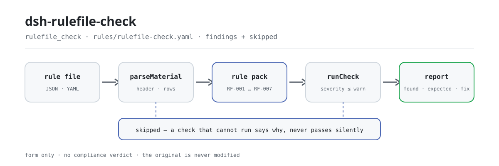

<div align="center">

<picture>
  <source media="(prefers-color-scheme: dark)" srcset="docs/assets/dsh-rulefile-check-flow-dark.svg">
  
</picture>

# dsh-rulefile-check

**逐条核对规则库的编号唯一性、依据字段、摘录长度、来源链接与定级上限——输出「哪一条、哪一栏、差什么」的清单。**

面向规则库维护者的 DeepSeek Harness 检查插件：核对的是本插件家族自定的条款引用纪律与效力上限，只列规则库自身能机械判定的形式差异，不判合规、不认定责任、不改原件。

[安装](#三步上手) · [配置](#配置) · [FAQ](#faq) · [简体中文](README.md) · [English](README.en.md) · [Español](README.es.md) · [Português](README.pt.md) · [हिन्दी](README.hi.md)

[](LICENSE)
[](#兼容性)
[](https://www.npmjs.com/package/dsh-rulefile-check)
[](https://github.com/PerryLink/dsh-rulefile-check/actions/workflows/ci.yml)
[](#兼容性)

[](https://github.com/PerryLink/dsh-rulefile-check/stargazers)
[](https://www.npmjs.com/package/dsh-rulefile-check)
[](https://dshfind.com/plugins/PerryLink/dsh-rulefile-check?ref=badge)
[](https://securityscorecards.dev/viewer/?uri=github.com/PerryLink/dsh-rulefile-check)
[](https://dsh.market/)
[](https://gitee.com/perrylink/dsh-rulefile-check)

```sh
dsh plugin --profile <name> add dsh-rulefile-check
```

</div>

<sub>社区插件，与 DeepSeek 官方无关。唯一仓库：<https://github.com/PerryLink/dsh-rulefile-check>（Gitee 为镜像）。</sub>

## 它是什么

`dsh-rulefile-check` 读取一份规则库——库头加每条规则一行——按本插件家族强制的条款引用纪律核对这份规则库：规则编号在库内是否唯一、依据字段是否都写全、摘录是否短于最小长度、来源是否写成 http(s) 链接、依据类型为 `derived-from-principle` 或 `institutional-configuration` 的规则有没有填定级、检查类型是否为引擎所支持、库头是否声明名称、适用插件与版本。你交出规则库（JSON 或 YAML），它返回一份「哪一条、哪一栏、差什么」的差异清单。

它不下合规结论、不认定责任、不替代审核人，也绝不修改原件。

## 三步上手

1. **安装**：

   ```sh
   dsh plugin --profile <name> add dsh-rulefile-check
   ```

2. **最小配置**（默认即可用；`cordis.patch.yml` 就是这样一行 `insert`）：

   ```yaml
   - insert:
       - id: dsh-rulefile-check
         name: dsh-rulefile-check
   ```

   全部可调项都在 `src/config.ts` 的 Schemastery schema 里，默认值开箱即用；逐条阈值在 `rules/rulefile-check.yaml` 的规则包里。

3. **验证已生效**：

   ```sh
   dsh --profile <name> --dump-config | grep 'dsh-rulefile-check'
   ```

   再用自带样例跑一次（需要先 `pnpm run build`，让 `lib/index.mjs` 就位）：

   ```sh
   node samples/quickstart/run.mjs --check
   ```

   样例输入在 `samples/quickstart/input/RF-001-unsafe.json`，期望输出在 `samples/quickstart/expected/result.json`。实际输出：

   ```text
   $ node samples/quickstart/run.mjs
   rulefile_check: 1 issue(s) — error 0, warn 1, info 0
   skipped: 1
   ```

   *Observed from `samples/quickstart/run.mjs:24-26; samples/quickstart/expected/result.json`*

**卸载**：`dsh plugin --profile <name> remove dsh-rulefile-check`（或从 profile patch 删掉该行）。

<details>
<summary>从 DSH Desktop 市场安装</summary>

所有 PerryLink 插件均可在 DSH Desktop 内置市场中浏览：**市场 → 来源 → 添加来源 → 粘贴** `https://perrylink-dsh-catalog.perrylink.workers.dev/catalog-source.json` **→ 选中**。安装仍需通过市场的 npm 身份校验与你的确认。

</details>

## 核心能力

本插件注册 `rulefile_check` 工具：读入一份规则库（库头 + 每条规则一行），套用带版本的规则包（`rules/rulefile-check.yaml`，7 条规则），返回一份结构化报告。

- **规则包即数据** —— 检查规则全部在 `rules/rulefile-check.yaml` 里，换规则不动代码；规则包在加载期校验，而非被信任。
- **严重级跟着依据走** —— 规则包里的 7 条规则依据都是 `derived-from-principle`，封顶 `warn`；依据为本机构配置（`institutional-configuration`）的检查封顶 `info`；加载器会直接以 `strongest permitted severity` 拒绝超限的规则库。
- **空清单不等于没问题** —— 每一项无法执行的检查都会在 `skipped` 里自报原因；`RF-006` 的支持清单出厂为空，未配置时该条进 `skipped`，而不是静默通过。
- **不裁决** —— 报告只列差异，永不判定合规、责任或对错；措辞守卫强制报告始终携带免责声明。
- **引文必须逐字** —— 每条规则带依据文件、文号、条款号、逐字摘录与来源链接；原文本次未取得时在摘录里明说，绝不把转述包装成引文。

```text
规则库（JSON / YAML）──parseMaterial──▶ 库头 + 每条规则一行 ──runCheck──▶ RF-001…RF-007
                                                                  └──▶ 报告（found / expected / fix + skipped）
```

### 规则一览

| 规则 | 核对内容 | 严重级 | 依据类型 |
|---|---|---|---|
| `RF-001` | 规则编号在库内唯一 | warn | 本插件家族引用纪律 |
| `RF-002` | 两个依据字段至少填了一个 | warn | 本插件家族引用纪律 |
| `RF-003` | 摘录有实质长度（不少于八个字符） | warn | 本插件家族引用纪律 |
| `RF-004` | 来源写成 http(s) 链接 | warn | 本插件家族引用纪律 |
| `RF-005` | 依据类型为推论或配置时带定级 | warn | 本插件家族引用纪律 |
| `RF-006` | 检查类型为引擎所支持（出厂空清单，默认不执行） | warn | 引擎契约 |
| `RF-007` | 库头声明名称、适用插件与版本 | warn | 规则库契约 |

### 示例

以下为插件真实入口；安装后调用一次即可。

**详细输出** — 工具 `rulefile_check`，输入：

```json
{"rows":[{"规则编号":"XX-001"},{"规则编号":"XX-001"}]}
```

输出：

```json
{
  "id": "dsh-rulefile-check.RF-001.de02f9e1",
  "ruleId": "RF-001",
  "severity": "warn",
  "locator": {
    "row": 2,
    "field": "ruleId"
  },
  "found": "第 2 行「ruleId」的值「XX-001」与第 1 行重复",
  "expected": "「ruleId」在材料内应唯一",
  "fix": "核对是否重复登记或抄错；本条只核对唯一性"
}
```

*Observed from `dsh-rulefile-check/tests/fixtures/RF-001/RF-001-unsafe.json`*

### 它回答什么问题

| 你会问 | 它怎么答 |
|---|---|
| 同一个规则编号在库里出现在两条规则上。 | `RF-001` 会报出重复的编号，因为编号重复会让 `issue.id` 指向两条不同的规则，命中信息再也追溯不回去。比较时忽略空白字符。它一次只看一份规则库：不把两份库互相对比，也不去任何登记库查询。 |
| 某条规则只写了 `document`，条款一个字没写。 | `RF-002` 核对的是两个依据字段里至少填了一个，所以 `document` 填了的规则会通过。它不判断所引条款是否真实存在、是否与规则相关。 |
| 摘录写的是一句对条款的描述，不是逐字引文。 | `RF-003` 要求摘录存在且不少于八个字符。长度只是必要条件、不是充分条件：写满二十字的描述照样不是引文，本条分不出来——它不拿摘录去和条款原文比对。 |
| 来源栏写的是「某某网站」，不是链接。 | `RF-004` 会报出，因为来源栏必须写成 http(s) 链接的样子。它只核对形式：不访问该链接、不告诉你链接能不能打开、也不告诉你该页面是否真含所引条款。 |
| 一条由原则推论的规则，定级填成了 `error`。 | `RF-005` 核对的是依据类型为 `derived-from-principle` 或 `institutional-configuration` 的规则到底有没有填定级。定级是否真的没超过上限由加载器强制——它会直接拒绝这样的规则库并抛 `strongest permitted severity`；本条只覆盖字段齐备，不能代替加载器判断。 |
| 规则库里写了一个引擎不认识的 `check.kind`——库头又有没有声明 `packName` 与 `version`？ | `RF-006` 会报出不认识的 `check.kind`，因为这样的规则会静默不执行。它核对的支持取值清单出厂为空，因为有哪些 kind 取决于引擎版本，所以未配置时该条进 `skipped`，而不是通过；它只拿你提供的清单比对。`RF-007` 一并核对库头的 `packName`、`plugin` 与 `version`，因为没有它们，替换规则库时就无法确认它属于哪个插件、是哪一版。两条都不核对填的值是否与实际使用的插件相符。 |

## 配置

全部可调参数都在 `src/config.ts` 的 Schemastery schema 中，只改 `cordis.yml` 即可生效，无需改代码；逐条阈值在 `rules/` 下的规则库文件里。全部配置键即下表 5 个；规则级参数见表后。

| 键 | 类型 | 默认值 | 说明 |
|---|---|---|---|
| `rulesFile` | string | `rules/rulefile-check.yaml` | 规则库文件路径，相对插件包根目录 |
| `disabledRules` | string[] | `[]` | 要停用的规则 id 列表；每条都会出现在 `skipped` 中 |
| `onlyRules` | string[] | `[]` | 只执行这些规则 id；留空表示执行全部规则 |
| `skipNotes` | string | `""` | 附加到每条 `skipped` 说明后的备注 |
| `timeoutMs` | number | `120000` | 工具协作式超时预算（毫秒） |

值得知道的规则级参数：

- `RF-003` `minLength` —— 摘录下限，默认八个字符（与加载器同一数值）。
- `RF-004` `pattern` —— 来源形状，默认 `^https?://[^\s]+$`。
- `RF-006` `values` —— **你的引擎支持的检查类型**。空表示本条不执行；请从引擎的调度表填，而不是从本插件填。

## FAQ

<details>
<summary>我的规则库会被上传或改写吗？</summary>

不会。工具只读取你给出的 `file` 或 `material` 文本，**绝不修改原件**；插件是纯 ESM、无原生代码、**不联网、不调用模型**（见「兼容性」），材料不离开你的机器。包清单里的 `writes: []`、`network: false` 是这项声明的机器可读版本。

</details>

<details>
<summary>某条规则没执行，会不会静默通过？</summary>

不会。无法执行的检查会进 `skipped` 并写明原因；`RF-006` 的支持清单出厂为空，未配置时该条进 `skipped`。因此空的差异清单不会被读成「规则库没问题」。

</details>

<details>
<summary>它能判我这份规则库合规吗？</summary>

不能。它只核对形式：字段齐不齐、摘录够不够长、来源像不像链接、定级有没有超过上限。它发现不了「引了一条真实但不相关的条款」——见「已知限制」。报告只列差异，判定仍由人做。

</details>

<details>
<summary>会和其他 DSH 插件抢名字或冲突吗？</summary>

不会。它只通过 `tools` 服务注册一个 `rulefile_check` 工具；不监听共享事件、不提供服务键、不注册客户端 slot 或 HTTP 路由、不改写全局对象，因此不存在工具名、服务键或 patch 层冲突。

</details>

<details>
<summary>批量核一整个目录的规则库，跑得动吗？</summary>

`native` 与 `ptc` 两种模式都可用；批量校验整个目录时建议 `ptc`，schema 成本只付一次。检查本身是纯计算，除读取材料与规则库文件外不做其他 I/O。

</details>

## 依据的标准

本规则库不引用任何公开标准：每条规则的依据都是本插件家族自定的引用纪律、引擎契约与规则库契约，因此下表列的是家族内部约定，而不是任何法律法规或国家标准。

| 文件 | 文号 | 引用它的规则 |
|---|---|---|
| 本插件家族的条款引用纪律（自定纪律，非国家标准） | 无编号（本规则库自定） | RF-001, RF-002, RF-003, RF-004, RF-005 |
| 本插件家族的检查引擎契约（自定纪律，非国家标准） | 无编号（本规则库自定） | RF-006 |
| 本插件家族的规则库契约（自定纪律，非国家标准） | 无编号（本规则库自定） | RF-007 |

**边界：** 本插件核对一份 **规则库**（rule pack）是否符合本插件家族所强制执行的引用纪律——规则 id 是否唯一，每个依据字段是否齐备，摘录是否具有真实长度，来源是否为链接，派生依据或本机构配置依据是否带有严重级，检查类型是否为引擎支持的类型，以及规则库是否声明其名称、插件与版本。

## 材料格式

工具接受 JSON 或 YAML：

```yaml
packName: 某某规则库
plugin: dsh-rulefile-check
version: '2026.1'
rows:
  - { 规则编号: XX-001, 规则标题: 示例规则标题, 定级: warn,
      依据类型: derived-from-principle, 依据文件: 《某某标准》, 条款号: 第 5.3 条,
      摘录: 该条文本次未取得：核查未获得该标准的逐字原文，本规则库不伪造引文。,
      来源: https://openstd.samr.gov.cn/, 检查类型: presence, 参数: 'field: title' }
```

栏目名匹配忽略大小写、空格、下划线与连字符；清单里自己的栏目名会被保留，因此一条发现会指出它读的是哪一栏。字段在读取层是可选的，由检查引擎校验，因此部分导出的材料会产生「缺项」类差异，而不是让程序崩溃。

## 规则来源

规则数据在 `rules/rulefile-check.yaml`，与代码分离。每条规则携带依据文件、文号、按原文自身编号体系的条款号、逐字摘录与来源地址。加载期强制：摘录必须是真实引文且不少于八个字符；依据仅为原则性条款（`kind: derived-from-principle`，严重级上限 `warn`）或本机构配置（`kind: institutional-configuration`，上限 `info`）的检查不得标为 `error`。夸大依据的规则库会在加载期失败，而不会产出一份看起来很有底气的报告。

`pnpm run check:citations` 逐条核对摘录能否在 `rules/evidence/` 找到；尚未溯源的规则列在 `rules/citations-baseline.json`，该清单只能缩短，新引文必须先有核验记录。核验中确认的边界与「刻意没有作出的结论」见随包的 `rules/evidence/` 目录。

## 安全边界

- **只读原件。** 工具只读取你给出的 `file` 或 `material` 文本，**绝不修改原件**；包清单的 `writes: []`、`network: false` 与 `external: []` 是这项声明的机器可读版本。
- **不联网、不调用模型。** 纯 ESM，无原生代码、无网络请求、无模型调用；材料不离开你的机器。
- **不裁决。** 报告只列差异，永不判定合规、责任或对错；措辞守卫强制报告始终携带免责声明。
- **失败即自报。** 无法执行的检查进 `skipped` 并写明原因；规则库加载失败会抛错，而不是产出一份看起来很有底气的报告。
- **严重级上限。** 依据为原则性条款的检查封顶 `warn`，依据为本机构配置的封顶 `info`；加载器直接拒绝超限的规则库。

## 已知限制

> ### ⚠️ 这里核对的是形式，不是内容——而且它自己这么说
>
> **所核对的这套纪律是自定的，不是国家标准。**「摘录必须是逐字引文」与「由原则推论的检查不得标为 `error`」是本插件家族在 `shared/ruleset.ts` 中强制执行的规则；它们的依据是知识诚实这一一般原则——绝不把描述包装成引文，绝不把推论包装成要求——**而不是任何法规或标准**。每条规则的 `basis` 都如实写明这一点，这也是此处每条规则都是 `warn` 或 `info` 的原因。
>
> **它无法判断一条引文是否贴切。** 它核对的是字段是否填写、摘录是否够长、来源*看起来是否像*链接，以及是否写明了严重级。它会欣然通过一条引用了**真实但无关条款**的规则——这正是形式核对已在文档中写明的局限，也是为什么自动核对永远不能取代人工通读。
>
> 有两条规则值得说明。`RF-003` 的八个字符下限，是加载期强制在台账一侧的呼应——但**长度是必要条件，不是充分条件**：二十个字符的*描述*仍然不是引文，本插件分不出两者的差别。而 `RF-005` 只能确认严重级字段存在：严重级是否真的未超过上限由加载器强制执行，它会以 `strongest permitted severity` 直接拒绝违规的规则库。`RF-006` 的 kind 取值清单出厂为**空**，因为引擎支持哪些 kind 取决于引擎版本——若把本家族自己的清单硬编码进去，就意味着引擎每新增一种 kind 都要改这个插件。

- **一次只看一份规则库。** `RF-001` 只在单份库内比较编号：不把两份库互相对比，也不去任何登记库查询。
- **规则库归属只核对字段。** `RF-007` 只核对 `packName`、`plugin`、`version` 三个字段是否存在，不核对填的值是否与实际使用的插件相符。
- **`manifest-peers` 的静态检查结论不作数。** 那份静态检查器比对的是一份早于 0.2 世代的硬编码 peer 范围；安装期的 peer 校验以运行时为准，声明的范围才是正确的（见「故障排查」）。

## 兼容性

| 项目 | 状态 |
|---|---|
| Harness | 对等版本范围 `>=0.1.2-rc.1 <0.2.0 \|\| >=0.2.0-0 <0.3.0` —— 已实测同时接受 `0.2.0-rc.2` 与 `0.2.1-rc.2`。**已声明 `engines.dsh`**：0.2.1 起由宿主单独裁决，范围为 `>=0.2.1-0 <0.3.0` |
| Node | `^22.19.0 \|\| >=24.0.0` |
| 平台 | 全平台（纯 ESM；无原生代码、无联网、不调用模型） |
| 工具模式 | `native` / `ptc` 均可；批量校验整个目录时建议 `ptc`，schema 成本只付一次 |

## 故障排查

- **插件装上了但工具不出现。** 确认 `main` 指向 `lib/index.mjs` 且 `pnpm run build` 已生成该文件；`main` 写错会让加载器静默跳过该条目。
- **`dsh plugin add` 报版本不兼容。** peer 范围覆盖 `0.1.x` 与 `0.2.x`；若运行时在其之外，可显式豁免：`dsh plugin --profile <name> allow-version dsh-rulefile-check@0.1.0 --dsh-version <runtime> --accept-risk`
- **某条规则没有执行。** 查看 `skipped` 数组，其中写明了规则 id 与原因。`RF-006` 的 `values` 为空时即如此。
- **`RF-005` 放过一份规则库，加载器随后却拒绝了它。** 这是预期：`RF-005` 只核对定级字段是否存在，效力上限由加载器强制，它的报错会点名违规的规则。
- **`check` 报 `manifest-peers` 失败。** 静态检查器比对的是一份早于 0.2 世代的硬编码 peer 范围；安装期的 peer 校验以运行时为准，声明的范围才是正确的。这是 `dsh-plugin-dev` 的已知上游问题。
- **`check:citations` 报某条规则尚未溯源。** 新引文必须先有 `rules/evidence/` 里的核验记录；`rules/citations-baseline.json` 只能缩短，不能新增。

## 生态与质量

- [Gitee 镜像](https://gitee.com/perrylink/dsh-rulefile-check)（同步镜像，以 GitHub 为准）
- [dshfind 插件页](https://dshfind.com/plugins/PerryLink/dsh-rulefile-check)（安装量与排名）
- [OpenSSF Scorecard 报告](https://securityscorecards.dev/viewer/?uri=github.com/PerryLink/dsh-rulefile-check)（由 [.github/workflows/scorecard.yml](.github/workflows/scorecard.yml) 驱动）
- [DSH Market](https://dsh.market/)（已上架）
- [生态实测知识库 · 按材料选核查器](https://perrylink.github.io/zh/checkers/choose/)（完整家族清单）

## 开发

```sh
pnpm install
pnpm run typecheck      # tsc --noEmit
pnpm test               # vitest，每条规则配对正/反夹具（tests/fixtures/<RULE>/）
pnpm run build          # tsdown -> lib/index.mjs + lib/index.d.mts
pnpm run check:citations   # 逐字引文可溯源（rules/evidence/）
pnpm run check:readmes     # 五语 README 一致性
node ../scripts/sync-shared.mjs dsh-rulefile-check   # 从 ../_shared 刷新 src/shared
pnpm pack
```

本插件是**数据驱动**的：`src/model.ts` 声明表结构，`src/shared/` 提供读取器与检查引擎，规则包声明每一项检查。规则包是数据不是代码：改 `rules/*.yaml` 即切换规则集，无需动 TypeScript；规则包在加载期校验，而非被信任。README 配图由 [`scripts/gen-readme-assets.py`](scripts/gen-readme-assets.py) 程序化生成（Python + Pillow），可重复执行；本插件无 UI，hero 为手写 SVG 流程图（深浅双版，图内仅命令面 token）。

Topics：`dsh`, `dsh-plugin`, `deepseek-harness`, `cordis`, `rulefile`

## 家族与致谢

本项目是 [PerryLink](https://github.com/PerryLink) 维护的 DeepSeek Harness 插件家族成员（全部 Apache-2.0）。如果这个插件帮到了你，**给个 star**——它不解锁任何功能，但会让下一个人更容易找到它。

- [@PerryLink](https://github.com/PerryLink) —— 创建者与维护者：`rulefile_check` 工具、逐字引文的规则包与条款核验记录、五语文档。

<details>
<summary>展开全部插件</summary>

| 插件 | 状态 |
|---|---|
| **[dsh-aqua-input-check](https://github.com/PerryLink/dsh-aqua-input-check)** |  |
| **[dsh-archive-check](https://github.com/PerryLink/dsh-archive-check)** |  |
| **[dsh-auto-review](https://github.com/PerryLink/dsh-auto-review)** |  |
| **[dsh-autotier](https://github.com/PerryLink/dsh-autotier)** | 🧊 已冻结 — 见仓库 README |
| **[dsh-bid-ca-precheck](https://github.com/PerryLink/dsh-bid-ca-precheck)** |  |
| **[dsh-bid-qual-check](https://github.com/PerryLink/dsh-bid-qual-check)** |  |
| **[dsh-cert-mcp](https://github.com/PerryLink/dsh-cert-mcp)** | 🧊 已冻结 — 见仓库 README |
| **[dsh-checkpoint-rewind](https://github.com/PerryLink/dsh-checkpoint-rewind)** |  |
| **[dsh-click](https://github.com/PerryLink/dsh-click)** |  |
| **[dsh-composer-history](https://github.com/PerryLink/dsh-composer-history)** |  |
| **[dsh-contract-stance](https://github.com/PerryLink/dsh-contract-stance)** |  |
| **[dsh-customs-doc-check](https://github.com/PerryLink/dsh-customs-doc-check)** |  |
| **[dsh-data-quality](https://github.com/PerryLink/dsh-data-quality)** | 🧊 已冻结 — 见仓库 README |
| **[dsh-demurrage-ledger](https://github.com/PerryLink/dsh-demurrage-ledger)** |  |
| **[dsh-doublecheck](https://github.com/PerryLink/dsh-doublecheck)** |  |
| **[dsh-drill-script-check](https://github.com/PerryLink/dsh-drill-script-check)** |  |
| **[dsh-eia-guide-check](https://github.com/PerryLink/dsh-eia-guide-check)** |  |
| **[dsh-emergency-plan](https://github.com/PerryLink/dsh-emergency-plan)** |  |
| **[dsh-essay-rubric-check](https://github.com/PerryLink/dsh-essay-rubric-check)** |  |
| **[dsh-evidence-check](https://github.com/PerryLink/dsh-evidence-check)** |  |
| **[dsh-export-ctl-check](https://github.com/PerryLink/dsh-export-ctl-check)** |  |
| **[dsh-fast](https://github.com/PerryLink/dsh-fast)** |  |
| **[dsh-fmea-table-check](https://github.com/PerryLink/dsh-fmea-table-check)** |  |
| **[dsh-forecast-penalty](https://github.com/PerryLink/dsh-forecast-penalty)** |  |
| **[dsh-fund-research](https://github.com/PerryLink/dsh-fund-research)** |  |
| **[dsh-github](https://github.com/PerryLink/dsh-github)** |  |
| **[dsh-gongwen-flow-check](https://github.com/PerryLink/dsh-gongwen-flow-check)** |  |
| **[dsh-gongwen-word-check](https://github.com/PerryLink/dsh-gongwen-word-check)** |  |
| **[dsh-guard-plan-qc](https://github.com/PerryLink/dsh-guard-plan-qc)** |  |
| **[dsh-hazchem-check](https://github.com/PerryLink/dsh-hazchem-check)** |  |
| **[dsh-hazplan-check](https://github.com/PerryLink/dsh-hazplan-check)** |  |
| **[dsh-hidden-risk-map](https://github.com/PerryLink/dsh-hidden-risk-map)** |  |
| **[dsh-hs-classify](https://github.com/PerryLink/dsh-hs-classify)** |  |
| **[dsh-icd-rule-check](https://github.com/PerryLink/dsh-icd-rule-check)** |  |
| **[dsh-industry-research](https://github.com/PerryLink/dsh-industry-research)** |  |
| **[dsh-lawcite-adapter](https://github.com/PerryLink/dsh-lawcite-adapter)** |  |
| **[dsh-laya](https://github.com/PerryLink/dsh-laya)** |  |
| **[dsh-lc-doc-check](https://github.com/PerryLink/dsh-lc-doc-check)** |  |
| **[dsh-learning-gap-check](https://github.com/PerryLink/dsh-learning-gap-check)** |  |
| **[dsh-library](https://github.com/PerryLink/dsh-library)** |  |
| **[dsh-local-ai](https://github.com/PerryLink/dsh-local-ai)** |  |
| **[dsh-lsp-actions](https://github.com/PerryLink/dsh-lsp-actions)** |  |
| **[dsh-mask](https://github.com/PerryLink/dsh-mask)** |  |
| **[dsh-mcp-panel](https://github.com/PerryLink/dsh-mcp-panel)** |  |
| **[dsh-medrec-qc](https://github.com/PerryLink/dsh-medrec-qc)** |  |
| **[dsh-memento](https://github.com/PerryLink/dsh-memento)** | 🧊 已冻结 — 见仓库 README |
| **[dsh-nsfc-form-check](https://github.com/PerryLink/dsh-nsfc-form-check)** |  |
| **[dsh-nurse-record-check](https://github.com/PerryLink/dsh-nurse-record-check)** |  |
| **[dsh-observe](https://github.com/PerryLink/dsh-observe)** |  |
| **[dsh-origin-rvc-check](https://github.com/PerryLink/dsh-origin-rvc-check)** |  |
| **[dsh-ota-review-check](https://github.com/PerryLink/dsh-ota-review-check)** |  |
| **[dsh-output-styles](https://github.com/PerryLink/dsh-output-styles)** |  |
| **[dsh-paper-doc-adapter](https://github.com/PerryLink/dsh-paper-doc-adapter)** |  |
| **[dsh-permission-rules](https://github.com/PerryLink/dsh-permission-rules)** |  |
| **[dsh-permit-report-check](https://github.com/PerryLink/dsh-permit-report-check)** |  |
| **[dsh-pipeline-check](https://github.com/PerryLink/dsh-pipeline-check)** |  |
| **[dsh-pleading-draft](https://github.com/PerryLink/dsh-pleading-draft)** |  |
| **[dsh-plugin-doctor](https://github.com/PerryLink/dsh-plugin-doctor)** | 🚫 已退役（仓库已归档） |
| **[dsh-plugin-guide](https://github.com/PerryLink/dsh-plugin-guide)** |  |
| **[dsh-plugin-kit](https://github.com/PerryLink/dsh-plugin-kit)** | 🚫 已退役（仓库已归档） |
| **[dsh-plugin-upgrade](https://github.com/PerryLink/dsh-plugin-upgrade)** | 🚫 已退役（仓库已归档） |
| **[dsh-policy-brief-draft](https://github.com/PerryLink/dsh-policy-brief-draft)** |  |
| **[dsh-power-loss-split](https://github.com/PerryLink/dsh-power-loss-split)** |  |
| **[dsh-power-ticket-check](https://github.com/PerryLink/dsh-power-ticket-check)** |  |
| **[dsh-ppap-check](https://github.com/PerryLink/dsh-ppap-check)** |  |
| **[dsh-protest-deadline](https://github.com/PerryLink/dsh-protest-deadline)** |  |
| **[dsh-railway-window](https://github.com/PerryLink/dsh-railway-window)** |  |
| **[dsh-repair-order-qc](https://github.com/PerryLink/dsh-repair-order-qc)** |  |
| **[dsh-research-report](https://github.com/PerryLink/dsh-research-report)** |  |
| **[dsh-review-reply-check](https://github.com/PerryLink/dsh-review-reply-check)** |  |
| **[dsh-rulefile-check](https://github.com/PerryLink/dsh-rulefile-check)** |  |
| **[dsh-safety-brief-check](https://github.com/PerryLink/dsh-safety-brief-check)** |  |
| **[dsh-score](https://github.com/PerryLink/dsh-score)** | 🧊 已冻结 — 见仓库 README |
| **[dsh-session-sync](https://github.com/PerryLink/dsh-session-sync)** |  |
| **[dsh-site-log-check](https://github.com/PerryLink/dsh-site-log-check)** |  |
| **[dsh-skill-pack-security](https://github.com/PerryLink/dsh-skill-pack-security)** |  |
| **[dsh-soe-decision-check](https://github.com/PerryLink/dsh-soe-decision-check)** |  |
| **[dsh-soilwater-check](https://github.com/PerryLink/dsh-soilwater-check)** |  |
| **[dsh-sop-sync-check](https://github.com/PerryLink/dsh-sop-sync-check)** |  |
| **[dsh-spc-gbt-adapter](https://github.com/PerryLink/dsh-spc-gbt-adapter)** |  |
| **[dsh-talk](https://github.com/PerryLink/dsh-talk)** |  |
| **[dsh-tender-extract](https://github.com/PerryLink/dsh-tender-extract)** |  |
| **[dsh-tender-matrix](https://github.com/PerryLink/dsh-tender-matrix)** |  |
| **[dsh-test-drive](https://github.com/PerryLink/dsh-test-drive)** |  |
| **[dsh-ticktick](https://github.com/PerryLink/dsh-ticktick)** | 🚫 已退役（仓库已归档） |
| **[dsh-translate](https://github.com/PerryLink/dsh-translate)** |  |
| **[dsh-warranty-calc](https://github.com/PerryLink/dsh-warranty-calc)** |  |
| **[dsh-budget](https://github.com/PerryLink/dsh-budget)** | 🧊 已冻结 — 见仓库 README |
| **[dsh-claude-move](https://github.com/PerryLink/dsh-claude-move)** | 🧊 已冻结 — 见仓库 README |
| **[dsh-defend](https://github.com/PerryLink/dsh-defend)** | 🧊 已冻结 — 见仓库 README |
| **[dsh-draw](https://github.com/PerryLink/dsh-draw)** | 🧊 已冻结 — 见仓库 README |
| **[dsh-reach](https://github.com/PerryLink/dsh-reach)** | 🧊 已冻结 — 见仓库 README |
| **[dsh-background-agents](https://github.com/PerryLink/dsh-background-agents)** | 🚫 已退役（仓库已归档） |
| **[dsh-session-pin](https://github.com/PerryLink/dsh-session-pin)** | 🚫 已退役（仓库已归档） |
| **[dsh-team-rooms](https://github.com/PerryLink/dsh-team-rooms)** | 🚫 已退役（仓库已归档） |

</details>

## License

[LICENSE](LICENSE)（Apache License 2.0）© 2026 dsh-rulefile-check contributors

<p align="center"><sub>Apache-2.0 · 社区插件，与 DeepSeek 无关。</sub></p>
