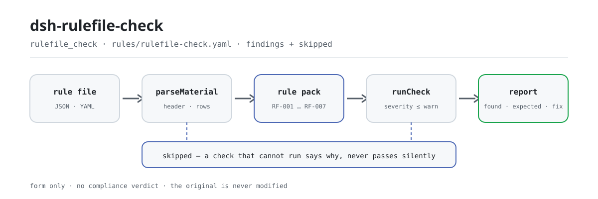

<div align="center">

<picture>
  <source media="(prefers-color-scheme: dark)" srcset="docs/assets/dsh-rulefile-check-flow-dark.svg">
  
</picture>

# dsh-rulefile-check

**Verifica linha a linha um ficheiro de regras —ids únicos, campos de fundamento completos, extratos com comprimento real, fontes com forma de ligação e tetos de severidade— e devolve o que está inconsistente, onde e como corrigir.**

Um verificador DeepSeek Harness para mantenedores de ficheiros de regras: aplica a disciplina de citações e os tetos de severidade que esta família de plugins se impõe, enumera apenas as diferenças formais que um ficheiro de regras pode sustentar mecanicamente, e não decide conformidade, não atribui responsabilidade nem altera o original.

[Instalar](#instalação-em-três-passos) · [Configuração](#configuração) · [FAQ](#faq) · [简体中文](README.md) · [English](README.en.md) · [Español](README.es.md) · [Português](README.pt.md) · [हिन्दी](README.hi.md)

[](LICENSE)
[](#compatibilidade)
[](https://www.npmjs.com/package/dsh-rulefile-check)
[](https://github.com/PerryLink/dsh-rulefile-check/actions/workflows/ci.yml)
[](#compatibilidade)

[](https://github.com/PerryLink/dsh-rulefile-check/stargazers)
[](https://www.npmjs.com/package/dsh-rulefile-check)
[](https://dshfind.com/plugins/PerryLink/dsh-rulefile-check?ref=badge)
[](https://securityscorecards.dev/viewer/?uri=github.com/PerryLink/dsh-rulefile-check)
[](https://dsh.market/)
[](https://gitee.com/perrylink/dsh-rulefile-check)

```sh
dsh plugin --profile <name> add dsh-rulefile-check
```

</div>

<sub>Plugin da comunidade, sem afiliação com a DeepSeek. Repositório canónico: <https://github.com/PerryLink/dsh-rulefile-check> (o Gitee é um espelho).</sub>

## O que é

`dsh-rulefile-check` lê um ficheiro de regras —o cabeçalho do ficheiro mais uma linha por regra— e confronta-o com a disciplina de citações que a sua família de plugins impõe: que cada id de regra seja único dentro do ficheiro, que os dois campos de fundamento estejam preenchidos, que nenhum extrato seja mais curto do que o comprimento mínimo, que toda a fonte esteja escrita como ligação http(s), que uma regra cujo tipo de fundamento seja `derived-from-principle` ou `institutional-configuration` traga uma severidade, que o tipo de verificação seja um que o motor aceite, e que o cabeçalho do ficheiro declare o nome, o plugin e a versão. Entrega o ficheiro de regras (JSON ou YAML) e recebe o que está inconsistente, onde e como corrigir.

Não emite um veredicto de conformidade, não atribui responsabilidade, não substitui o revisor —e nunca altera o original.

## Instalação em três passos

1. **Instale**:

   ```sh
   dsh plugin --profile <name> add dsh-rulefile-check
   ```

2. **Configuração mínima** (funciona com os valores por omissão; `cordis.patch.yml` é exatamente esta linha `insert`):

   ```yaml
   - insert:
       - id: dsh-rulefile-check
         name: dsh-rulefile-check
   ```

   Todos os parâmetros ajustáveis vivem no esquema Schemastery de `src/config.ts` e os valores por omissão estão prontos a usar; os limites por regra estão no pacote de regras em `rules/rulefile-check.yaml`.

3. **Verifique que monta**:

   ```sh
   dsh --profile <name> --dump-config | grep 'dsh-rulefile-check'
   ```

   Depois execute o exemplo incluído (primeiro `pnpm run build`, para que `lib/index.mjs` exista):

   ```sh
   node samples/quickstart/run.mjs --check
   ```

   A entrada de exemplo está em `samples/quickstart/input/RF-001-unsafe.json` e a saída esperada em `samples/quickstart/expected/result.json`. Saída real:

   ```text
   $ node samples/quickstart/run.mjs
   rulefile_check: 1 issue(s) — error 0, warn 1, info 0
   skipped: 1
   ```

   *Observado em `samples/quickstart/run.mjs:24-26; samples/quickstart/expected/result.json`*

**Desinstalar**: `dsh plugin --profile <name> remove dsh-rulefile-check` (ou remova a linha do patch do perfil).

<details>
<summary>Instalar a partir do mercado DSH Desktop</summary>

Todos os plugins PerryLink podem ser explorados no mercado integrado do DSH Desktop: **Market → Sources → Add source → colar** `https://perrylink-dsh-catalog.perrylink.workers.dev/catalog-source.json` **→ selecionar**. A instalação continua a passar pela verificação de identidade npm do mercado e pela sua confirmação.

</details>

## Capacidades principais

O plugin registra a ferramenta `rulefile_check`: lê um ficheiro de regras (o cabeçalho mais uma linha por regra), aplica um pacote de regras versionado (`rules/rulefile-check.yaml`, 7 regras) e devolve um relatório estruturado.

- **O pacote de regras é dado, não código** — todas as verificações vivem em `rules/rulefile-check.yaml`; trocar o ficheiro troca o conjunto de regras sem tocar em TypeScript, e o pacote é validado ao carregar, não é confiado.
- **A severidade segue a evidência** — as sete regras assentam em `derived-from-principle` e têm teto `warn`; uma verificação baseada em `institutional-configuration` tem teto `info`; o carregador rejeita de imediato um pacote que exceda o teto com `strongest permitted severity`.
- **Uma lista vazia nunca é «está tudo bem»** — cada verificação que não pôde correr declara-se em `skipped` com o seu motivo; a lista de tipos aceites de `RF-006` vem vazia, pelo que a regra cai em `skipped` em vez de passar em silêncio.
- **Sem adjudicação** — o relatório apenas enumera diferenças e nunca se pronuncia sobre conformidade, responsabilidade ou correção; um guarda de redação obriga a que o relatório traga sempre o aviso legal.
- **Citações apenas literais** — cada regra traz documento, número, cláusula na numeração própria da fonte, extrato literal e a ligação de origem; quando o texto não pôde ser obtido, o extrato di-lo, e uma paráfrase nunca é apresentada como citação.

```text
ficheiro de regras (JSON / YAML) ──parseMaterial──▶ cabeçalho + linhas ──runCheck──▶ RF-001…RF-007
                                                                             └──▶ relatório (found / expected / fix + skipped)
```

### Regras em resumo

| Regra | Verificação | Severidade | Tipo de base |
|---|---|---|---|
| `RF-001` | os ids de regra são únicos dentro do ficheiro | warn | disciplina de citações da família |
| `RF-002` | pelo menos um dos dois campos de fundamento está preenchido | warn | disciplina de citações da família |
| `RF-003` | o extrato tem comprimento real (pelo menos oito caracteres) | warn | disciplina de citações da família |
| `RF-004` | a fonte está escrita como ligação http(s) | warn | disciplina de citações da família |
| `RF-005` | um fundamento derivado ou de configuração local traz severidade | warn | disciplina de citações da família |
| `RF-006` | o tipo de verificação é um que o motor aceita (lista vazia de origem, desligada por omissão) | warn | contrato do motor |
| `RF-007` | o cabeçalho declara nome, plugin e versão | warn | contrato do ficheiro |

### Exemplos

Estes são os pontos de entrada reais do plugin; instale uma vez e chame um.

**Saída detalhada** — ferramenta `rulefile_check`, entrada:

```json
{"rows":[{"规则编号":"XX-001"},{"规则编号":"XX-001"}]}
```

Saída:

```json
{
  "id": "dsh-rulefile-check.RF-001.de02f9e1",
  "ruleId": "RF-001",
  "severity": "warn",
  "locator": {
    "row": 2,
    "field": "ruleId"
  },
  "found": "第 2 行「ruleId」的值「XX-001」与第 1 行重复",
  "expected": "「ruleId」在材料内应唯一",
  "fix": "核对是否重复登记或抄错；本条只核对唯一性"
}
```

*Observado em `dsh-rulefile-check/tests/fixtures/RF-001/RF-001-unsafe.json`*

### O que responde

| Você pergunta | O que responde |
|---|---|
| O mesmo id de regra aparece em duas regras do ficheiro. | `RF-001` comunica o id repetido, porque um duplicado faz com que `issue.id` aponte para duas regras diferentes e a ocorrência deixa de ser rastreável. A comparação ignora espaços em branco. Só vê um ficheiro de cada vez: não compara dois ficheiros entre si nem consulta qualquer registo. |
| Uma regra traz apenas `document` e não diz nada sobre a cláusula. | `RF-002` verifica que pelo menos um dos dois campos de fundamento esteja preenchido, pelo que uma regra com `document` presente passa. Não julga se a cláusula citada existe realmente nem se tem relação com a regra. |
| O extrato é uma descrição da cláusula numa frase, não uma citação. | `RF-003` exige que o extrato exista e tenha pelo menos oito caracteres. O comprimento é necessário, não suficiente: uma descrição de vinte caracteres continua a não ser uma citação, e esta regra não distingue — não confronta o extrato com a cláusula original. |
| A fonte é o nome de um sítio web em vez de uma ligação. | `RF-004` comunica-o, porque o campo de fonte tem de parecer uma ligação http(s). Só verifica a forma: não visita a ligação, não diz se a ligação funciona nem se a página contém realmente a cláusula citada. |
| Uma regra derivada de um princípio está classificada como `error`. | `RF-005` confirma que uma regra cujo tipo de fundamento seja `derived-from-principle` ou `institutional-configuration` indica alguma severidade. Que essa severidade respeite de facto o teto é imposto pelo carregador, que rejeita esse ficheiro com `strongest permitted severity`; esta verificação cobre apenas a presença do campo e não pode substituir o carregador. |
| O ficheiro escreve um `check.kind` que o motor não conhece — e declara o seu `packName` e a sua `version`? | `RF-006` comunica o `check.kind` desconhecido, porque essa regra não é executada em silêncio. A sua lista de tipos aceites vem vazia, já que os tipos existentes dependem da versão do motor, pelo que um ficheiro sem configuração deixa essa regra em `skipped` em vez de a aprovar; só compara com a lista que fornecer. `RF-007` verifica em conjunto `packName`, `plugin` e `version` no cabeçalho, porque sem eles não se sabe a que plugin pertence um ficheiro, nem que revisão, ao substituí-lo. Nenhuma das duas verifica se os valores declarados correspondem ao plugin realmente em uso. |

## Configuração

Todos os parâmetros ajustáveis vivem no esquema Schemastery de `src/config.ts`, pelo que se alteram a partir de `cordis.yml` sem tocar no código; os limites por regra estão no pacote de regras em `rules/`. Estas cinco chaves são toda a superfície de configuração; os parâmetros por regra vêm depois da tabela.

| Chave | Tipo | Omissão | Descrição |
|---|---|---|---|
| `rulesFile` | string | `rules/rulefile-check.yaml` | Caminho do pacote de regras, relativo à raiz do pacote |
| `disabledRules` | string[] | `[]` | Ids de regras que deixam de correr; cada uma aparece em `skipped` |
| `onlyRules` | string[] | `[]` | Correr apenas estas regras; vazio corre todas |
| `skipNotes` | string | `""` | Nota acrescentada a cada motivo de `skipped` |
| `timeoutMs` | number | `120000` | Orçamento de tempo de espera cooperativo da ferramenta |

Parâmetros por regra que vale a pena conhecer:

- `RF-003` `minLength` — o piso do extrato, oito caracteres por omissão (o mesmo valor que o carregador usa).
- `RF-004` `pattern` — a forma da fonte, `^https?://[^\s]+$` por omissão.
- `RF-006` `values` — **os tipos de verificação que o seu motor aceita.** Vazio significa que a regra não corre; preencha-o a partir da tabela de despacho do motor, não deste plugin.

## FAQ

<details>
<summary>O meu ficheiro de regras é enviado ou reescrito?</summary>

Não. A ferramenta só lê o texto de `file` ou `material` que entrega e **nunca altera o original**; é ESM puro, sem código nativo, **sem rede e sem chamada ao modelo** (ver «Compatibilidade»), pelo que o material não sai da sua máquina. Os campos `writes: []` e `network: false` do manifesto do pacote são a versão legível por máquina dessa declaração.

</details>

<details>
<summary>Se uma regra não correr, passa em silêncio?</summary>

Não. Cada verificação que não pôde correr declara-se em `skipped` com o seu motivo; a lista de tipos aceites de `RF-006` vem vazia, pelo que um ficheiro sem configuração deixa essa regra em `skipped` em vez de a aprovar. Por isso, uma lista de diferenças vazia não pode ser lida como «o ficheiro está bem».

</details>

<details>
<summary>Pode dizer-me se o meu ficheiro de regras está conforme?</summary>

Não. Só verifica a forma: campos presentes, extrato suficientemente longo, fonte com forma de ligação, severidade dentro do teto. Não deteta «uma cláusula real mas irrelevante» — ver «Limitações conhecidas». O relatório enumera diferenças; o julgamento continua humano.

</details>

<details>
<summary>Vai colidir com outros plugins DSH?</summary>

Não. Registra exatamente uma ferramenta, `rulefile_check`, através do serviço `tools`; não escuta eventos partilhados, não fornece chaves de serviço, não registra slots de cliente nem rotas HTTP e não reescreve objetos globais, pelo que não há conflito de nomes de ferramenta, de chaves de serviço nem de camadas de patch.

</details>

<details>
<summary>Pode verificar um diretório inteiro de ficheiros de regras de uma vez?</summary>

Sim. Funciona tanto em modo `native` como `ptc`; para um diretório completo convém `ptc`, assim o custo do esquema é pago uma só vez. A verificação é cálculo puro e não faz mais E/S do que ler o material e o ficheiro de regras.

</details>

## Normas que segue

Este ficheiro de regras não cita qualquer norma pública: o fundamento de cada regra é a disciplina de citações que a própria família de plugins se impõe, o seu contrato de motor e o seu contrato de ficheiro, pelo que as entradas abaixo nomeiam compromissos internos da família e não qualquer lei ou norma nacional.

| Documento | Número | Regras que o citam |
|---|---|---|
| Disciplina de citações desta família de plugins (autoimposta, não é uma norma nacional) | Sem número (fixada por este ficheiro de regras) | RF-001, RF-002, RF-003, RF-004, RF-005 |
| Contrato do motor de verificação desta família (autoimposto, não é uma norma nacional) | Sem número (fixado por este ficheiro de regras) | RF-006 |
| Contrato do ficheiro de regras desta família (autoimposto, não é uma norma nacional) | Sem número (fixado por este ficheiro de regras) | RF-007 |

Os nomes que o próprio ficheiro dá a estes contratos:

```text
本插件家族的条款引用纪律（自定纪律，非国家标准）
本插件家族的检查引擎契约（自定纪律，非国家标准）
本插件家族的规则库契约（自定纪律，非国家标准）
```

**Limite:** este plugin verifica um **ficheiro de regras** (rule pack) face à disciplina de citações que esta família de plugins impõe — que os ids de regra sejam únicos, que cada campo de fundamento esteja presente, que um extrato tenha comprimento real, que uma fonte seja uma ligação, que um fundamento derivado ou de configuração local traga severidade, que o tipo de verificação seja um que o motor aceite e que o ficheiro declare o seu nome, plugin e versão.

## Formato do material

A ferramenta aceita JSON ou YAML:

```yaml
packName: 某某规则库
plugin: dsh-rulefile-check
version: '2026.1'
rows:
  - { 规则编号: XX-001, 规则标题: 示例规则标题, 定级: warn,
      依据类型: derived-from-principle, 依据文件: 《某某标准》, 条款号: 第 5.3 条,
      摘录: 该条文本次未取得：核查未获得该标准的逐字原文，本规则库不伪造引文。,
      来源: https://openstd.samr.gov.cn/, 检查类型: presence, 参数: 'field: title' }
```

Os nomes das colunas são comparados sem distinguir maiúsculas e ignorando espaços, underscores e hífenes; os nomes de coluna do próprio inventário são preservados, pelo que uma ocorrência nomeia a coluna que leu. Os campos são opcionais na camada de leitura e validados pelo motor de verificação, pelo que uma exportação parcial produz ocorrências sobre o que falta em vez de uma falha.

## Fontes das regras

Os dados das regras estão em `rules/rulefile-check.yaml`, separados do código. Cada regra traz documento, número, cláusula na numeração própria da fonte, extrato literal e a ligação de onde foi lida. O carregador impõe que o extrato seja uma citação real de pelo menos oito caracteres e que uma verificação baseada apenas num princípio geral (`kind: derived-from-principle`, teto `warn`) ou numa configuração local (`kind: institutional-configuration`, teto `info`) **nunca** seja declarada `error`. Um ficheiro que infle o seu fundamento falha ao carregar em vez de produzir um relatório que soe seguro.

`pnpm run check:citations` verifica regra a regra que cada extrato pode ser encontrado em `rules/evidence/`; as regras ainda não rastreáveis figuram em `rules/citations-baseline.json`, e essa lista só pode encolher: uma citação nova tem de estar documentada antes de entrar. Os limites confirmados durante a verificação e as conclusões deliberadamente não afirmadas estão no diretório `rules/evidence/` que acompanha o pacote.

## Limites de segurança

- **O original é só de leitura.** A ferramenta só lê o texto de `file` ou `material` que entrega e **nunca altera o original**; `writes: []`, `network: false` e `external: []` do manifesto do pacote são a versão legível por máquina dessa declaração.
- **Sem rede e sem chamada ao modelo.** ESM puro, sem código nativo, sem pedidos de rede e sem invocação de modelo; o material não sai da sua máquina.
- **Sem adjudicação.** O relatório apenas enumera diferenças e nunca se pronuncia sobre conformidade, responsabilidade ou correção; um guarda de redação obriga a que traga o aviso legal.
- **Falha em voz alta, não em silêncio.** Cada verificação que não pode correr declara-se em `skipped` com o seu motivo; um ficheiro de regras que não carrega lança erro em vez de produzir um relatório que soe seguro.
- **Tetos de severidade.** Uma verificação baseada num princípio tem teto `warn`, uma baseada em configuração local tem teto `info`; o carregador rejeita de imediato um ficheiro que exceda o teto.

## Limitações conhecidas

> ### ⚠️ Isto verifica a forma, não o conteúdo — e diz isso mesmo
>
> **A disciplina verificada é autoimposta, não uma norma nacional.** «Um extrato tem de ser uma citação literal» e «uma verificação derivada de um princípio não pode ser `error`» são regras que esta família de plugins impõe em `shared/ruleset.ts`; o seu fundamento é o princípio geral da honestidade intelectual —nunca disfarçar uma descrição de citação, nunca disfarçar uma inferência de requisito—, **não qualquer lei ou norma**. O `basis` de cada regra di-lo exatamente, e é por isso que aqui todas as regras são `warn` ou `info`.
>
> **Não consegue julgar se uma citação é pertinente.** Verifica que os campos estão preenchidos, que o extrato é suficientemente longo, que a fonte *parece* uma ligação e que é declarada uma severidade. Aprovará sem problema uma regra que cite **uma cláusula real mas irrelevante**: esse é o limite documentado de uma verificação de forma, e é por isso que a verificação automática nunca substitui uma leitura humana.
>
> Duas regras merecem nota. O piso de oito caracteres de `RF-003` é o eco no livro de registo do guarda de carregamento — mas **o comprimento é necessário, não suficiente**: uma *descrição* de vinte caracteres continua a não ser uma citação, e este plugin não distingue uma da outra. E `RF-005` só pode confirmar que o campo de severidade existe: que uma severidade respeite de facto o teto é imposto pelo carregador, que rejeita o ficheiro infrator com `strongest permitted severity`. O vocabulário de tipos de `RF-006` vem **vazio**, porque os tipos que um motor aceita dependem da versão do motor — codificar a lista desta família obrigaria a editar este plugin sempre que o motor ganhasse um tipo.

- **Um ficheiro de cada vez.** `RF-001` compara ids dentro de um único ficheiro: não compara dois ficheiros entre si nem consulta qualquer registo.
- **A identidade do ficheiro é uma verificação de campos.** `RF-007` só verifica que `packName`, `plugin` e `version` estão presentes; não confirma que os valores declarados correspondam ao plugin realmente em uso.
- **O veredicto estático de `manifest-peers` não é autoritativo.** Esse verificador compara com um intervalo de peers fixado em código anterior à linha 0.2; o runtime aplica a compatibilidade de peers ao instalar, pelo que o intervalo declarado é o correto (ver «Resolução de problemas»).

## Compatibilidade

| Superfície | Estado |
|---|---|
| Harness | Intervalo de peers `>=0.1.2-rc.1 <0.2.0 \|\| >=0.2.0-0 <0.3.0` — verificado a aceitar tanto `0.2.0-rc.2` como `0.2.1-rc.2`. **`engines.dsh` é declarado como `>=0.2.1-0 <0.3.0`** e o host aplica-o desde 0.2.1 |
| Node | `^22.19.0 \|\| >=24.0.0` |
| Plataformas | Todas (ESM puro; sem código nativo, sem rede, sem chamada ao modelo) |
| Modo de ferramenta | Funciona em `native` e `ptc`; para um diretório completo use `ptc` |

## Resolução de problemas

- **O plugin instala-se mas a ferramenta nunca aparece.** Confirme que `main` resolve para `lib/index.mjs` e que `pnpm run build` o gerou; um `main` errado faz o carregador saltar a entrada em silêncio.
- **`dsh plugin add` recusa o pacote como incompatível.** O intervalo de peers cobre `0.1.x` e `0.2.x`; se o seu runtime estiver fora, conceda uma isenção explícita: `dsh plugin --profile <name> allow-version dsh-rulefile-check@0.1.0 --dsh-version <runtime> --accept-risk`
- **Uma regra não correu.** Leia o array `skipped`: nomeia o id da regra e o motivo. É o que acontece enquanto `values` de `RF-006` estiver vazio.
- **`RF-005` aprova um ficheiro que o carregador depois rejeita.** É o esperado: `RF-005` verifica que o campo de severidade existe, enquanto o carregador aplica o teto. O erro do carregador nomeia a regra infratora.
- **`check` comunica `manifest-peers` como falha.** O verificador estático compara com um intervalo de peers fixado em código anterior à linha 0.2. O runtime aplica a compatibilidade de peers ao instalar, pelo que o intervalo declarado é o correto; é um problema conhecido do `dsh-plugin-dev`.
- **`check:citations` comunica uma regra ainda não rastreável.** Uma citação nova tem de ter primeiro um registo de verificação em `rules/evidence/`; `rules/citations-baseline.json` só pode encolher, nunca crescer.

## Ecossistema e qualidade

- [Espelho Gitee](https://gitee.com/perrylink/dsh-rulefile-check) (espelho sincronizado; o GitHub é o canónico)
- [Página do plugin no dshfind](https://dshfind.com/plugins/PerryLink/dsh-rulefile-check) (instalações e ranking)
- [Relatório OpenSSF Scorecard](https://securityscorecards.dev/viewer/?uri=github.com/PerryLink/dsh-rulefile-check) (alimentado por [.github/workflows/scorecard.yml](.github/workflows/scorecard.yml))
- [DSH Market](https://dsh.market/) (listado)
- [Base de conhecimento do ecossistema — escolha um verificador por material](https://perrylink.github.io/zh/checkers/choose/) (índice completo da família)

## Desenvolvimento

```sh
pnpm install
pnpm run typecheck      # tsc --noEmit
pnpm test               # vitest, fixtures emparelhados por regra (tests/fixtures/<RULE>/)
pnpm run build          # tsdown -> lib/index.mjs + lib/index.d.mts
pnpm run check:citations   # os extratos literais são rastreáveis (rules/evidence/)
pnpm run check:readmes     # consistência dos README em cinco idiomas
node ../scripts/sync-shared.mjs dsh-rulefile-check   # atualiza src/shared a partir de ../_shared
pnpm pack
```

O plugin é **só dados**: `src/model.ts` declara a forma da tabela, `src/shared/` fornece o leitor e o motor de verificação, e o pacote de regras declara cada verificação. O pacote de regras é dado, não código: edite `rules/*.yaml` para trocar o conjunto de regras sem tocar em TypeScript, e o pacote é validado ao carregar, não é confiado. As imagens do README são geradas programaticamente por [`scripts/gen-readme-assets.py`](scripts/gen-readme-assets.py) (Python + Pillow) e podem ser reexecutadas sem risco; este plugin não tem UI, pelo que o hero é um diagrama de fluxo SVG escrito à mão (par claro/escuro, apenas tokens da superfície de comandos).

Topics: `dsh`, `dsh-plugin`, `deepseek-harness`, `cordis`, `rulefile`

## Família e agradecimentos

Este projeto faz parte da família de plugins DeepSeek Harness mantida por [PerryLink](https://github.com/PerryLink) (todos Apache-2.0). Se lhe for útil, **uma estrela** não desbloqueia nada, mas ajuda a próxima pessoa a encontrá-lo.

- [@PerryLink](https://github.com/PerryLink) — criador e mantenedor: a ferramenta `rulefile_check`, o pacote de regras com citações literais e o seu registo de verificação de cláusulas, e a documentação em cinco idiomas.

<details>
<summary>Expandir todos os plugins</summary>

| Plugin | Estado |
|---|---|
| **[dsh-aqua-input-check](https://github.com/PerryLink/dsh-aqua-input-check)** |  |
| **[dsh-archive-check](https://github.com/PerryLink/dsh-archive-check)** |  |
| **[dsh-auto-review](https://github.com/PerryLink/dsh-auto-review)** |  |
| **[dsh-autotier](https://github.com/PerryLink/dsh-autotier)** | 🧊 CONGELADO — ver o README do repo |
| **[dsh-bid-ca-precheck](https://github.com/PerryLink/dsh-bid-ca-precheck)** |  |
| **[dsh-bid-qual-check](https://github.com/PerryLink/dsh-bid-qual-check)** |  |
| **[dsh-cert-mcp](https://github.com/PerryLink/dsh-cert-mcp)** | 🧊 CONGELADO — ver o README do repo |
| **[dsh-checkpoint-rewind](https://github.com/PerryLink/dsh-checkpoint-rewind)** |  |
| **[dsh-click](https://github.com/PerryLink/dsh-click)** |  |
| **[dsh-composer-history](https://github.com/PerryLink/dsh-composer-history)** |  |
| **[dsh-contract-stance](https://github.com/PerryLink/dsh-contract-stance)** |  |
| **[dsh-customs-doc-check](https://github.com/PerryLink/dsh-customs-doc-check)** |  |
| **[dsh-data-quality](https://github.com/PerryLink/dsh-data-quality)** | 🧊 CONGELADO — ver o README do repo |
| **[dsh-demurrage-ledger](https://github.com/PerryLink/dsh-demurrage-ledger)** |  |
| **[dsh-doublecheck](https://github.com/PerryLink/dsh-doublecheck)** |  |
| **[dsh-drill-script-check](https://github.com/PerryLink/dsh-drill-script-check)** |  |
| **[dsh-eia-guide-check](https://github.com/PerryLink/dsh-eia-guide-check)** |  |
| **[dsh-emergency-plan](https://github.com/PerryLink/dsh-emergency-plan)** |  |
| **[dsh-essay-rubric-check](https://github.com/PerryLink/dsh-essay-rubric-check)** |  |
| **[dsh-evidence-check](https://github.com/PerryLink/dsh-evidence-check)** |  |
| **[dsh-export-ctl-check](https://github.com/PerryLink/dsh-export-ctl-check)** |  |
| **[dsh-fast](https://github.com/PerryLink/dsh-fast)** |  |
| **[dsh-fmea-table-check](https://github.com/PerryLink/dsh-fmea-table-check)** |  |
| **[dsh-forecast-penalty](https://github.com/PerryLink/dsh-forecast-penalty)** |  |
| **[dsh-fund-research](https://github.com/PerryLink/dsh-fund-research)** |  |
| **[dsh-github](https://github.com/PerryLink/dsh-github)** |  |
| **[dsh-gongwen-flow-check](https://github.com/PerryLink/dsh-gongwen-flow-check)** |  |
| **[dsh-gongwen-word-check](https://github.com/PerryLink/dsh-gongwen-word-check)** |  |
| **[dsh-guard-plan-qc](https://github.com/PerryLink/dsh-guard-plan-qc)** |  |
| **[dsh-hazchem-check](https://github.com/PerryLink/dsh-hazchem-check)** |  |
| **[dsh-hazplan-check](https://github.com/PerryLink/dsh-hazplan-check)** |  |
| **[dsh-hidden-risk-map](https://github.com/PerryLink/dsh-hidden-risk-map)** |  |
| **[dsh-hs-classify](https://github.com/PerryLink/dsh-hs-classify)** |  |
| **[dsh-icd-rule-check](https://github.com/PerryLink/dsh-icd-rule-check)** |  |
| **[dsh-industry-research](https://github.com/PerryLink/dsh-industry-research)** |  |
| **[dsh-lawcite-adapter](https://github.com/PerryLink/dsh-lawcite-adapter)** |  |
| **[dsh-laya](https://github.com/PerryLink/dsh-laya)** |  |
| **[dsh-lc-doc-check](https://github.com/PerryLink/dsh-lc-doc-check)** |  |
| **[dsh-learning-gap-check](https://github.com/PerryLink/dsh-learning-gap-check)** |  |
| **[dsh-library](https://github.com/PerryLink/dsh-library)** |  |
| **[dsh-local-ai](https://github.com/PerryLink/dsh-local-ai)** |  |
| **[dsh-lsp-actions](https://github.com/PerryLink/dsh-lsp-actions)** |  |
| **[dsh-mask](https://github.com/PerryLink/dsh-mask)** |  |
| **[dsh-mcp-panel](https://github.com/PerryLink/dsh-mcp-panel)** |  |
| **[dsh-medrec-qc](https://github.com/PerryLink/dsh-medrec-qc)** |  |
| **[dsh-memento](https://github.com/PerryLink/dsh-memento)** | 🧊 CONGELADO — ver o README do repo |
| **[dsh-nsfc-form-check](https://github.com/PerryLink/dsh-nsfc-form-check)** |  |
| **[dsh-nurse-record-check](https://github.com/PerryLink/dsh-nurse-record-check)** |  |
| **[dsh-observe](https://github.com/PerryLink/dsh-observe)** |  |
| **[dsh-origin-rvc-check](https://github.com/PerryLink/dsh-origin-rvc-check)** |  |
| **[dsh-ota-review-check](https://github.com/PerryLink/dsh-ota-review-check)** |  |
| **[dsh-output-styles](https://github.com/PerryLink/dsh-output-styles)** |  |
| **[dsh-paper-doc-adapter](https://github.com/PerryLink/dsh-paper-doc-adapter)** |  |
| **[dsh-permission-rules](https://github.com/PerryLink/dsh-permission-rules)** |  |
| **[dsh-permit-report-check](https://github.com/PerryLink/dsh-permit-report-check)** |  |
| **[dsh-pipeline-check](https://github.com/PerryLink/dsh-pipeline-check)** |  |
| **[dsh-pleading-draft](https://github.com/PerryLink/dsh-pleading-draft)** |  |
| **[dsh-plugin-doctor](https://github.com/PerryLink/dsh-plugin-doctor)** | 🚫 APOSENTADO (repo arquivado) |
| **[dsh-plugin-guide](https://github.com/PerryLink/dsh-plugin-guide)** |  |
| **[dsh-plugin-kit](https://github.com/PerryLink/dsh-plugin-kit)** | 🚫 APOSENTADO (repo arquivado) |
| **[dsh-plugin-upgrade](https://github.com/PerryLink/dsh-plugin-upgrade)** | 🚫 APOSENTADO (repo arquivado) |
| **[dsh-policy-brief-draft](https://github.com/PerryLink/dsh-policy-brief-draft)** |  |
| **[dsh-power-loss-split](https://github.com/PerryLink/dsh-power-loss-split)** |  |
| **[dsh-power-ticket-check](https://github.com/PerryLink/dsh-power-ticket-check)** |  |
| **[dsh-ppap-check](https://github.com/PerryLink/dsh-ppap-check)** |  |
| **[dsh-protest-deadline](https://github.com/PerryLink/dsh-protest-deadline)** |  |
| **[dsh-railway-window](https://github.com/PerryLink/dsh-railway-window)** |  |
| **[dsh-repair-order-qc](https://github.com/PerryLink/dsh-repair-order-qc)** |  |
| **[dsh-research-report](https://github.com/PerryLink/dsh-research-report)** |  |
| **[dsh-review-reply-check](https://github.com/PerryLink/dsh-review-reply-check)** |  |
| **[dsh-rulefile-check](https://github.com/PerryLink/dsh-rulefile-check)** |  |
| **[dsh-safety-brief-check](https://github.com/PerryLink/dsh-safety-brief-check)** |  |
| **[dsh-score](https://github.com/PerryLink/dsh-score)** | 🧊 CONGELADO — ver o README do repo |
| **[dsh-session-sync](https://github.com/PerryLink/dsh-session-sync)** |  |
| **[dsh-site-log-check](https://github.com/PerryLink/dsh-site-log-check)** |  |
| **[dsh-skill-pack-security](https://github.com/PerryLink/dsh-skill-pack-security)** |  |
| **[dsh-soe-decision-check](https://github.com/PerryLink/dsh-soe-decision-check)** |  |
| **[dsh-soilwater-check](https://github.com/PerryLink/dsh-soilwater-check)** |  |
| **[dsh-sop-sync-check](https://github.com/PerryLink/dsh-sop-sync-check)** |  |
| **[dsh-spc-gbt-adapter](https://github.com/PerryLink/dsh-spc-gbt-adapter)** |  |
| **[dsh-talk](https://github.com/PerryLink/dsh-talk)** |  |
| **[dsh-tender-extract](https://github.com/PerryLink/dsh-tender-extract)** |  |
| **[dsh-tender-matrix](https://github.com/PerryLink/dsh-tender-matrix)** |  |
| **[dsh-test-drive](https://github.com/PerryLink/dsh-test-drive)** |  |
| **[dsh-ticktick](https://github.com/PerryLink/dsh-ticktick)** | 🚫 APOSENTADO (repo arquivado) |
| **[dsh-translate](https://github.com/PerryLink/dsh-translate)** |  |
| **[dsh-warranty-calc](https://github.com/PerryLink/dsh-warranty-calc)** |  |
| **[dsh-budget](https://github.com/PerryLink/dsh-budget)** | 🧊 CONGELADO — ver o README do repo |
| **[dsh-claude-move](https://github.com/PerryLink/dsh-claude-move)** | 🧊 CONGELADO — ver o README do repo |
| **[dsh-defend](https://github.com/PerryLink/dsh-defend)** | 🧊 CONGELADO — ver o README do repo |
| **[dsh-draw](https://github.com/PerryLink/dsh-draw)** | 🧊 CONGELADO — ver o README do repo |
| **[dsh-reach](https://github.com/PerryLink/dsh-reach)** | 🧊 CONGELADO — ver o README do repo |
| **[dsh-background-agents](https://github.com/PerryLink/dsh-background-agents)** | 🚫 APOSENTADO (repo arquivado) |
| **[dsh-session-pin](https://github.com/PerryLink/dsh-session-pin)** | 🚫 APOSENTADO (repo arquivado) |
| **[dsh-team-rooms](https://github.com/PerryLink/dsh-team-rooms)** | 🚫 APOSENTADO (repo arquivado) |

</details>

## Licença

[LICENSE](LICENSE) (Apache License 2.0) © 2026 dsh-rulefile-check contributors

<p align="center"><sub>Apache-2.0 · Plugin da comunidade, sem afiliação com a DeepSeek.</sub></p>
